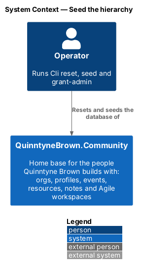
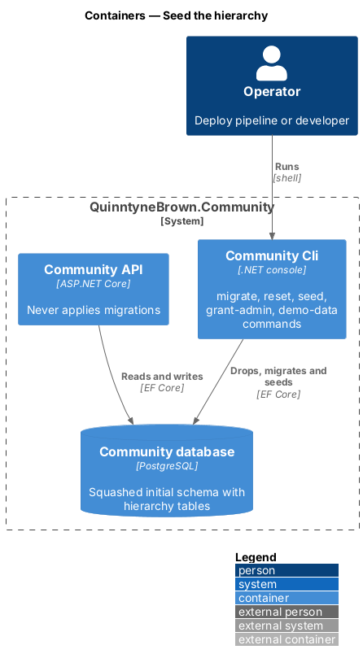
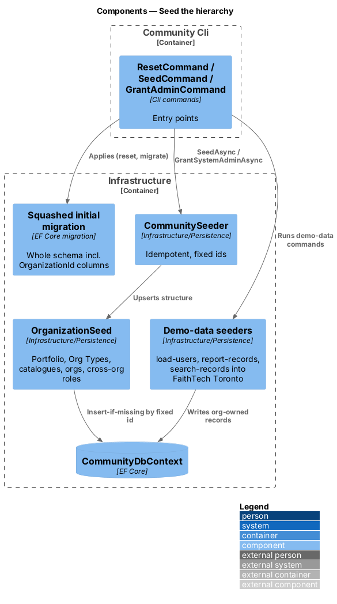
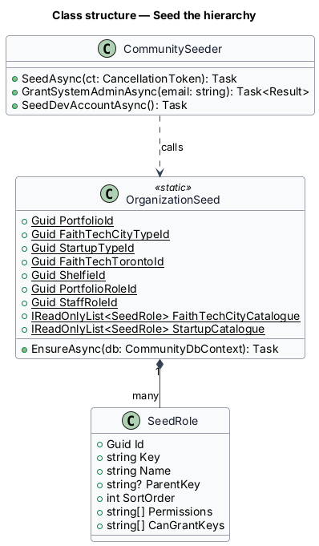
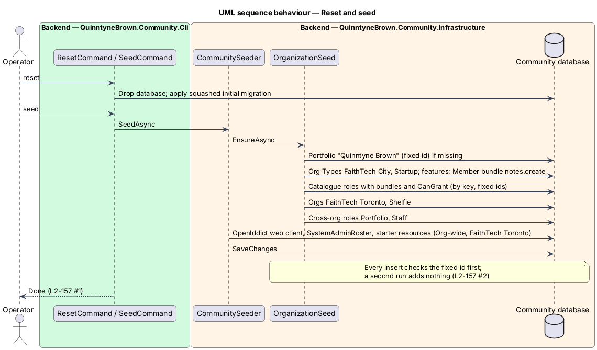
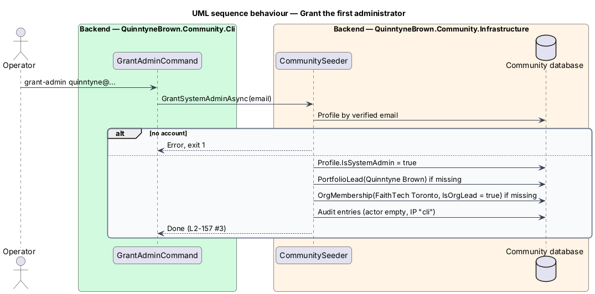

# Seed the hierarchy

## Overview

The organization hierarchy adds tables and a required `OrganizationId` to most existing tables of QuinntyneBrown.Community. There is no production data to keep, so the EF Core migrations are squashed into one new initial migration, and every environment is reset once and reseeded ([ADR 0040](../../../adr/0040-reset-and-reseed.md)). The seed reproduces today's FaithTech rules as data, so FaithTech Toronto behaves exactly as the single community did (L2-135 AC5).

- **squashed migration** — one initial EF Core migration that creates the whole schema, hierarchy included; applied only by the Cli
- **structural seed** — idempotent insert-if-missing of the portfolio, Org Types, catalogues, orgs and cross-org roles, with fixed ids
- **demo data** — optional records from `seed load-users`, `seed report-records` and `seed search-records`, placed in FaithTech Toronto

## Description

- **Squashed initial migration** (`Infrastructure/Persistence/Migrations/`) replaces every earlier migration. Future schema changes return to incremental migrations on top of it. The API never applies migrations and refuses to start against an unmigrated database, as before.
- **Cli commands** (`QuinntyneBrown.Community.Cli`): `migrate`, `reset` (drop, migrate, seed), `seed`, `grant-admin <email>` and the demo-data commands. Deployment notes say each environment is reset once when this ships.
- **`CommunitySeeder.SeedAsync`** — runs `OrganizationSeed.EnsureAsync`, then the OpenIddict web client, `SystemAdminRoster` and the starter resources (owned by the first System Admin, Org-wide in FaithTech Toronto). Every insert checks its fixed id first, so a second run adds nothing.
- **`OrganizationSeed`** (`Infrastructure/Persistence`) — fixed ids and the catalogue definitions:
  - Portfolio **"Quinntyne Brown"** (`quinntyne-brown`).
  - Org Type **"FaithTech City"** (`faithtech-city`): every feature on; Member bundle `notes.create`.
  - Org Type **"Startup"** (`startup`): profiles, invites, notes, resources and agile on; Member bundle `notes.create`.
  - Org **"FaithTech Toronto"** (`faithtech-toronto`, FaithTech City) and Org **"Shelfie"** (`shelfie`, Startup).
  - Cross-org roles **"Portfolio"** and **"Staff"** ([cross-org roles](../cross-org-roles/README.md)).
- **FaithTech City catalogue** — reproduces `docs/roles-and-permissions.txt` before the hierarchy. Every member also holds the Member bundle (`notes.create`).

  | Key | Name | Parent | Permissions | `CanGrant` |
  |-----|------|--------|-------------|------------|
  | `city-lead` | City Lead | — | `people.view`, `roles.grant`, `invites.send`, `connectLink.own`, `contacts.private`, `partners.read`, `partners.write`, `events.manage`, `events.rsvpList`, `events.rsvpListEmails`, `events.checkIn`, `resources.create`, `workspaces.create`, `workspaces.join`, `team.member`, `team.lead` | the other six |
  | `event-lead` | Event Lead | `city-lead` | `invites.send`, `contacts.private`, `partners.read`, `partners.write`, `events.manage`, `events.rsvpList`, `events.rsvpListEmails`, `events.checkIn`, `resources.create`, `workspaces.join`, `team.member`, `team.lead` | — |
  | `create-lead` | Create Lead | `city-lead` | `invites.send`, `contacts.private`, `partners.read`, `partners.write`, `events.rsvpList`, `events.rsvpListEmails`, `events.checkIn`, `resources.create`, `workspaces.join`, `team.member`, `team.lead` | — |
  | `communications-lead` | Communications Lead | `city-lead` | Create Lead's bundle plus `announcements.send` | — |
  | `volunteer` | Volunteer | `event-lead` | `workspaces.join`, `team.member` | — |
  | `product-engineer` | Product Engineer | `event-lead` | — | — |
  | `attendee` | Attendee | `volunteer` | — | — |

- **Startup catalogue**:

  | Key | Name | Permissions | `CanGrant` |
  |-----|------|-------------|------------|
  | `engineer` | Engineer | `invites.send`, `resources.create`, `workspaces.create`, `workspaces.join`, `notes.create` | — |
  | `advisor` | Advisor | `resources.create`, `workspaces.join` | — |

- **`GrantSystemAdminAsync(email)`** (`grant-admin`) — sets `Profile.IsSystemAdmin`, adds a `PortfolioLead` row for "Quinntyne Brown" and an `OrgMembership` in FaithTech Toronto with `IsOrgLead = true` and `JoinedVia = Seed`, each only when missing, and writes audit entries with an empty actor and IP `cli`. `SeedDevAccountAsync` gives the development account the same.
- **Demo data** — `seed load-users` makes each generated person a member of FaithTech Toronto with catalogue roles that match the previous enum roles; `seed report-records` and `seed search-records` create their records in FaithTech Toronto.
- **Deleted types** — `Role`, `ProfileRole`, `TeamRoles`, `LeadRoles`, `RoleLabels` and `CityLeadRoleRemoved` are removed, not kept for compatibility.
- **Tests** — `QuinntyneBrown.Community.Cli.Tests` run `SeedAsync` twice against the in-memory provider and assert no duplicates. The API test helper's `SeededRole` vocabulary (`CityLead`, `Staff`, …) maps to these seeded rows.

## Requirements

The feature realizes the following level-2 (L2) requirements. Each L2 requirement refines a level-1 (L1) requirement, cited by identifier.

| L2 ID | Refines (L1) | Requirement |
|-------|--------------|-------------|
| `L2-157` | `L1-025` | Seed |

### Acceptance criteria

**`L2-157` — Seed**

1. Given an empty database, when `Cli reset` and `Cli seed` run, then the portfolio "Quinntyne Brown", the Org Types "FaithTech City" (every feature, today's catalogue) and "Startup" (profiles, invites, notes, resources, agile; Engineer and Advisor), the orgs FaithTech Toronto and Shelfie, and the cross-org roles Portfolio and Staff exist.
2. Given the seed run twice, when it finishes, then nothing is duplicated.
3. Given `Cli grant-admin <email>`, when it runs, then that person is System Admin, Portfolio Lead of "Quinntyne Brown" and Org Lead of FaithTech Toronto.
4. Given the demo-data commands, when they run, then their records belong to FaithTech Toronto.

## Diagrams

### System context

An operator resets and seeds the database of QuinntyneBrown.Community.

### Containers

The Community Cli drops, migrates and seeds the Community database; the Community API only reads and writes it.

### Components

Cli commands apply the squashed migration and call `CommunitySeeder`, which delegates the hierarchy to `OrganizationSeed`; the demo-data seeders write into FaithTech Toronto.

### Class structure

`OrganizationSeed` holds the fixed ids and composes `SeedRole` definitions for both catalogues; `CommunitySeeder` calls it.

### Behaviour — reset and seed

`reset` recreates the schema from the squashed migration; `seed` inserts each structural row only when its fixed id is missing (`L2-157` AC1, AC2).

### Behaviour — grant the first administrator

`grant-admin` makes the person System Admin, Portfolio Lead of "Quinntyne Brown" and Org Lead of FaithTech Toronto (`L2-157` AC3).

## Open questions

- **Settled: resolver cached per request and explicit query scoping** ([ADR 0034](../../../adr/0034-org-owned-data-and-the-access-resolver.md)); the seed needs no cache warm-up.
- **Settled: agent authentication is a hashed personal access token** ([ADR 0036](../../../adr/0036-agent-identities-and-tokens.md)); the seed creates no agents and no tokens.
- **Settled: the frontend learns permissions from `GET /api/me/access`** ([ADR 0037](../../../adr/0037-org-addressed-urls-switcher-and-branding.md)); seeded catalogue names reach the UI only through the API.
- `ParentRoleId` values in the FaithTech City catalogue are display hints taken from the proposal's tree; they grant nothing.
- Whether Shelfie gets demo members is `<TO SUPPLY>`; the isolation tests seed their own second-org data.
