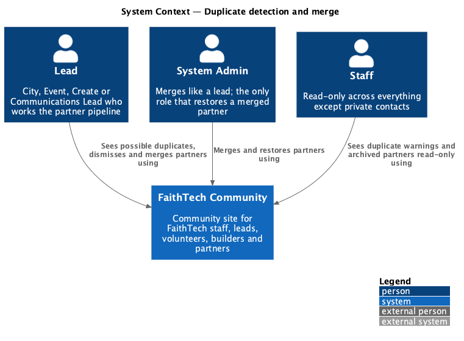
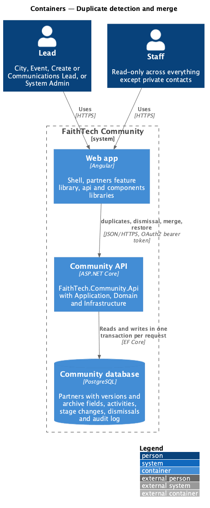
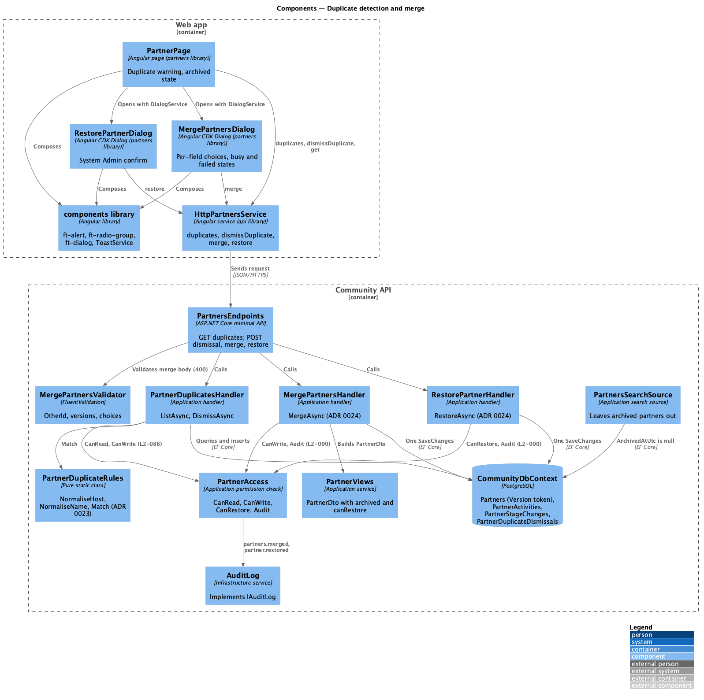
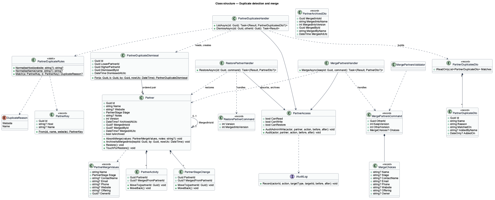
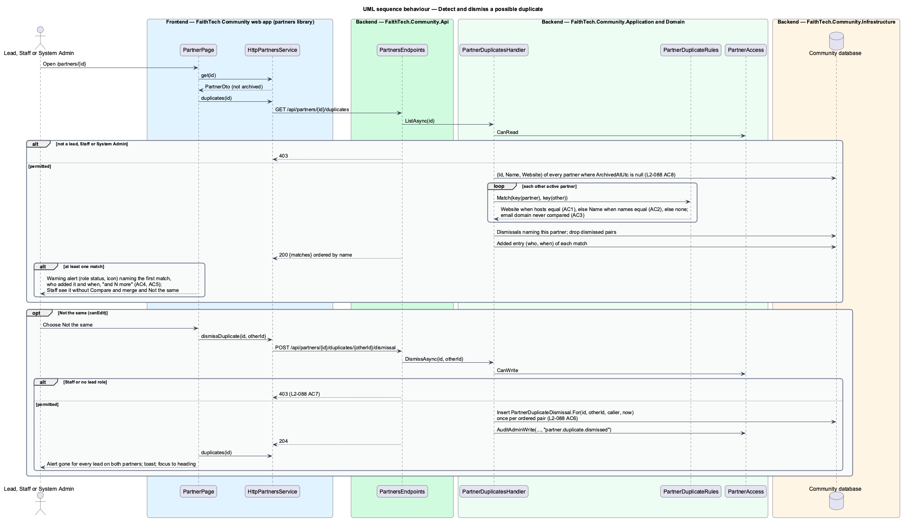
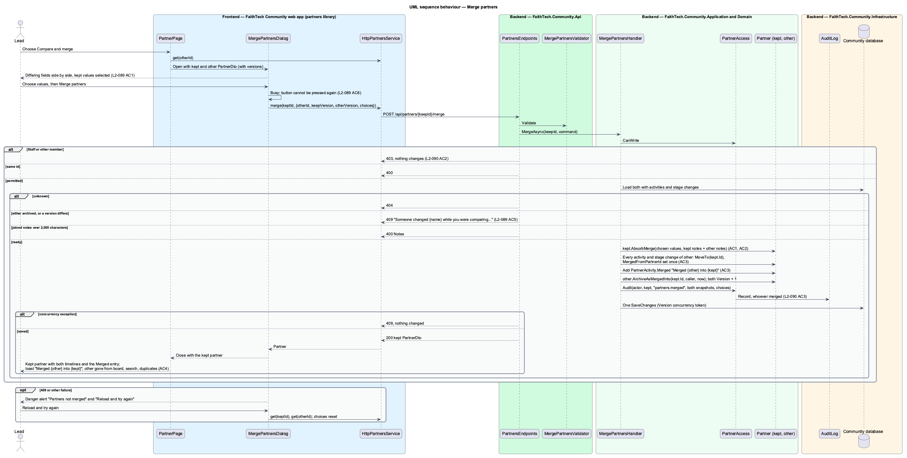
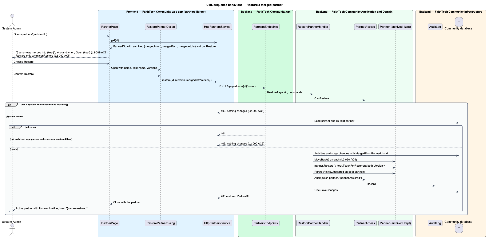

# Duplicate detection and merge

## Overview

Leads in different cities share one partner pipeline (`partners/manage-partners`), so two leads can add the same organization twice. A **possible duplicate** — two partners that are not archived and whose website hosts or names are equal after normalising, under the exact match rule in [ADR 0027](../../../adr/0027-partner-duplicate-match-rule.md). The partner page warns about the first undismissed possible duplicate. A lead then either merges the two records or marks them as **not the same**: a dismissal stored once for the pair that hides the warning for every lead.

A **merge** — keeps one partner (the **kept** record), takes the lead's choice of value for each field that differs, joins the notes, moves both activity timelines and both stage histories into the kept record and **archives** the other record. An **archived** partner leaves the board, global search, duplicate checks and Reports, but its page still opens and says who merged it, when and into which partner. A System Admin can **restore** an archived partner: it becomes active again and every timeline entry and stage change that came from it moves back. Merge and restore semantics are recorded in [ADR 0028](../../../adr/0028-partner-merge-and-restore.md).

Each partner carries a **version** — a counter that every edit, stage move, merge and restore increments. The merge and restore requests carry the versions the caller saw, so a record that changed in the meantime is never merged or restored on stale data.

The timeline entries this feature writes (Merged, Restored) and the activity rows it moves belong to `partners/partner-activity-timeline`.

## Description

### Domain (`QuinntyneBrown.Community.Domain/Partners/`)

- **`Partner`** — gains:
  - `Version` (`int`), incremented by `Update`, `MoveTo`, `AbsorbMerge`, `ArchiveAsMergedInto`, `Restore` and `TouchForRestore`;
  - `ArchivedAtUtc`, `MergedIntoId`, `MergedById`, `MergedAtUtc` and `IsArchived` (`ArchivedAtUtc is not null`);
  - `AbsorbMerge(PartnerMergeValues values, string? notes)` — sets the chosen name, stage, contact name, email, phone, website, offering and owner on the kept record and the joined notes; it does not add a `PartnerStageChange`;
  - `ArchiveAsMergedInto(Guid keptId, Guid by, DateTime nowUtc)` — throws `InvalidOperationException` when already archived or when `keptId` is its own id;
  - `Restore()` — clears the archive and merge fields; throws when not archived.
- **`PartnerMergeValues`** — record of the eight field values the kept record takes.
- **`PartnerStageChange`** — gains `MergedFromPartnerId` with `MoveTo(Guid partnerId)` and `MoveBack()`, as `PartnerActivity` has (`partners/partner-activity-timeline`). `MoveTo` sets `MergedFromPartnerId` only when it is empty, so a row keeps the record it was first written on through a chain of merges.
- **`PartnerDuplicateDismissal`** — `Id`, `LowerPartnerId`, `HigherPartnerId`, `DismissedById`, `DismissedAtUtc`. `PartnerDuplicateDismissal.For(a, b, by, nowUtc)` orders the two ids (`Guid.CompareTo`), so the pair is stored once whichever partner it was chosen from (`L2-113` AC6), and throws `ArgumentException` when `a == b`.

### Application (`QuinntyneBrown.Community.Application/Partners/`)

- **`PartnerDuplicateRules`** — pure static class with no dependencies, unit-tested on its own (ADR 0027):
  - `NormaliseHost(string? website) : string?` — trims; adds `http://` when no scheme is present; parses with `Uri.TryCreate`; takes the host only (dropping scheme, port, path, query and fragment); lowercases; removes one leading `www.` and a trailing dot. Blank or unparseable input returns `null`.
  - `NormaliseName(string? name) : string?` — Unicode NFD then drops non-spacing marks (accents folded); lowercases with the invariant culture; deletes every punctuation and symbol character; collapses whitespace to single spaces and trims; removes one trailing word when it is one of `inc`, `incorporated`, `ltd`, `limited`, `llc`, `corp`, `corporation`, `co`, `company` and another word remains. An empty result returns `null`. "Acme Ltd." and "acme" both give `acme`.
  - `Match(PartnerKey a, PartnerKey b) : DuplicateReason?` — `Website` when both hosts are present and equal, else `Name` when both names are present and equal, else `null`. Email and email domain are never compared (`L2-113` AC3).
  - `PartnerKey` is `(Guid Id, string? Host, string? Name)`; `PartnerKey.From(id, name, website)` builds it.
- **`PartnerDuplicatesHandler`**:
  - `ListAsync(id)` — requires `PartnerAccess.CanRead` (`403`), `404` for an unknown partner, and an empty list for an archived one. It loads `(Id, Name, Website)` for every non-archived partner (`L2-113` AC8), keeps those that `Match` the partner, removes pairs with a `PartnerDuplicateDismissal`, orders by name (current culture, ignoring case) then id, and adds each match's Added entry (who and when) when it exists (`L2-113` AC4, AC5).
  - `DismissAsync(id, otherId)` — requires `PartnerAccess.CanWrite` (`403`, `L2-113` AC7); `400` when both ids are equal; `404` when either is unknown; `409` when either is archived. An existing dismissal for the pair is kept and the call still succeeds. It writes `PartnerAccess.AuditAdminWrite(..., "partner.duplicate.dismissed", ...)` for a System Admin without a lead role.
- **`MergePartnersCommand`** — `OtherId`, `KeepVersion`, `OtherVersion` and `Choices` (`MergeChoices`: `Name`, `Stage`, `ContactName`, `Email`, `Phone`, `Website`, `Offering`, `Owner`, each `"keep"`, `"other"` or missing for keep).
- **`MergePartnersValidator`** — `OtherId` required; both versions required and not negative; each choice `keep` or `other` ("Choose which value to keep.").
- **`MergePartnersHandler.MergeAsync(keepId, command)`** — in this order, changing nothing until every check passes:
  1. `PartnerAccess.CanWrite`, else `403` (`L2-115` AC2);
  2. `keepId == OtherId` → `400` "Choose two different partners.";
  3. load both partners with their stage changes, activities and the dismissals that name the other; either unknown → `404`;
  4. either archived → `409` "{name} has already been merged.";
  5. `KeepVersion` or `OtherVersion` differs from the stored `Version` → `409` "Someone changed {name} while you were comparing. Nothing was changed; reload and try again." with extension `partnerId` (`L2-114` AC5);
  6. joined notes (kept first, a blank line, then the other's; either alone when the other is empty) longer than 2,000 characters → `400` keyed `Notes` "The joined notes are longer than 2,000 characters. Shorten the notes on one partner, then merge.";
  7. builds `PartnerMergeValues` from `Choices`, calls `kept.AbsorbMerge(...)` (`L2-114` AC1, AC2);
  8. moves every `PartnerActivity` and `PartnerStageChange` of the other partner to the kept one with `MoveTo(kept.Id)` (`L2-114` AC3);
  9. adds `PartnerActivity.Merged(kept, other, caller, nowUtc, fromStage, toStage)` on the kept record, with the stages only when the stage changed;
  10. `other.ArchiveAsMergedInto(kept.Id, caller, nowUtc)`;
  11. records `partners.merged` in `IAuditLog` for every caller (`L2-115` AC3): target type `Partner`, target id the kept partner, before both snapshots with their versions, after the other's id and the chosen values;
  12. saves in one `SaveChanges`. A `DbUpdateConcurrencyException` on the `Version` token answers the same `409`. It returns `200` with the kept `PartnerDto`.
- **`RestorePartnerCommand`** — `Version` (the archived partner) and `MergedIntoVersion` (the kept partner).
- **`RestorePartnerHandler.RestoreAsync(id, command)`**:
  1. `PartnerAccess.CanRestore` (System Admin only), else `403` (`L2-115` AC5);
  2. `404` for an unknown partner; `409` "{name} is not archived." when it is active;
  3. the kept partner (`MergedIntoId`) archived → `409` "Restore {kept} first.";
  4. either version differs → `409` "Someone changed these partners since the page loaded. Nothing was changed; reload and try again." (`L2-115` AC6);
  5. every `PartnerActivity` and `PartnerStageChange` with `MergedFromPartnerId == id` calls `MoveBack()`, wherever it now lives;
  6. `partner.Restore()`, `kept.TouchForRestore()` (version only);
  7. adds `PartnerActivity.Restored(partner, kept, ...)` on both records;
  8. records `partner.restored` in `IAuditLog` (target the restored partner; before and after the archive fields and the moved row counts);
  9. one `SaveChanges`; `200` with the restored `PartnerDto`.
  The kept record keeps the values and joined notes the merge gave it.
- **`PartnerAccess`** — gains `CanRestore` (`current.HasRole(Role.SystemAdmin)`) and `Audit(actor, partner, action, before, after)`, which records whoever acts (merge and restore are always audited).
- **`PartnerViews.ToDtoAsync`** — `PartnerDto` gains `Archived` (`PartnerArchivedDto`: `MergedIntoId`, `MergedIntoName`, `MergedIntoVersion`, `MergedById`, `MergedByName`, `MergedAtUtc`; `null` when active) and `CanRestore` (`CanRestore` and archived). For an archived partner `CanEdit` and `CanLogActivity` are `false`.
- **Archived partners left out** — `ManagePartnersHandler.BoardAsync` and the next-step query filter `ArchivedAtUtc == null` (`L2-114` AC4); `PartnersSearchSource` (`Application/Search/SearchSources.cs`) adds the same filter before `IFullTextSearch.Match`; `PartnerDuplicatesHandler` uses it as above; Reports (`reports/reports-dashboard`) filter it in their partner figures. `GET /api/partners/{id}` still answers `200` for an archived partner so its page can show the archived state.

### Infrastructure (`QuinntyneBrown.Community.Infrastructure/Persistence/`)

- **`CommunityDbContext`** — `Partner.Version` is a concurrency token (`IsConcurrencyToken()`), with an index on `ArchivedAtUtc`. `DbSet<PartnerDuplicateDismissal> PartnerDuplicateDismissals` maps to `PartnerDuplicateDismissals` with a unique index on `(LowerPartnerId, HigherPartnerId)` and cascade-delete foreign keys to `Partners`. `PartnerStageChange.MergedFromPartnerId` and `PartnerActivity.MergedFromPartnerId` are indexed.
- **Migration `PartnerDuplicatesAndMerge`** — after `PartnerActivities` and `PartnerStageMoveActivities` from `partners/partner-activity-timeline` (the planned shared `PartnerActivitiesAndMerge` was split as the slices landed); it adds the columns, the table and the indexes above.

### API (`QuinntyneBrown.Community.Api/Endpoints/PartnersEndpoints.cs`)

All routes require authentication (anonymous `401`, `L2-115` AC2). No business logic.

- **`GET /api/partners/{id}/duplicates`** — `200`, `403` or `404`:

  ```json
  {
    "matches": [
      {
        "id": "2b7c…",
        "name": "Kestrel Labs Inc.",
        "reason": "Website",
        "matchedOn": "kestrel.example",
        "addedByName": "Esther Nakamura",
        "addedOn": "2026-10-13"
      }
    ]
  }
  ```

  `reason` is `Website` or `Name`; `matchedOn` is the normalised host for `Website` and the other partner's name as written for `Name`. `addedByName` and `addedOn` are `null` when the other partner has no Added entry.
- **`POST /api/partners/{id}/duplicates/{otherId}/dismissal`** — no body; `204`, `400`, `403`, `404` or `409`.
- **`POST /api/partners/{keepId}/merge`** — `200` with the kept `PartnerDto`; `400`, `403`, `404` or `409`:

  ```json
  {
    "otherId": "2b7c…",
    "keepVersion": 7,
    "otherVersion": 2,
    "choices": {
      "name": "keep",
      "stage": "keep",
      "contactName": "keep",
      "email": "keep",
      "phone": "keep",
      "website": "keep",
      "offering": "keep",
      "owner": "other"
    }
  }
  ```

- **`POST /api/partners/{id}/restore`** — body `{ "version": 3, "mergedIntoVersion": 8 }`; `200` with the restored `PartnerDto`; `403`, `404` or `409`.
- **`GET /api/partners/{id}`** — `PartnerDto` gains:

  ```json
  {
    "archived": {
      "mergedIntoId": "6f1a…",
      "mergedIntoName": "Kestrel Labs",
      "mergedIntoVersion": 8,
      "mergedById": "4d0f…",
      "mergedByName": "Grace Okonkwo",
      "mergedAtUtc": "2026-10-22T19:02:44Z"
    },
    "canRestore": true
  }
  ```

### Frontend

- **`PartnersService`** / **`PARTNERS_SERVICE`** / **`HttpPartnersService`** (`api/src/lib/partners`) — gain `duplicates(id): Observable<PartnerDuplicatesDto>`, `dismissDuplicate(id, otherId): Observable<void>`, `merge(keepId, request: MergePartnersRequest): Observable<PartnerDto>` and `restore(id, request: RestorePartnerRequest): Observable<PartnerDto>`. New types: `PartnerDuplicateDto`, `PartnerDuplicatesDto`, `DuplicateReason`, `MERGE_FIELDS` (`name`, `stage`, `contactName`, `email`, `phone`, `website`, `offering`, `owner`, with their labels Name, Stage, Main contact, Email, Phone, Website, Offering, Owner), `MergeField`, `MergeChoice` (`'keep' | 'other'`), `MergePartnersRequest`, `RestorePartnerRequest` and `PartnerArchivedDto`; `PartnerDto` gains `archived` and `canRestore`.
- **`PartnerPage`** — after the partner loads, and when it is not archived, it loads `duplicates(id)`. With a match it shows `ft-alert status="warning"` (role `status`, warning icon) above the split (mock `partner/duplicate`):
  - heading "This may be the same partner as “{other}”", followed by " and {N} more" when `matches.length > 1` (`L2-113` AC5);
  - text "{added by} added {other} on {day} with the same {website|name}, {matched on}." (only when the Added entry exists), then "Merging keeps one record and moves both activity timelines into it.";
  - actions: "Compare and merge" (when `canEdit`), "Open {other}" (always) and "Not the same" (when `canEdit`) (`L2-113` AC4).
  "Not the same" calls `dismissDuplicate`, reloads the duplicates (the next match, if any, takes the alert), moves focus to the page heading and shows the toast "Marked {other} as a different partner". When `archived` is set the page shows the archived state instead of the actions, timeline log button and alert (mock `partner/archived`): `ft-alert status="info"` "{name} was merged into {kept}" with "{merged by} merged it on {day}. Its activity and stage history are on {kept}." and actions "Open {kept}" and, when `canRestore`, "Restore" (`L2-114` AC7, `L2-115` AC5).
- **`MergePartnersDialog`** (`partners/src/lib/dialogs/merge-partners`) — CDK dialog "Merge {other} into {kept}" (mocks `dialogs/merge-partners/default`, `busy`, `failed`). It receives both `PartnerDto`s (the page calls `get(otherId)` before opening). It shows the info alert "Nothing is lost", the who-added-when line, and one stacked `ft-radio-group` per field in `MERGE_FIELDS` whose values differ, each with the kept value (preselected, `L2-114` AC1) and the other value, with the record name as the radio's description and "Not set" for an empty value; fields that are equal are listed in one caption line. The confirm button "Merge partners" is busy and disabled while the request runs (`L2-114` AC6). A `409` or other failure shows the danger alert "Partners not merged" with the server's detail and turns the button into "Reload and try again", which reloads both partners and resets the choices (`L2-114` AC5). Success closes with the kept `PartnerDto`; the page navigates to the kept partner (when the dialog was opened from the other) and shows the toast "Merged {other} into {kept}". On an XS viewport each field group stacks with both values visible (`L2-114` AC8).
- **`RestorePartnerDialog`** (`partners/src/lib/dialogs/restore-partner`) — CDK confirm dialog "Restore {name}?" with "Its activity and stage history move back from {kept}. {kept} keeps the values chosen in the merge." and "Restore" (busy while running). A `409` shows a danger alert with "Reload and try again". Success closes with the restored `PartnerDto`; the page shows it and the toast "{name} restored".
- **`PartnersPage`** — unchanged; the board no longer contains archived partners because the API leaves them out.

### Components used

From `frontend/projects/components/`: `ft-alert` (warning, info and danger, with `ftAlertActions`), `ft-button` (including `href` and busy), `ft-dialog` and `DialogService`, `ft-radio-group` and `ft-radio` (with `description`), `ToastService`, `ft-page-header`, `ft-badge`, `ft-icon`, `ft-link`, `ft-skeleton`.

Missing from `components` today: the `merge` icon (see `partners/partner-activity-timeline`). The merge dialog's stacked radio rows already match `ft-radio-group`'s default layout, which the design system's drift log prefers over the mock's inline row.

### Fake backend (`e2e/fixtures/mock-partners.ts`)

- `MockPartner` gains `version`, `archivedAtUtc`, `mergedIntoId`, `mergedById` and `mergedAtUtc`; `MockActivity` gains `mergedFromPartnerId` (the fake keeps stage moves as activities, so there is no separate stage-change record); `MockPartners` gains `dismissals: MockDismissal[]` (`{ lower, higher, byId, atUtc }`) and writes merge, restore and admin dismissal entries through the shared fake audit log (`addAuditEntry`).
- A `normaliseHost` and `normaliseName` pair in `e2e/fixtures/partner-duplicates.ts` mirrors `PartnerDuplicateRules` for the fake.
- Routes: `GET /api/partners/{id}/duplicates`; `POST /api/partners/{id}/duplicates/{otherId}/dismissal`; `POST /api/partners/{keepId}/merge` with the same checks, order, messages and status codes as the handler, including `409` on a version mismatch; `POST /api/partners/{id}/restore` for System Admin only. `board()` and the search fake leave archived partners out; `dto()` returns `archived` and `canRestore`.
- `bumpVersion(partnerId)` lets a spec simulate "someone moved it while you were comparing".
- The path pattern accepts the four-segment dismissal route; any other unknown path still fails loudly.

### Tests

Application unit tests in `backend/tests/QuinntyneBrown.Community.Application.Tests/Common/PartnerDuplicateRulesTests.cs` (rows of input and expected key):

- hosts: `https://www.Kestrel.example:8443/about?x=1` → `kestrel.example`; `kestrel.example.` → `kestrel.example`; `www.www.example` → `www.example`; blank and `not a url` → `null`;
- names: "Acme Ltd." and "acme" → `acme`; "Café Lumière Inc" → `cafe lumiere`; "  Harbour   Coffee  Co. " → `harbour coffee`; "Company" → `company`; "Ltd Inc" → `ltd`;
- `Match`: website before name; two partners sharing only an email domain do not match (`L2-113` AC1 to AC3).

Backend integration tests in `backend/tests/QuinntyneBrown.Community.Api.Tests/Partners/`:

- `PartnerDuplicatesTests.cs` — matches by website and by name; no match by email domain; an archived partner is never offered; two matches return both in name order with the Added entry; Staff read them, a Volunteer gets `403`, anonymous `401`; dismissing from either side stores one row and hides the pair for another lead; Staff dismissing gets `403`; a System Admin without a lead role is audited `partner.duplicate.dismissed` (`L2-113`).
- `MergePartnersTests.cs` — each lead role and System Admin merge (`L2-115` AC1); choices apply; notes join kept first; both timelines and stage histories end on the kept record with `mergedFromPartnerId`; the Merged entry is written; the other is archived and absent from the board, search and duplicates (`L2-114` AC1 to AC4); a stale `keepVersion` or `otherVersion` answers `409` and nothing changes (AC5); joined notes over 2,000 characters answer `400`; Staff and a Volunteer `403`, anonymous `401` (`L2-115` AC2); a `partners.merged` audit entry for a lead and for a System Admin (AC3).
- `RestorePartnerTests.cs` — a System Admin restores; rows move back; Restored entries on both; `partner.restored` audited (`L2-115` AC4); a City Lead and Staff get `403` and nothing changes (AC5); a stale version answers `409` (AC6); restoring an active partner answers `409`; a chain A into B into C restores A's rows from C.

E2E specs in `e2e/tests/partners/` with page objects `e2e/pages/partner.page.ts` (duplicate alert, archived state) and `e2e/pages/merge-partners.dialog.ts` and `e2e/pages/restore-partner.dialog.ts`:

- `partner-duplicates.spec.ts` — the alert names the match, who added it and when, and "and N more"; Staff see it without Compare and merge and Not the same; Not the same hides it for another signed-in lead.
- `merge-partners.spec.ts` — only differing fields are offered with the current values selected; merging lands on the kept partner with both timelines and the Merged entry and the toast; the busy state; a version conflict shows "Partners not merged" and "Reload and try again"; the archived page shows who merged it and links to the kept partner; XS viewport stacks the fields without horizontal page scroll.
- `restore-partner.spec.ts` — a System Admin restores from the archived page; a City Lead sees no Restore.
- axe checks on the partner page with the alert, the archived page, and both dialogs in each state.

### Organization hierarchy

The organization hierarchy changes this design as follows; the rules are in [hierarchy and permissions](../../organizations/hierarchy-and-permissions/README.md) and [org-owned data and context](../../organizations/org-owned-data-and-context/README.md), and the binding decisions in [ADR 0033](../../../adr/0033-permission-codes-and-role-catalogues.md) and [ADR 0034](../../../adr/0034-org-owned-data-and-the-access-resolver.md). Where this section and the text above differ, this section applies. Requests for records outside the caller's coverage, or in an org whose type has the feature off, answer `404` ([feature flags](../../organizations/feature-flags/README.md)).

- `Partner` carries a required `OrganizationId`; activities, stage changes and duplicate dismissals belong to it. Partners are created in the active org.
- Reading requires `partners.read` in the partner's org (the four FaithTech leads, the Staff and Portfolio cross-org roles, and the tiers); changing requires `partners.write` (the four leads and the tiers). `LeadRoles` is deleted.
- An *override* is now an action allowed by a tier (Org Lead, Portfolio Lead, System Admin) but not by any role: `CallerAccess.Has(org, code)` without `HasByRole(org, code)`. Overrides on other people's items are audited, replacing "a System Admin without a lead role". This replaces "a System Admin acting without a lead role".
- Lists and the board cover the active org, or every covered org under "All orgs" with org labels.
- Duplicate detection and merge work within one org: both partners shall belong to the same org; a partner outside coverage answers `404`, and one in another covered org answers `400`.

## Requirements

The feature realizes the following level-2 (L2) requirements. Each L2 requirement refines a level-1 (L1) requirement, cited by identifier.

| L2 ID | Refines (L1) | Requirement |
|-------|--------------|-------------|
| `L2-113` | `L1-006` | Possible duplicate partner |
| `L2-114` | `L1-006` | Merge partners |
| `L2-115` | `L1-006` | Merge access, audit and restore |

### Acceptance criteria

**`L2-113` — Possible duplicate partner**

1. Given two non-archived partners, when their website hosts are equal after normalising (lowercase; drop the scheme, a leading `www.`, the port, path, query and a trailing dot), then they are possible duplicates.
2. Given two non-archived partners, when their names are equal after normalising (lowercase, accents folded, punctuation removed, whitespace collapsed, and one trailing company suffix removed: inc, incorporated, ltd, limited, llc, corp, corporation, co, company), then they are possible duplicates; for example "Acme Ltd." and "acme" match.
3. Given two partners whose only shared detail is the contact email's domain (for example both use gmail.com), when duplicates are checked, then they are not possible duplicates.
4. Given a partner with an undismissed possible duplicate, when a lead, Staff or System Admin opens its page, then a warning alert (`role="status"`, with its icon) names the first match and who added it and when (when its "Added" entry exists), with "Compare and merge", "Open {other}" and "Not the same"; Staff see the alert without "Compare and merge" and "Not the same".
5. Given more than one undismissed match, when the alert renders, then it names the first and adds "and N more".
6. Given a lead or System Admin, when they choose "Not the same", then the dismissal is stored once for the pair, whichever partner it was chosen from, with who and when, and the alert for that pair no longer shows for any lead on either partner.
7. Given Staff, or a member without a lead role, when they call the dismiss endpoint, then the response is 403.
8. Given an archived partner, when duplicates are checked, then it is never offered as a match.

**`L2-114` — Merge partners**

1. Given a possible duplicate, when a lead chooses "Compare and merge", then a dialog shows both records side by side and, for each field that differs (name, stage, contact name, email, phone, website, offering, owner), lets the lead choose which value to keep; the current record's values are selected by default.
2. Given both records have notes, when the merge completes, then the kept record's notes are followed by the other record's notes; notes are not a choice in the dialog.
3. Given the lead confirms, when `POST /api/partners/{keepId}/merge` succeeds, then the kept record takes the chosen values, both timelines and both stage histories are in the kept record (each moved entry remembers which record it came from), a system "Merged" entry ("Merged {other} into {kept}") is written on the kept record, and the other record is archived and points to the kept record.
4. Given an archived (merged) partner, when the board, global search (`L2-026`), duplicate checks (`L2-113`) and Reports (`L2-125`) are built, then it is not included.
5. Given either record was edited, moved, merged or restored after the lead opened the dialog, when they confirm, then the API answers 409, nothing is changed, and the dialog shows the failed state with "Reload and try again".
6. Given the merge is in flight, when the lead waits, then the confirm button is busy and cannot be pressed again.
7. Given an archived partner's page, when a lead, Staff or System Admin opens it, then it says who merged it, when, and into which partner, with a link to that partner (mock `partner/archived`).
8. Given an XS viewport, when the merge dialog is shown, then the two records stack one field at a time with both values visible, without horizontal page scroll.

**`L2-115` — Merge access, audit and restore**

1. Given a City Lead, Event Lead, Create Lead, Communications Lead or System Admin, when they merge two partners, then the merge is allowed.
2. Given Staff or any other signed-in member, when they call the merge endpoint, then the response is 403 and nothing changes; an anonymous visitor gets 401.
3. Given any merge, when it completes, then an audit entry `partners.merged` records who merged, both partners and the chosen values, whoever performed it (`L2-041`).
4. Given a System Admin on an archived partner's page, when they choose Restore and confirm, then `POST /api/partners/{id}/restore` un-archives it, moves back every timeline entry and stage change that came from it, writes a system entry on both partners, and writes an audit entry `partner.restored`.
5. Given any caller other than a System Admin, lead roles included, when they view an archived partner, then no Restore control is shown; when they call the restore endpoint, then the response is 403 and nothing changes.
6. Given a restore whose records changed since the page loaded, when the System Admin confirms, then the API answers 409 and nothing is changed.

## Diagrams

### System context

Leads and System Admin dismiss and merge duplicates; only System Admin restores; Staff see the warning and the archived state read-only.



### Containers

The `partners` feature library calls the Community API through the `api` library. The API keeps dismissals, versions and archive fields in the PostgreSQL Community database and writes merge and restore entries to the audit log there.



### Components

`PartnerPage` shows the warning and the archived state and opens `MergePartnersDialog` and `RestorePartnerDialog`. `PartnerDuplicatesHandler` relies on the pure `PartnerDuplicateRules`; `MergePartnersHandler` and `RestorePartnerHandler` check `PartnerAccess`, compare versions and write the audit entry in the same unit of work.



### Class structure

`Partner` carries its version and archive fields; `PartnerActivity` and `PartnerStageChange` remember the record they came from; `PartnerDuplicateDismissal` stores one ordered pair.



### Behaviour — detect and dismiss a possible duplicate

The page asks for duplicates after the partner loads; the server compares normalised keys of active partners and drops dismissed pairs. "Not the same" stores the ordered pair once.



### Behaviour — merge partners

The dialog sends both versions and the per-field choices; the handler checks access, archive state and versions before changing anything, then moves rows, writes the Merged entry, archives the other record and audits in one `SaveChanges`.



### Behaviour — restore a merged partner

Only a System Admin restores. Rows that came from the archived partner move back, both partners get a Restored entry, and the audit log records it.



## Open questions

- The brief names only the merge and restore endpoints; the design adds `GET /api/partners/{id}/duplicates` and `POST /api/partners/{id}/duplicates/{otherId}/dismissal`.
- Audit action names follow the codebase's dotted form: `PartnersMerged` is `partners.merged` and `PartnerRestored` is `partner.restored`. A System Admin without a lead role dismissing a pair is also audited (`partner.duplicate.dismissed`), as other admin-right partner writes are. The spec uses the dotted names.
- Joined notes can exceed the 2,000-character notes limit. The design refuses that merge with `400` rather than truncating or raising the limit.
- A merge that changes the stage does not add a `PartnerStageChange`; the Merged entry carries the from and to stages. Reports read the current stage, so their figures are unaffected.
- Restore does not undo the kept record's chosen values or joined notes; the Restored entry on the kept record signals that a lead may need to tidy it. Undoing them would need the pre-merge snapshot, which only the audit log holds.
- Moved rows keep the first record they came from (`MergedFromPartnerId` is set once). In a chain A into B into C, restoring B moves back only rows first written on B; A's rows stay on C until A is restored. Restoring A while B is still archived answers `409` "Restore B first."
- Matches are computed in memory over every active partner's id, name and website on each page load. This suits a pipeline of a few thousand partners; storing normalised keys on `Partner` with indexes is the change if it grows past that.
- "First match" is the first by name. The order is stable and explainable; it is not ranked by match strength.
- The archived page follows `pages/partner/archived`; the restore confirmation follows `dialogs/restore-partner`.
- The mock `partner/duplicate` text reads "with the same website, kestrel.example"; for a name match the alert reads "with the same name, {name}".
- Implementation: the schema ships as one migration, `PartnerDuplicatesAndMerge` (after `PartnerActivities` and `PartnerStageMoveActivities`), with `Partner.Version`, the archive and merge columns, `PartnerDuplicateDismissals`, `PartnerActivity.RelatedPartnerId` and both `MergedFromPartnerId` columns. The alert's "Compare and merge" lands with the merge slice; the duplicates slice ships "Open {other}" and "Not the same".
- Copy: where the mocks and `docs/screen-composition.md` word a toast or alert differently from this design ("We won’t flag these two again", "Archived: merged into {kept} by {who} on {day}"), the implementation follows this design. A failed "Not the same" shows the danger toast "Couldn’t mark {other} as a different partner. Try again.". `PageHeaderComponent` gains `focusTitle()` (its h1 takes `tabindex="-1"`) so focus can return to the heading after the alert goes.
- Implementation of the merge: `PartnerActivityDto` also carries `mergedFromPartnerName` (beside the timeline design's `relatedPartnerName`) so a moved entry's meta reads "· from {other}". The restored record's Restored entry carries the stage it came back at (`ToStage`), which is how the timeline tells "Restored {name} from {other}" from the kept record's "Restored {other} as its own partner". Edits and moves of an archived partner answer `409` "{name} was merged into {kept}. Change it there." / "Move it there."; a logged activity "… Log it there.". The merge dialog's intro names who added the other record (from the duplicate match); `PartnerDto` does not carry who added the kept record, so that half of the mock's sentence is left out. The radios stay enabled while the merge runs (only the buttons are busy), so the dialog's scrolling body always holds a focusable control. The archived page's Activity card says "This record’s entries moved to {kept} when it was merged." without the mock's count, which `PartnerDto` does not carry. The merge toast adds the mock's "Both timelines are here now. A System Admin can restore {other}."
- Implementation of restore: the dialog follows the mock's copy (`docs/mocks/dialogs/restore-partner`, "It comes back as its own partner at its old stage, {stage}, and the timeline entries that came from it move back from {kept}.", the muted "The values chosen in the merge stay on {kept}.", *Restore partner*) with this design's refusal behaviour: "Partner not restored" with the server's reason and *Reload and try again*, which reads the partner again (and closes with it when someone else already restored it). The page's toast is "{name} restored" with "It’s back on the board at {stage} with its own entries.". Reports (`reports/reports-dashboard`) is not built yet; its partner figures must filter `ArchivedAtUtc == null` when it lands.
