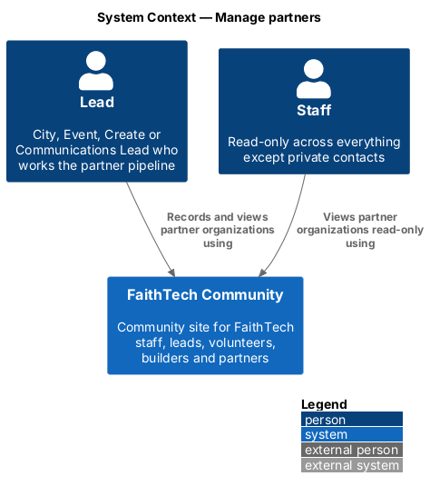
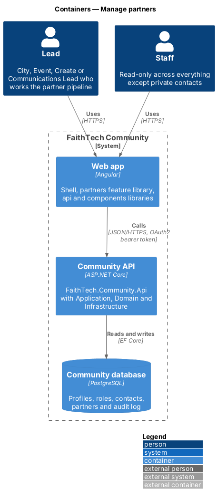
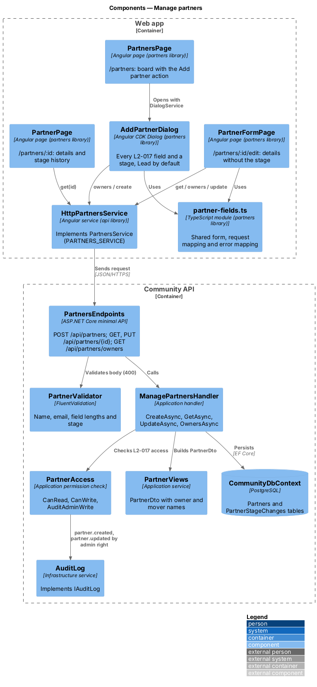
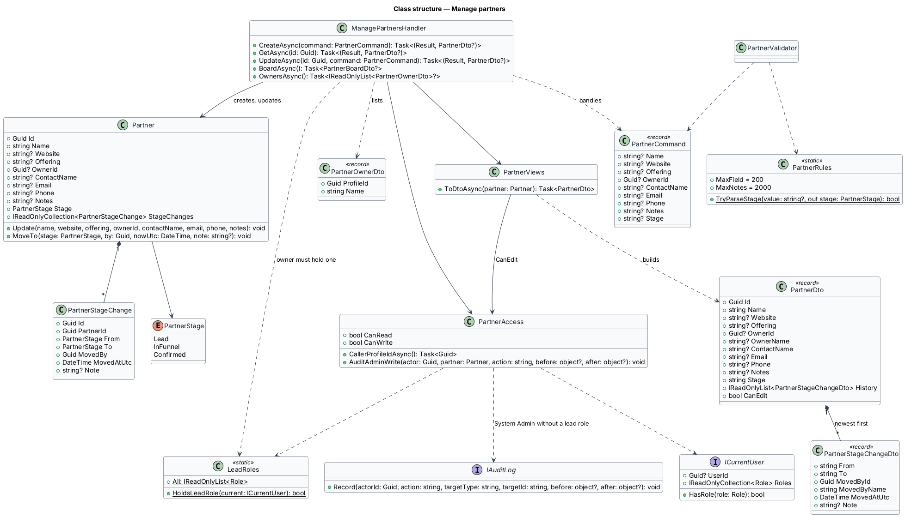
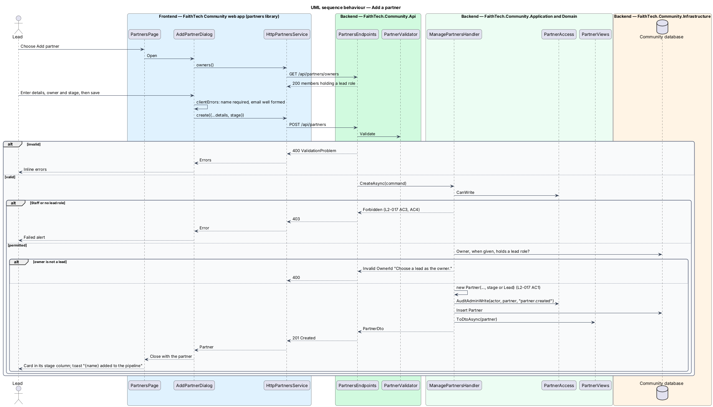

# Manage partners

## Overview

A **partner** — organization FaithTech works with or hopes to work with, such as a church, company or school. Leads track partners in one shared **partner pipeline** — the single set of partner records every lead sees and works on together, with no per-lead or per-city copies.

This feature covers creating, viewing and editing partner records. A new partner enters the pipeline at the Lead stage. Staff and System Admin can see the pipeline; Staff cannot change it. Moving partners between stages is the `partners/partner-kanban-board` slice.

## Description

- **`PartnersPage`** — the board page in the `partners` feature library at `/partners` (see `partners/partner-kanban-board`); it hosts the Add partner action, opens `AddPartnerDialog` and places the new card in its stage column with a "{name} added to the pipeline" toast.
- **`AddPartnerDialog`** — CDK dialog collecting name (required), website, offering, owner (a lead, from `owners()`), main contact, email, phone, notes and stage (Lead by default). It calls `PARTNERS_SERVICE.create` itself, shows field errors and a failed state, and closes with the new `PartnerDto`.
- **`PartnerPage`** — partner detail page at `/partners/:id` with the details and the stage history, newest first ("{mover} moved {name} from {from} to {to}: note"). Edit navigates to `PartnerFormPage`; Move opens `MovePartnerDialog`. Both are hidden when `canEdit` is false (Staff). A `404` shows the not-found state.
- **`PartnerFormPage`** — edit screen at `/partners/:id/edit` (mock `pages/partner-form`) with the same fields as `AddPartnerDialog` except the stage, which changes only by a move. It shows a read-only state when `canEdit` is false and an error summary with focus on the first invalid field.
- **`partner-fields.ts`** — the form group, `fromPartner`, `toRequest`, `clientErrors`, `serverErrors` and `ownerOptions` that the dialog and the form page share.
- **`PartnersService`** / **`PARTNERS_SERVICE`** / **`HttpPartnersService`** — API client in `api/src/lib/partners`: `getBoard()`, `get(id)`, `owners()`, `create(partner)`, `update(id, partner)` and `move(id, to, note)`, calling `GET /api/partners`, `GET /api/partners/{id}`, `GET /api/partners/owners`, `POST /api/partners`, `PUT /api/partners/{id}` and `POST /api/partners/{id}/stage`.
- **`PartnersEndpoints`** — minimal API mapping in `FaithTech.Community.Api`; it holds no business logic. Create answers `201`, `400` or `403`; get answers `200`, `403` or `404`; update answers `200`, `400`, `403` or `404`; owners answers `200` or `403`.
- **`PartnerCommand`** — one request body for create and update (`Name`, `Website`, `Offering`, `OwnerId`, `ContactName`, `Email`, `Phone`, `Notes`, `Stage`); `Stage` applies on create only.
- **`PartnerValidator`** and **`PartnerRules`** — a name is required ("Enter the organisation’s name."), the email must be well formed when present, other fields are at most 200 characters, notes at most 2,000, and a stage must be `Lead`, `InFunnel` or `Confirmed`.
- **`ManagePartnersHandler`** — Application handler in `Partners/` with `CreateAsync`, `GetAsync`, `UpdateAsync`, `BoardAsync` (see `partners/partner-kanban-board`) and `OwnersAsync`.
- **`PartnerAccess`** — Application permission check. `CanRead`: any lead role, Staff or System Admin; `CanWrite`: any lead role or System Admin. Others receive `403`. `AuditAdminWrite(...)` records `partner.created` and `partner.updated` (target type `Partner`) when a System Admin without a lead role makes the change.
- **`PartnerViews`** — builds **`PartnerDto`** with the owner's name, the history as **`PartnerStageChangeDto`** rows (newest first, mover's name or "A former member") and `CanEdit` from `PartnerAccess.CanWrite`.
- **Owner** — optional; it must be a member holding a lead role (`LeadRoles`), otherwise `400` "Choose a lead as the owner." `OwnersAsync` lists those members by name as **`PartnerOwnerDto`**.
- **`Partner`** — Domain entity; new partners start at `PartnerStage.Lead` unless another stage is chosen. `Update(...)` edits the details but never the stage. `CommunityDbContext` maps it to `Partners` with the stage stored as text.

Which lead roles may write partners: `decisions.txt` lists partners under City Lead, while `L2-017` says "a lead" and refuses only users "without a lead role, Staff or System Admin". `PartnerAccess` grants writes to any lead role and System Admin; the role set is confirmed in [ADR 0014](../../../adr/0014-contacts-and-partners-access-and-open-questions.md).

## Requirements

The feature realizes the following level-2 (L2) requirements. Each L2 requirement refines a level-1 (L1) requirement, cited by identifier.

| L2 ID | Refines (L1) | Requirement |
|-------|--------------|-------------|
| `L2-017` | `L1-006` | Partner records |

### Acceptance criteria

**`L2-017` — Partner records**

1. Given a lead, when they add a partner with a name, an optional website, offering, owner (a lead), contact details and notes, and a stage (Lead by default), then the partner appears in that stage.
2. Given a partner, when any lead, Staff or System Admin views it, then all leads see the same record (one shared pipeline).
3. Given Staff, when they view partners, then they cannot create, edit or move partners, and the API returns 403 for writes.
4. Given a user without a lead role, Staff or System Admin, when they request partners, then the response is 403.

## Diagrams

### System context

Leads and System Admin create and edit partners; Staff view them read-only. All see the same shared pipeline.

### Containers

The `partners` feature library in the Angular web app calls the Community API through the `api` library over HTTPS with an OAuth2 bearer token. The API persists state in the PostgreSQL Community database.

### Components

`PartnerValidator` rejects bad bodies with `400`; `ManagePartnersHandler` consults `PartnerAccess` before touching the shared pipeline, builds DTOs through `PartnerViews` and saves through `CommunityDbContext`.

### Class structure

`Partner` holds a `PartnerStage` and composes its stage history. `PartnerAccess` separates read and write rights; `ManagePartnersHandler` handles `PartnerCommand` and returns `PartnerDto` from `PartnerViews`.

### Behaviour — add a partner

A permitted lead creates a partner that enters the chosen stage, Lead by default; Staff and other callers receive `403`, and an owner without a lead role is `400`.

### Behaviour — view a partner

Every permitted reader sees the same shared record (`L2-017` AC2). A lead or System Admin can go on to edit it on `PartnerFormPage`.

## Open questions

Decisions recorded while building the Domain layer (`FaithTech.Community.Domain`):

- `L2-017` adds website, offering and an owner (a lead) to a partner; `Partner` carries `Website`, `Offering` and `OwnerId`. Resolved.
- Domain rule violations throw `InvalidOperationException` (a broken rule) or `ArgumentException` (invalid input); there is no shared domain exception type. Handlers check permissions and preconditions first and map any remaining violation to a `400` or `409` result.
- Edit navigates to the new partner form page (`/partners/:id/edit`, mock `pages/partner-form`); the add-partner dialog mock gained website, owner, phone and notes, and the partner page shows stage history without an inline note form ([ADR 0014](../../../adr/0014-contacts-and-partners-access-and-open-questions.md)).
- Only a System Admin acting without a lead role is audited (`partner.created`, `partner.updated`); a lead's changes are not audited, and their moves are recorded in the partner's own stage history.
