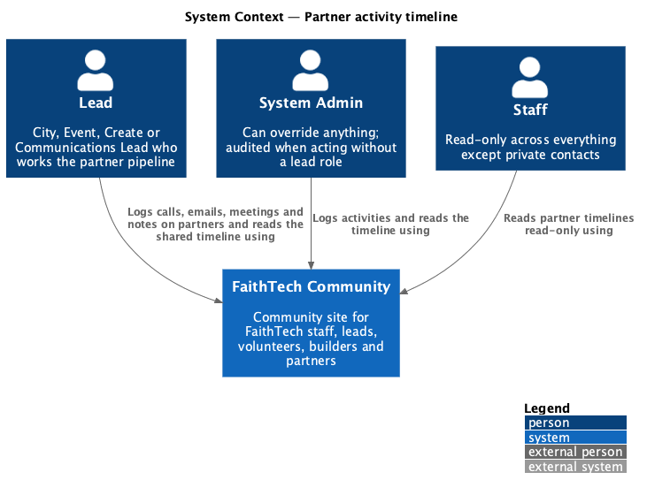
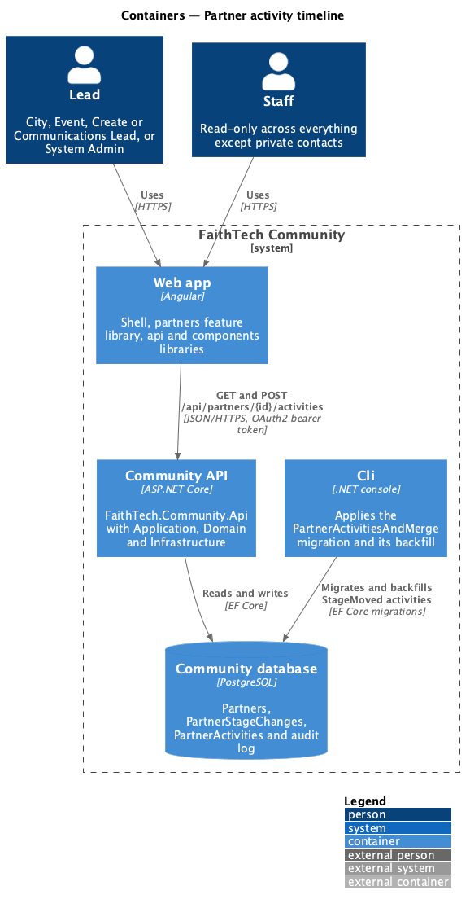
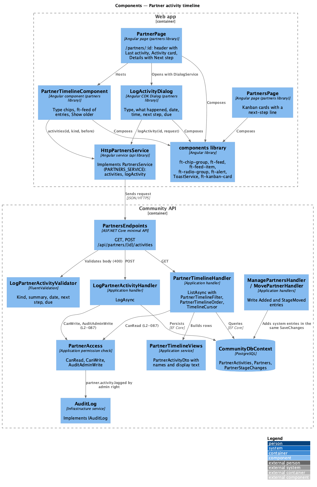
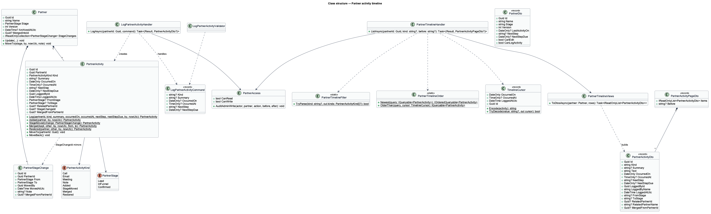
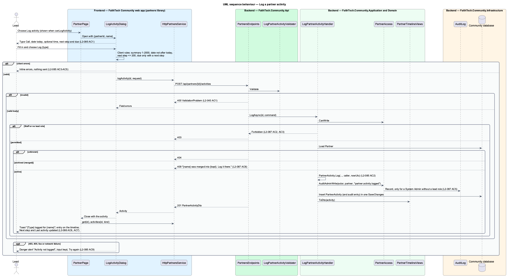
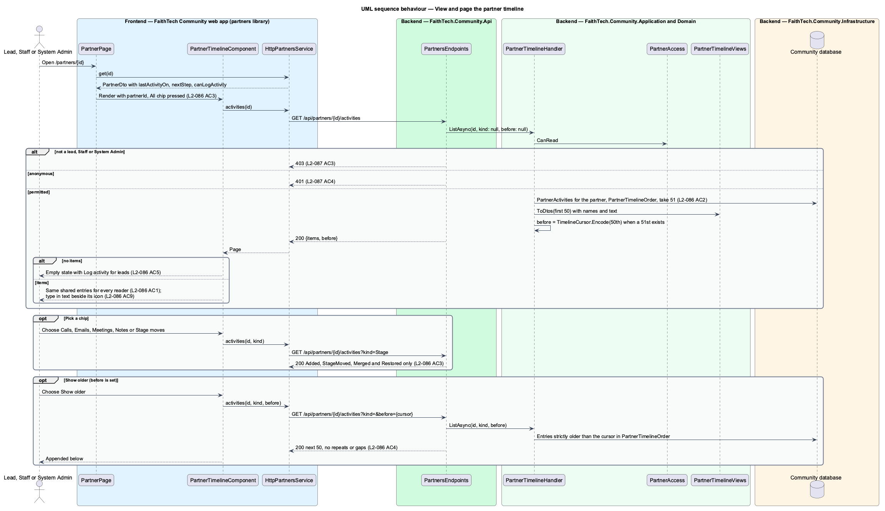
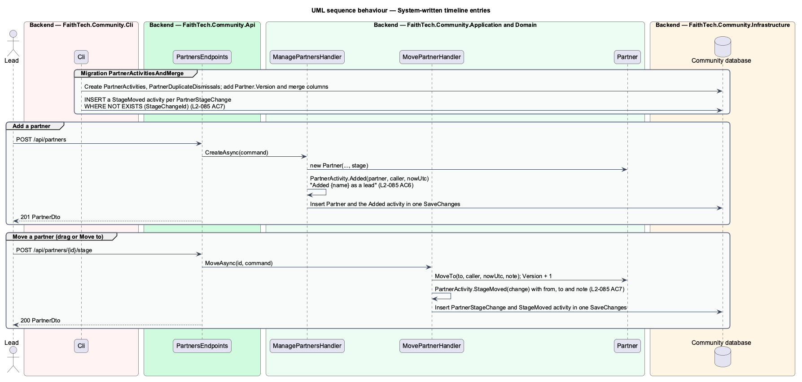

# Partner activity timeline

## Overview

A **partner activity** — one dated touchpoint with a partner organization: a call, an email, a meeting or a note that a lead logs, or an entry the system writes when the partner is added, moved to another stage, merged or restored. The **activity timeline** is the single shared list of a partner's activities on the partner page at `/partners/:id`. Every lead, Staff member and System Admin sees the same timeline, so whoever picks a partner up next sees every earlier touchpoint, whoever logged it.

A **next step** — a short follow-up a lead may attach to a logged activity, with an optional due date. The next step of the latest logged activity that has one shows in the partner's Details and on its Kanban card. **Last activity** — the date of the latest timeline entry, shown in the partner header.

The timeline replaces the partner page's Stage history list (`partners/manage-partners`). Existing stage moves stay recorded as `PartnerStageChange` rows and also appear on the timeline as Stage moved entries: the migration writes one for each existing stage change, and every later move writes one. Creating a partner writes an Added entry. Merging and restoring partners write their entries through `partners/duplicate-detection-and-merge`. Logged activities cannot be edited or deleted in v1.

## Description

### Domain (`QuinntyneBrown.Community.Domain/Partners/`)

- **`PartnerActivityKind`** — enum: `Call`, `Email`, `Meeting`, `Note` (logged by people) and `Added`, `StageMoved`, `Merged`, `Restored` (written by the system). `PartnerActivityKinds.Logged` lists the first four; `PartnerActivityKinds.Stage` lists the system kinds, which the Stage moves chip shows.
- **`PartnerActivity`** — entity with `Id`, `PartnerId`, `Kind`, `Summary`, `OccurredOn` (`DateOnly`), `OccurredAt` (`TimeOnly?`), `NextStep`, `NextStepDue` (`DateOnly?`), `LoggedById`, `LoggedAtUtc`, `FromStage` and `ToStage` (`PartnerStage?`, set on `Added`, `StageMoved` and, when the stage changed, `Merged`), `RelatedPartnerId` (the other partner of a `Merged` or `Restored` entry), `StageChangeId` (the `PartnerStageChange` a `StageMoved` entry mirrors) and `MergedFromPartnerId` (set when a merge moved the row; see `partners/duplicate-detection-and-merge`). Factory methods keep each kind's shape:
  - `PartnerActivity.Log(partnerId, kind, summary, occurredOn, occurredAt, nextStep, nextStepDue, by, nowUtc)` accepts only logged kinds and throws `ArgumentException` for a blank summary or a due date without a next step.
  - `PartnerActivity.Added(partner, by, nowUtc)`, `PartnerActivity.StageMoved(change)`, `PartnerActivity.Merged(kept, other, by, nowUtc, fromStage, toStage)` and `PartnerActivity.Restored(partner, other, by, nowUtc)` write system entries with `OccurredOn` and `OccurredAt` taken from `nowUtc`.
  - `MoveTo(partnerId)` changes `PartnerId` and records `MergedFromPartnerId`; `MoveBack()` reverses it (both used by merge and restore).
- **`Partner`** — gains `Version` (incremented by `Update`, `MoveTo` and the merge and restore methods), `ArchivedAtUtc`, `MergedIntoId`, `MergedById` and `MergedAtUtc` (owned by `partners/duplicate-detection-and-merge`). `MoveTo` keeps adding the `PartnerStageChange` it adds today.

### Application (`QuinntyneBrown.Community.Application/Partners/`)

- **`LogPartnerActivityCommand`** — `Kind`, `Summary`, `OccurredOn`, `OccurredAt`, `NextStep`, `NextStepDue`.
- **`LogPartnerActivityValidator`** (FluentValidation) — `Kind` must be `Call`, `Email`, `Meeting` or `Note` ("Choose call, email, meeting or note."); `Summary` is required and at most 2,000 characters after trimming ("Say what happened." / "Use 2,000 characters or fewer for what happened."); `OccurredOn` is required and not after today ("Enter the date it happened." / "Choose today or an earlier date."); `NextStep` at most 200 characters ("Use 200 characters or fewer for the next step."); `NextStepDue` only with a next step ("Add the next step, or clear its due date."). "Today" on the server is the UTC date plus one day, so a lead east of UTC is not refused for their local today; the dialog enforces the lead's local today.
- **`LogPartnerActivityHandler.LogAsync(partnerId, command)`** — requires `PartnerAccess.CanWrite` (`403`), answers `404` for an unknown partner and `409` "{name} was merged into {kept}. Log it there." for an archived one (`L2-112` AC6), adds the activity with the caller's profile id and `TimeProvider` UTC time, calls `PartnerAccess.AuditAdminWrite(..., "partner.activity.logged", null, snapshot)`, saves and returns `201` with the `PartnerActivityDto`.
- **`PartnerTimelineHandler.ListAsync(partnerId, kind, before)`** — requires `PartnerAccess.CanRead`, answers `404` for an unknown partner and `400` for an unknown `kind` or a malformed `before`. It filters by `PartnerTimelineFilter`, orders by `PartnerTimelineOrder` and takes 50 rows plus one to know whether older rows exist.
- **`PartnerTimelineFilter`** — maps `kind` to kinds: missing → all; `Call`, `Email`, `Meeting`, `Note` → that kind; `Stage` → `Added`, `StageMoved`, `Merged`, `Restored`.
- **`PartnerTimelineOrder`** — the one ordering every list, cursor and next-step query uses: `OccurredOn` descending, then `OccurredAt` descending with a missing time as `00:00`, then `LoggedAtUtc` descending, then `Id` descending as the tie-break. It is plain LINQ, so it runs on the EF Core in-memory provider in tests.
- **`TimelineCursor`** — the `before` value: base64url of `{occurredOn:yyyy-MM-dd}|{occurredAt:HH:mm:ss or empty}|{loggedAtUtc ticks}|{id}` of the oldest entry on the page. `Encode` and `TryDecode` are pure static methods. "Show older" asks for entries strictly after the cursor in `PartnerTimelineOrder`, so no entry repeats or is skipped (`L2-111` AC4).
- **`PartnerTimelineViews`** — builds `PartnerActivityDto` rows with the logger's name ("A former member" when the profile is gone), the other partner's name and the display `Text`:
  - logged kinds: the summary;
  - `Added`: "Added {name} as a lead" (or "Added {name} at {stage}" for another first stage);
  - `StageMoved`: "Moved {name} from {from} to {to}", plus `: “{note}”` when the move had one;
  - `Merged`: "Merged {other} into {name}"; `Restored`: "Restored {name} from {other}" on the restored partner and "Restored {other} as its own partner" on the kept one.
  The names are the partners' current names. `{name}` is the partner the row was first written on: the `MergedFromPartnerId` partner for a row a merge moved, otherwise the timeline's partner, so a moved "Added Kestrel Labs Inc. as a lead" keeps its own name.
- **`PartnerViews.ToDtoAsync`** — extended: `PartnerDto` loses `History` and gains `Version`, `LastActivityOn` (the first entry in `PartnerTimelineOrder`, or `null`), `NextStep` and `NextStepDue` (the first logged activity with a next step in `PartnerTimelineOrder`) and `CanLogActivity` (`CanWrite` and not archived). `PartnerDto.Archived` and `CanRestore` belong to `partners/duplicate-detection-and-merge`.
- **`ManagePartnersHandler.CreateAsync`** — also adds `PartnerActivity.Added(...)` in the same `SaveChanges` (`L2-110` AC6).
- **`MovePartnerHandler.MoveAsync`** — also adds `PartnerActivity.StageMoved(change)` for the new `PartnerStageChange` in the same `SaveChanges` (`L2-110` AC7).
- **`ManagePartnersHandler.BoardAsync`** — `PartnerCardDto` gains `NextStep` and `NextStepDue`. One query loads `(PartnerId, OccurredOn, OccurredAt, LoggedAtUtc, Id, NextStep, NextStepDue)` for logged activities with a next step on non-archived partners; the handler keeps the first per partner in `PartnerTimelineOrder` (`L2-111` AC6). There is no per-card query.
- **`PartnerAccess`** — unchanged: `CanRead` is any lead role, Staff or System Admin; `CanWrite` is any lead role or System Admin. `AuditAdminWrite` audits only a System Admin acting without a lead role (`L2-112` AC5).

### Infrastructure (`QuinntyneBrown.Community.Infrastructure/Persistence/`)

- **`CommunityDbContext`** and **`IApplicationDbContext`** — gain `DbSet<PartnerActivity> PartnerActivities`. Mapping: table `PartnerActivities`; `Kind`, `FromStage` and `ToStage` as text (max 16); `Summary` max 2,000; `NextStep` max 200; index `(PartnerId, OccurredOn, OccurredAt, LoggedAtUtc)`; filtered index on `PartnerId` where `NextStep IS NOT NULL`; foreign key to `Partners` with cascade delete. `Partner.Version` is an `int` concurrency token.
- **Migrations `PartnerActivities`, `PartnerStageMoveActivities` and `PartnerDuplicatesAndMerge`** (in `Persistence/Migrations/`, applied by the Cli project; planned as one `PartnerActivitiesAndMerge` and split as the slices landed, see Open questions) — together they create `PartnerActivities` and `PartnerDuplicateDismissals`, adds `Version` (default `0`), `ArchivedAtUtc`, `MergedIntoId`, `MergedById` and `MergedAtUtc` to `Partners` and `MergedFromPartnerId` to `PartnerStageChanges`, then backfills with SQL:

  ```sql
  INSERT INTO "PartnerActivities" ("Id", "PartnerId", "Kind", "Summary", "OccurredOn", "OccurredAt",
      "LoggedById", "LoggedAtUtc", "FromStage", "ToStage", "StageChangeId")
  SELECT gen_random_uuid(), c."PartnerId", 'StageMoved', c."Note", c."MovedAtUtc"::date,
      c."MovedAtUtc"::time, c."MovedBy", c."MovedAtUtc", c."From", c."To", c."Id"
  FROM "PartnerStageChanges" c
  WHERE NOT EXISTS (SELECT 1 FROM "PartnerActivities" a WHERE a."StageChangeId" = c."Id");
  ```

  The `NOT EXISTS` guard makes the backfill safe to re-run. Existing partners have no creation time, so no Added entry is backfilled. The seeder writes an Added entry for each partner it seeds.

### API (`QuinntyneBrown.Community.Api/Endpoints/PartnersEndpoints.cs`)

No business logic; both routes require authentication (anonymous `401`, `L2-112` AC4).

- **`GET /api/partners/{id}/activities?kind=&before=`** — `200`, `400`, `403` or `404`.

  ```json
  {
    "items": [
      {
        "id": "8c1e…",
        "kind": "Call",
        "summary": "Called Nadia about the contract.",
        "text": "Called Nadia about the contract.",
        "occurredOn": "2026-10-22",
        "occurredAt": "14:15:00",
        "nextStep": "Send credit-line wording",
        "nextStepDue": "2026-10-23",
        "loggedById": "4d0f…",
        "loggedByName": "Grace Okonkwo",
        "loggedAtUtc": "2026-10-22T18:20:11Z",
        "fromStage": null,
        "toStage": null,
        "relatedPartnerId": null,
        "relatedPartnerName": null,
        "mergedFromPartnerId": null
      }
    ],
    "before": "MjAyNi0xMC0xNnwxMDowMDowMHw2Mzg5…"
  }
  ```

  `before` is `null` when no older entry exists. `kind` is `Call`, `Email`, `Meeting`, `Note` or `Stage`; any other value is `400`.
- **`POST /api/partners/{id}/activities`** — body `{ "kind": "Call", "summary": "…", "occurredOn": "2026-10-22", "occurredAt": "14:15", "nextStep": "…", "nextStepDue": "2026-10-23" }`; `201` with the `PartnerActivityDto` and `Location: /api/partners/{id}/activities/{activityId}`; `400` validation problem details keyed `Kind`, `Summary`, `OccurredOn`, `NextStep`, `NextStepDue` (`L2-043` AC1); `403`; `404`; `409` for an archived partner. There is no `PUT` or `DELETE` (`L2-110` AC8).
- **`GET /api/partners/{id}`** — `PartnerDto` without `history`, with `version`, `lastActivityOn`, `nextStep`, `nextStepDue` and `canLogActivity`.
- **`GET /api/partners`** — each card gains `nextStep` and `nextStepDue`.

### Frontend

- **`PartnersService`** / **`PARTNERS_SERVICE`** / **`HttpPartnersService`** (`api/src/lib/partners`) — gain `activities(id, kind?: PartnerActivityFilter, before?: string): Observable<PartnerActivityPageDto>` and `logActivity(id, request: LogPartnerActivityRequest): Observable<PartnerActivityDto>`. New types: `PARTNER_ACTIVITY_KINDS`, `PartnerActivityKind`, `LoggedActivityKind`, `PartnerActivityFilter` (`'Call' | 'Email' | 'Meeting' | 'Note' | 'Stage'`), `PARTNER_ACTIVITY_LABELS` (Call, Email, Meeting, Note, Added to the pipeline, Stage moved, Merged, Restored), `PartnerActivityDto`, `PartnerActivityPageDto`, `LogPartnerActivityRequest`. `PartnerDto` drops `history` and `PartnerStageChangeDto`, and gains `version`, `lastActivityOn`, `nextStep`, `nextStepDue` and `canLogActivity`; `PartnerCardDto` gains `nextStep` and `nextStepDue`.
- **`PartnerPage`** (`partners/src/lib/pages/partner`) — the header subtitle adds "· Last activity {day}" when `lastActivityOn` is set (`L2-111` AC7); "Log activity" (primary) shows when `canLogActivity`; the main card becomes **Activity** with `PartnerTimelineComponent`; Details adds a Next step row ("{next step} · {due day}") when set (`L2-111` AC6). After a log, a move or a merge it reloads the partner and the timeline's first page.
- **`PartnerTimelineComponent`** (`partners/src/lib/pages/partner/partner-timeline`) — feature composition only: `ft-chip-group` labelled "Show" with one `ft-chip` per filter (All pressed by default; picking one un-presses the others and reloads with `kind`, `L2-111` AC3, AC9); `ft-feed` labelled "Activity" with one `ft-feed-item` per entry led by the kind's icon tile, then "**{label}** · {logged by}", the text, the next step line and the meta "{day}, {time}" (`L2-111` AC2); `ft-feed` `state` covers loading, error with Try again, and empty; "Show older" (`ft-button`, busy while loading) appends the next page using `before`. The empty state (mock `partner/activity-empty`) says "No activity yet" with "Log activity" for leads.
- **`LogActivityDialog`** (`partners/src/lib/dialogs/log-activity`) — CDK dialog "Log activity for {name}" (mocks `dialogs/log-activity/default`, `invalid`, `busy`, `failed`): `ft-radio-group` "Type" (Call by default), `ft-textarea` "What happened", `ft-text-field` `type="date"` "When" (today by default) and `type="time"` "Time (optional)", `ft-text-field` "Next step (optional)" with the help "Shown on the partner card so any lead can pick it up.", and `type="date"` "Next step due (optional)". The primary button reads "Log {type}". Client rules mirror the validator; server `400` errors map onto the fields; the dialog is busy while saving; any other failure keeps the input and shows the danger alert "Activity not logged" with "Try again" (`L2-110` AC9). On success it closes with the `PartnerActivityDto` and the page shows the success toast "{Type} logged for {name}" (`L2-054`).
- **`PartnersPage`** — passes `detail` "Next: {next step} · {due day}" to each `ft-kanban-card` when the card has a next step.
- **`partners.routes.ts`** — unchanged.

### Components used

From `frontend/projects/components/`: `ft-page-header`, `ft-button`, `ft-icon`, `ft-badge`, `ft-split`, `ft-card`, `ft-chip-group`, `ft-chip`, `ft-feed`, `ft-feed-item`, `ft-icon-tile`, `ft-description-list`, `ft-dialog` and `DialogService`, `ft-radio-group` and `ft-radio`, `ft-form-field`, `ft-text-field`, `ft-textarea`, `ft-alert`, `ToastService`, `ft-empty-state`, `ft-skeleton`, `ft-kanban-card`.

Missing from `components` today, to add there first (no local copies):

- **`ft-feed-item` leading icon tile** — an `icon` input that renders `ft-icon-tile size="sm"` in place of the avatar, as the design system's typed partner activity example shows (`docs/design-system/components/feed.html`).
- **Icons `call` and `merge`** in `icon/icons.ts`. Meeting uses `events`, Note `edit`, Stage moved `move`, Added `add`, Restored `restore`, Email `email`.
- **`ft-radio-group` inline layout** — an `orientation` input (`'stack' | 'inline'`) so the four type radios sit in one wrapping row as in the mock.
- **`ft-kanban-card` detail line** — a `detail` input for a second muted line under the caption.
- **`ft-text-field` `min` and `max`** — optional; lets the date field cap at today. Validation does not depend on it.

### Fake backend (`e2e/fixtures/mock-partners.ts`)

- `MockPartner` loses `history` and gains `version` and `activities: MockActivity[]` (`id`, `kind`, `summary`, `occurredOn`, `occurredAt`, `nextStep`, `nextStepDue`, `loggedById`, `loggedAtUtc`, `fromStage`, `toStage`, `relatedPartnerId`, `mergedFromPartnerId`).
- `add()` writes an Added activity; `POST …/stage` writes a StageMoved activity and increments `version`; `PUT` increments `version`.
- `addActivity(partnerId, activity)` seeds entries for a test, including more than 50 for paging.
- Routes: `GET /api/partners/{id}/activities` with the same filter, order, page size of 50 and an opaque `before` (the fake may use the entry id) as the API; `POST /api/partners/{id}/activities` with the same `400` keys and messages, `403` for Staff and non-leads, `409` for an archived partner; anonymous `401`.
- `dto()` returns `version`, `lastActivityOn`, `nextStep`, `nextStepDue` and `canLogActivity`; `board()` returns each card's `nextStep` and `nextStepDue`; display `text` follows `PartnerTimelineViews`.
- `failNext(path)` (or the existing fault hook in `MockApi`) makes the next activity `POST` answer `500` for the failed-dialog test.
- The handler's path pattern gains a third segment so `/{id}/activities` is recognised; any other unknown path still fails loudly.

### Tests

Backend integration tests in `backend/tests/QuinntyneBrown.Community.Api.Tests/Partners/PartnerActivityTests.cs` (EF Core in-memory database, `TimeProvider` faked), with `PartnerClients` gaining `Activity`, `ActivityPage` and `LogActivityAsync`:

- a City, Event, Create and Communications Lead and a System Admin each log an activity (`201`); it lists first with the logger's name (`L2-110` AC2, `L2-112` AC1);
- blank, whitespace-only and 2,001-character summaries, a missing date, a date after tomorrow UTC, a 201-character next step and a due date without a next step each answer `400` with the field key and nothing is saved (`L2-110` AC3 to AC5);
- creating a partner writes an Added entry; moving it writes a StageMoved entry with from, to and the note (`L2-110` AC6, AC7);
- no `PUT` or `DELETE` route exists for an activity (`405`/`404`, `L2-110` AC8);
- the timeline order with and without times and with equal dates; each `kind` filter, `Stage` including Added and Merged; 120 entries page as 50, 50, 20 with no repeats or gaps; an unknown `kind` or a broken `before` is `400` (`L2-111` AC2 to AC4);
- the partner's `nextStep` is the latest logged activity with one, ignoring newer entries without one; the board card carries it; `lastActivityOn` is the latest entry's date (`L2-111` AC6, AC7);
- Staff read the timeline and get `403` on `POST`; a Volunteer gets `403` on both; anonymous gets `401` on both (`L2-112` AC2 to AC4);
- a System Admin without a lead role writes one `partner.activity.logged` audit entry; a City Lead writes none (`L2-112` AC5);
- logging on an archived partner is `409` (`L2-112` AC6).

Application unit tests in `backend/tests/QuinntyneBrown.Community.Application.Tests/Common/TimelineCursorTests.cs` round-trip `TimelineCursor` and reject malformed values. Infrastructure tests in `backend/tests/QuinntyneBrown.Community.Infrastructure.Tests/` prove the backfill writes one StageMoved activity per stage change and none on a second run, when the migration SQL can run there; otherwise the seeder path covers it (see Open questions).

E2E specs in `e2e/tests/partners/partner-activity.spec.ts` with page objects `e2e/pages/partner.page.ts` (timeline, chips, Show older, next step, last activity) and `e2e/pages/log-activity.dialog.ts`:

- a City Lead logs a call with a next step; the toast shows; the entry tops the timeline; Details and the board card show the next step;
- inline errors for an empty summary, a future date and a due date with no next step;
- the failed save keeps the input and offers Try again;
- each chip filters; Stage moves lists Added and Stage moved entries; Show older loads the next 50;
- the empty state for a type with no entries;
- Staff see the timeline without Log activity;
- XS viewport: single column, chips wrap without horizontal page scroll (`L2-111` AC8);
- axe checks on the partner page, the timeline empty state and the dialog in each state.

`e2e/tests/partners/partner-board.spec.ts` changes its two Stage history assertions to read the timeline's Stage moved entry.

## Requirements

The feature realizes the following level-2 (L2) requirements. Each L2 requirement refines a level-1 (L1) requirement, cited by identifier.

| L2 ID | Refines (L1) | Requirement |
|-------|--------------|-------------|
| `L2-110` | `L1-006` | Log a partner activity |
| `L2-111` | `L1-006` | Partner activity timeline |
| `L2-112` | `L1-006` | Partner activity access and audit |

### Acceptance criteria

**`L2-110` — Log a partner activity**

1. Given a lead or System Admin on a partner page, when they choose "Log activity", then a dialog asks for the type (Call, Email, Meeting or Note), what happened, the date (today by default), an optional time, an optional next step and an optional due date for that next step.
2. Given the dialog, when the lead saves with a type, what happened and a date, then `POST /api/partners/{id}/activities` saves the activity with who logged it and when (UTC), the dialog closes, a success toast confirms it (`L2-054`), and the activity appears on the timeline (`L2-111`).
3. Given what happened is empty or only whitespace, or longer than 2000 characters after trimming, when the lead saves, then the field shows an inline error, the API answers 400 with problem details (`L2-043` AC1), and nothing is saved.
4. Given no date, or a date after today, when the lead saves, then the date field shows an inline error and nothing is saved.
5. Given a next step longer than 200 characters, or a due date with no next step, when the lead saves, then the field shows an inline error and nothing is saved.
6. Given a new partner, when it is created (`L2-017` AC1), then the system writes an "Added" entry ("Added {name} as a lead") with who added it and when.
7. Given a partner moved to another stage by drag or "Move to" (`L2-018` AC2), when the move is saved, then the system writes a "Stage moved" entry carrying the stage it left, the stage it entered, who moved it and the move note; existing stage changes appear as "Stage moved" entries too.
8. Given a logged activity, when anyone, the lead who logged it included, tries to edit or delete it, then no control or API exists to do so in v1.
9. Given the save fails, when the API answers with an error, then the dialog stays open with the lead's input, and a danger message offers to try again.

**`L2-111` — Partner activity timeline**

1. Given a partner, when any lead, Staff or System Admin opens its page, then they see the same timeline, whoever logged each entry (`L2-017` AC2).
2. Given the timeline, when it renders, then entries are ordered newest first by date, then time (an entry with no time sorts as the start of its day), then the time it was logged; each entry shows its type, what happened, its date and time, who logged it, and its next step and due date when set.
3. Given the type chips All, Calls, Emails, Meetings, Notes and Stage moves, when the lead picks one, then only entries of that type are listed; Stage moves includes the "Added" and "Merged" entries; All is selected by default.
4. Given more than 50 entries for the selected type, when the timeline loads, then the newest 50 are shown with "Show older", which loads the next 50 older entries without repeating or skipping any (`GET /api/partners/{id}/activities?kind=&before=`).
5. Given a partner with no entries for the selected type, when the timeline renders, then the empty state (mock `partner/activity-empty`) invites the lead to log the first activity.
6. Given logged activities with a next step, when the partner page and the Kanban card render, then the next step of the latest such activity in timeline order is shown in the partner's Details and on its card, with its due date when set; with none, no next step is shown.
7. Given the partner header, when it renders, then "Last activity" shows the date of the latest timeline entry.
8. Given an XS viewport, when the partner page is shown, then the timeline is a single column, the type chips wrap or scroll within the timeline without horizontal page scroll (`L2-045` AC1), and "Log activity" stays reachable.
9. Given a keyboard or screen-reader user, when they use the timeline, then the type chips are a labelled group with the selected chip announced, and each entry's type is conveyed in text, not by icon or colour alone (`L2-044`).

**`L2-112` — Partner activity access and audit**

1. Given a City Lead, Event Lead, Create Lead, Communications Lead or System Admin, when they log an activity, then it is saved.
2. Given Staff, when they view a partner, then they see the timeline without "Log activity", and `POST /api/partners/{id}/activities` answers 403 (`L2-017` AC3, `L2-066` AC3).
3. Given a signed-in member without a lead role, Staff or System Admin, when they call either activity endpoint, then the response is 403 (`L2-017` AC4).
4. Given an anonymous visitor, when they call either activity endpoint, then the response is 401 (`L2-042` AC1).
5. Given a System Admin without a lead role, when they log an activity, then an audit entry `partner.activity.logged` records them, the partner and the activity (`L2-041`); a lead's own logging is not audited.
6. Given an archived partner (`L2-114`), when a lead tries to log an activity on it, then the request is refused and the partner page shows no "Log activity".

## Diagrams

### System context

Leads and System Admin log activities and read the shared timeline; Staff read it only.



### Containers

The `partners` feature library calls the Community API through the `api` library over HTTPS with an OAuth2 bearer token. The API stores activities next to partners in the PostgreSQL Community database; the Cli project applies the migration and its backfill.



### Components

`PartnerPage` composes `PartnerTimelineComponent` and opens `LogActivityDialog`. On the server, `LogPartnerActivityHandler` and `PartnerTimelineHandler` check `PartnerAccess`; `ManagePartnersHandler` and `MovePartnerHandler` add the system entries in the same unit of work as the change.



### Class structure

A `Partner` composes its `PartnerActivity` rows and its `PartnerStageChange` rows; a `StageMoved` activity points at the stage change it mirrors. `PartnerTimelineOrder` and `TimelineCursor` define the one order every query uses.



### Behaviour — log an activity

A permitted lead logs a call, email, meeting or note; validation failures stay in the dialog, Staff and non-leads receive `403`, an archived partner `409`, and a System Admin without a lead role is audited.



### Behaviour — view and page the timeline

Every permitted reader loads the same first 50 entries; a chip reloads with `kind`, and "Show older" passes the cursor of the oldest entry shown.



### Behaviour — system entries

Creating a partner writes Added and moving it writes Stage moved, each in the same `SaveChanges` as the change. The migration backfills a Stage moved entry for every existing stage change.



## Open questions

- Audit action names follow the codebase's existing dotted form: the `PartnerActivityLogged` entry of `L2-112` AC5 is recorded as `partner.activity.logged` (target type `Partner`, target id the partner, after the activity's kind, date and summary). The spec uses the dotted name.
- The brief lists `Added`, `StageMoved` and `Merged` as system kinds. Restore (`L2-115` AC4) also writes "a system entry on both partners", so the design adds a fourth system kind, `Restored`, shown under Stage moves.
- The brief's entity omits the from and to stages, the related partner and the stage-change link that `L2-110` AC7 and the merge entries need; the design adds `FromStage`, `ToStage`, `RelatedPartnerId` and `StageChangeId`.
- The response wraps rows as `{ items, before }` with an opaque cursor rather than a raw date, because entries on the same date need the time, log time and id to page without repeats.
- "Not in the future" is checked on the server against the UTC date plus one day, since the server does not know the lead's time zone; the dialog enforces the lead's local today. Backfilled Stage moved entries take their date and time from the UTC move time.
- Display text for system entries uses the partners' current names, so renaming a partner renames its old entries' sentences. A rename itself is not a timeline entry.
- `PartnerDto.history` is removed in the same change that ships the timeline; `PartnerStageChangeDto` stays only if another caller needs it (none does today).
- The migration backfill uses PostgreSQL SQL (`gen_random_uuid()`, `::date`), which the in-memory provider does not run. Its effect is checked by review and by running the Cli migration locally; backend tests seed activities through the handlers. No Cli-level check is added.
- The Kanban card next-step line "Next: {next step} · {due}" follows the `pages/partners` mocks.
- `L2-110` AC1 names the type choice first with no default; the mock preselects Call, which the dialog follows.
- The one migration `PartnerActivitiesAndMerge` is split as the slices land: `PartnerActivities` creates the `PartnerActivities` table with the columns the timeline needs (no `RelatedPartnerId` or `MergedFromPartnerId` yet); the stage-move backfill comes with the system entries; `Partner.Version`, the archive and merge columns, `PartnerDuplicateDismissals`, `RelatedPartnerId` and `MergedFromPartnerId` come in a later migration with `partners/duplicate-detection-and-merge`.
- The dialog's date field is labelled "Date" and its empty-summary error reads "Say what happened, in a sentence or two.", as the `dialogs/log-activity` mocks and `docs/screen-composition.md` write them; the API keeps the shorter "Say what happened." for the same rule.
- The stage-move backfill is its own data-only migration, `PartnerStageMoveActivities`, after `PartnerActivities`; it reads the move time as UTC (`AT TIME ZONE 'UTC'`) so the date does not depend on the database session's time zone. Its `Down` is empty: rolling back `PartnerActivities` drops the backfilled rows with the table.
- `PartnerDto.Version` and the merge and restore texts ("Merged {other} into {name}", "Restored …") ship with `partners/duplicate-detection-and-merge`, which owns the concurrency token and those entries; the timeline slice adds `LastActivityOn`, `NextStep`, `NextStepDue` and `CanLogActivity` only.
- The activity-empty mock shows "No touchpoints yet" above the system's Added entry, so the empty state shows whenever the chosen type has no call, email, meeting or note (for Stage moves, when it has no entries at all); entries the system wrote still list under it. The filtered caption counts the entries loaded so far ("1 call."), with "+" while older pages remain.
- `L2-112` AC6 (an archived partner refuses a log with `409` and shows no Log activity) waits for the archive columns that `partners/duplicate-detection-and-merge` adds; until then no partner can be archived, `CanLogActivity` is `CanWrite`, and the `409` check, its integration test and the fake's `409` land with that slice.
