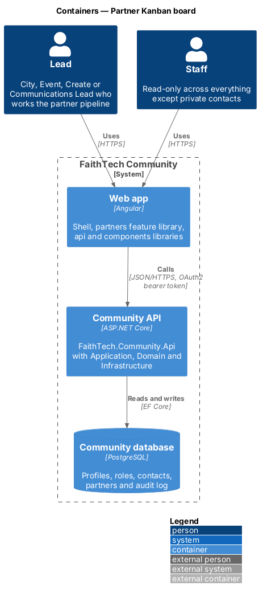
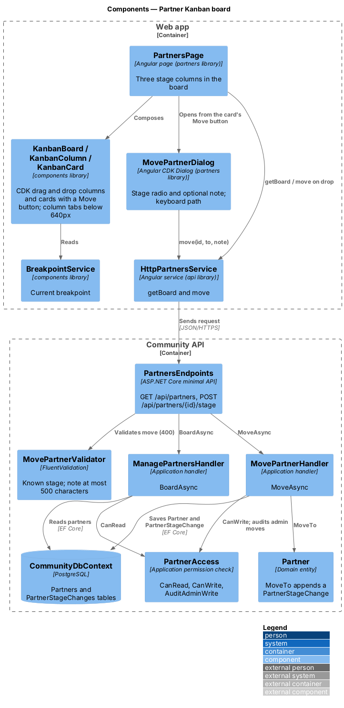
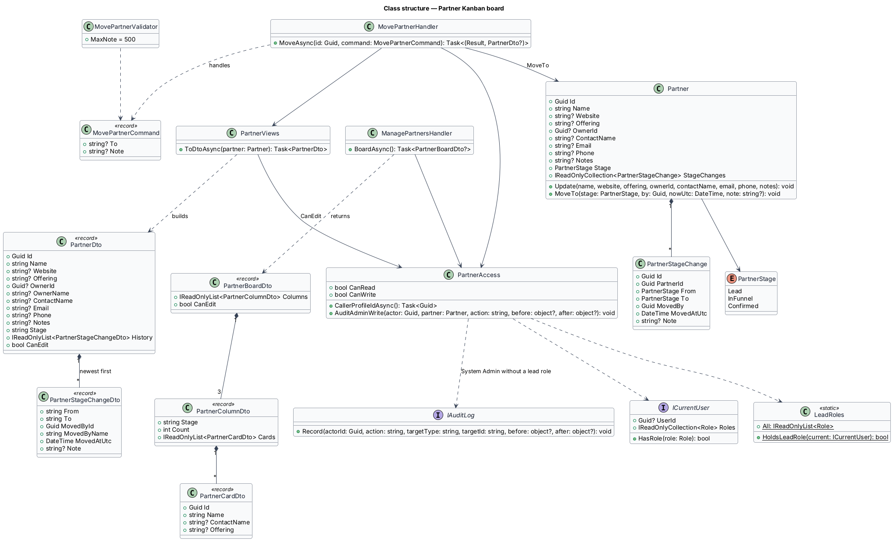
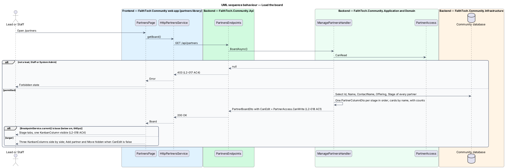
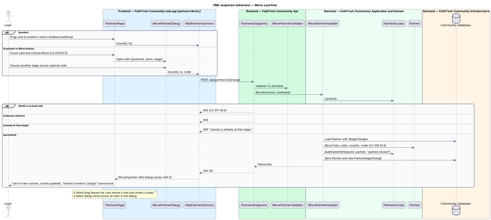

# Partner Kanban board

## Overview

The partner pipeline is shown as a **Kanban board** — view of work items arranged in columns by stage. The partner board has three columns, in order: Lead, In Funnel and Confirmed, each with a count. A lead moves a partner to another stage by dragging its card, or through the Move dialog, which is also the keyboard path. Each move is recorded with who made it and when.

On phones (below the 640px `sm` breakpoint, which covers XS) the board shows the stages as tabs with one column visible at a time.

## Description

- **`PartnersPage`** — board page in the `partners` feature library at `/partners`. It loads `PartnerBoardDto` and renders one `KanbanColumnComponent` per stage inside `KanbanBoardComponent`, with `KanbanCardComponent` cards (name, main contact and offering). On phones (below the 640px `sm` breakpoint, which covers XS), `KanbanBoardComponent` turns the stages into its own column tabs ("Partner pipeline columns") with one column visible at a time (mock `pages/partners/tabs`). Add partner and Move are hidden when `canEdit` is false. A live region announces "{name} moved to {stage}" after each move.
- **`KanbanBoardComponent`**, **`KanbanColumnComponent`** and **`KanbanCardComponent`** — from the `components` library, built on Angular CDK drag and drop. A drop emits a `KanbanCardDrop`; each card has a Move button reachable by keyboard (WCAG 2.5.7). After a move by drag or dialog, the page sets the board's `announcement` ("Kestrel Labs moved to Confirmed"), which `ft-kanban-board` reads out in a polite live region; the deprecated `aria-grabbed` is not used.
- **`MovePartnerDialog`** — CDK dialog in the `partners` library listing the stages, preselecting the next one, with an optional note. Move stays disabled while the current stage is chosen. It calls `PARTNERS_SERVICE.move` itself and closes with the moved `PartnerDto`. It is opened from the card's Move button and from `PartnerPage`, and is the keyboard and screen-reader path.
- **`PartnersService`** / **`HttpPartnersService`** — `getBoard()` and `move(id, to, note)` calling `GET /api/partners` and `POST /api/partners/{id}/stage`.
- **`PartnersEndpoints`** — the board answers `200` or `403`; the move answers `200`, `400`, `403`, `404` or `409`.
- **`ManagePartnersHandler.BoardAsync`** — requires `PartnerAccess.CanRead` and returns **`PartnerBoardDto`**: the three **`PartnerColumnDto`** stages in order, each with its count and **`PartnerCardDto`** cards by name, and `CanEdit`.
- **`MovePartnerCommand`** (`To`, `Note`) / **`MovePartnerValidator`** / **`MovePartnerHandler`** — the validator requires a known stage and a note of at most 500 characters. `MoveAsync` requires `CanWrite`, answers `404` for an unknown partner and `409` for the current stage, calls `Partner.MoveTo`, which appends a `PartnerStageChange` with `From`, `To`, `MovedBy`, `MovedAtUtc` and the optional `Note` (`L2-018` AC2), audits `partner.moved` for a System Admin without a lead role, and returns the `PartnerDto`.
- Stage moves are not restricted to adjacent stages; any stage may move to any other.

Behaviour when two leads move the same card at the same time: last write wins, with no concurrency token ([ADR 0014](../../../adr/0014-contacts-and-partners-access-and-open-questions.md)).

## Requirements

The feature realizes the following level-2 (L2) requirements. Each L2 requirement refines a level-1 (L1) requirement, cited by identifier.

| L2 ID | Refines (L1) | Requirement |
|-------|--------------|-------------|
| `L2-018` | `L1-006` | Partner Kanban board |

### Acceptance criteria

**`L2-018` — Partner Kanban board**

1. Given the partners page, when it loads, then partners appear in three columns, Lead, In Funnel and Confirmed, each with a count.
2. Given a lead, when they drag a partner to another column, or use the "Move to" dialog with an optional note, then its stage changes and the move is recorded in the partner's history with who made it, when, and the note.
3. Given a keyboard-only user, when they focus a partner card, then they can move it to another stage without a pointer.
4. Given an XS viewport, when the board is shown, then the stages are shown as tabs with one column visible at a time.

## Diagrams

### System context

Leads and System Admin move partners on the board; Staff view the board read-only.

### Containers

The `partners` feature library in the Angular web app calls the Community API through the `api` library over HTTPS with an OAuth2 bearer token. The API persists state in the PostgreSQL Community database.

### Components

The page composes the library's Kanban and tabs components. The board comes from `ManagePartnersHandler.BoardAsync`; moves go through `MovePartnerHandler`, which records the change on `Partner`.

### Class structure

`Partner.MoveTo` appends a `PartnerStageChange`. `ManagePartnersHandler` and `MovePartnerHandler` depend on `PartnerAccess`; the board is a `PartnerBoardDto` of three `PartnerColumnDto` columns.

### Behaviour — load the board

The board loads three columns with counts; on phones the page renders tabs (`L2-018` AC1, AC4).

### Behaviour — move a partner

Drag, the Move dialog and the keyboard path all send the same request; the move is recorded with actor, time and note (`L2-018` AC2, AC3).

## Open questions

Decisions recorded while building the Domain layer (`FaithTech.Community.Domain`):

- Moving a partner to the stage it is already in is rejected and records no history. Domain rule violations throw `InvalidOperationException` (a broken rule) or `ArgumentException` (invalid input); there is no shared domain exception type. Handlers check permissions and preconditions first and map any remaining violation to a `400` or `409` result.
- At XS the board's own column tabs show one `KanbanColumnComponent` at a time; the mock gained a `tabs` state.
- A failed drag leaves the card in its column and shows a "That didn’t work" toast; a failed move from the dialog shows an alert inside the dialog. Only a System Admin acting without a lead role is audited (`partner.moved`).
