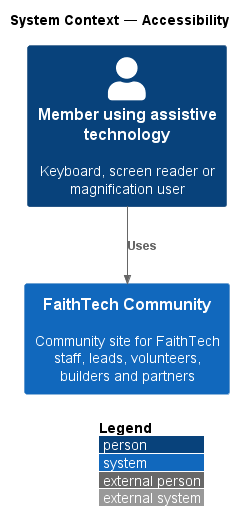
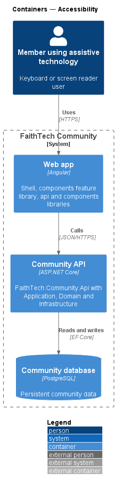
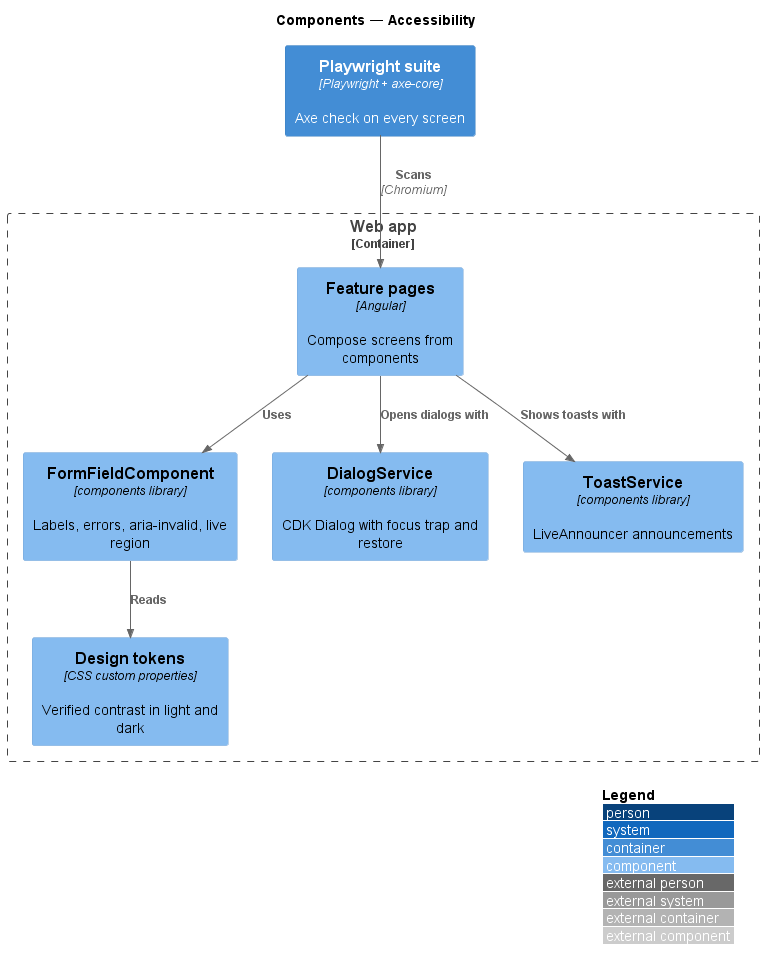
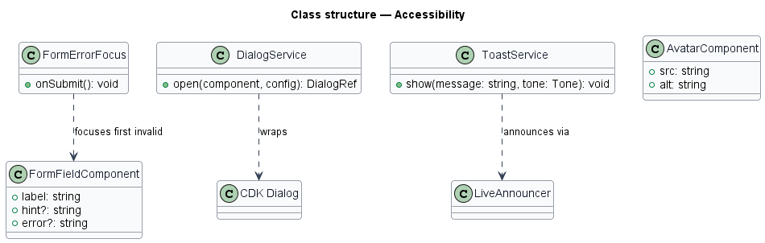
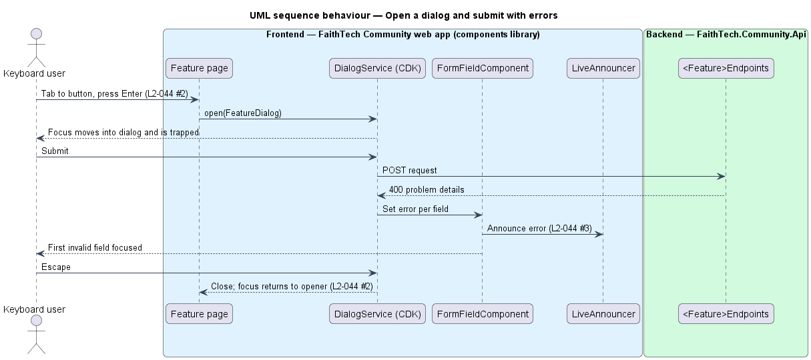

# Accessibility

## Overview

Every FaithTech Community screen shall meet WCAG 2.2 AA. Accessibility comes from one place: the `components` library, which every feature composes its screens from. This design describes how that library, the shell and the end-to-end suite together satisfy `L2-044`.

- **live region** — element with `aria-live` whose content changes are announced by screen readers
- **focus trap** — dialog behaviour that keeps keyboard focus inside the dialog until it closes, then returns it to the opener
- **axe check** — automated WCAG rule scan run against a rendered screen

Design tokens carry contrast: colour tokens are chosen and verified for 4.5:1 text and 3:1 UI contrast in light and dark themes (`docs/design-system/`).

## Description

- **`components` library** — buttons, form fields, dialogs, toasts, avatars and the remaining design-system components. Each exposes labelled controls, visible `:focus-visible` outlines from the focus token, and keyboard handling.
- **`FormFieldComponent`** — associates label, hint and error via `aria-describedby`, sets `aria-invalid`, conveys `required` as `aria-required="true"` on the control (`ft-text-field`, `ft-textarea`, `ft-select`; `ft-radio-group` takes `required` on its `radiogroup`) so a screen reader hears it before submitting, while validation stays with the page, and renders errors inside a polite live region that is present before any error, so an error is read when it appears even if focus stays on the submit button (Send invite, Add role, Suspend, Send a new link). Inside a form with `ftFormErrorFocus`, which moves focus to the error summary or first invalid field, the field leaves announcing to that focus so nothing is read twice. `RadioGroupComponent` puts its group error in the same polite region.
- **`FormErrorFocus`** — directive in `components` that moves focus to the first invalid field on submit.
- **`DialogService`** — wrapper over Angular CDK `Dialog` in `components`. CDK `FocusTrap` holds focus; `restoreFocus` returns it to the opening control. A dialog picks its first focus by setting `initialFocus` on an `ft-button`, `ft-text-field`, `ft-textarea` or `ft-radio`, which renders CDK `cdkFocusInitial` on the native control: form dialogs set it on their first field (Email in Send invite, the first role in Add role), destructive dialogs on the reason field or on Cancel.
- **`ToastService`** / **`ToastComponent`** — announce through CDK `LiveAnnouncer`. A toast never takes focus. `ToastService.show` remembers the element that had focus; when the toast that holds keyboard focus closes (Dismiss, Escape, its action, or code), `ToastRegionComponent` returns focus to that element, or to `main` when it is gone or disabled, unless the action already moved focus elsewhere.
- **Loading states** — a loading container (`ListSkeletonComponent`, the loading `ProfileHeaderComponent`, the Edit profile skeleton) is `role="status"` with `aria-busy="true"` and an `aria-label` saying what is loading: a name on a role-less `div` is prohibited (axe `aria-prohibited-attr`), and the status announces the wait politely. The e2e suite runs axe while each loading state is held.
- **`AvatarComponent`** / **`PhotoComponent`** — require an `alt` input; profile photos pass the uploader's alt text.
- **Design tokens** — role-named CSS custom properties such as `--color-text-primary`; components read tokens by role, never hex values.
- **`AxePage` fixture** — Playwright fixture in `e2e/fixtures/` that runs `@axe-core/playwright` with WCAG 2.2 A and AA tags on every page object's screen and fails on any violation.

## Requirements

The feature realizes the following level-2 (L2) requirements. Each L2 requirement refines a level-1 (L1) requirement, cited by identifier.

| L2 ID | Refines (L1) | Requirement |
|-------|--------------|-------------|
| `L2-044` | `L1-016` | Accessibility |

### Acceptance criteria

**`L2-044` — Accessibility**

1. Given any screen, when axe runs in the end-to-end suite, then it reports no WCAG 2.2 A or AA violations.
2. Given keyboard-only use, when the user tabs through any screen, then every control is reachable, the focus is visible, and dialogs trap focus and return it to the control that opened them.
3. Given any form error or toast, when it appears, then it is announced through a live region.
4. Given any text or control, when it is checked, then text contrast is at least 4.5:1 and contrast for UI components is at least 3:1, in light and dark themes.
5. Given an image, when it is rendered, then it has alt text. Profile photos use the alt text the uploader supplied.
6. Given a destructive dialog (delete, suspend, remove, cancel), when it opens, then focus starts on its DELETE or reason field, or on Cancel when it has no field, never on the destructive button.

## Diagrams

### System context

Members who use assistive technology use FaithTech Community through the same screens as every other member.

### Containers

Accessibility lives in the web app; the `components` library supplies every accessible control.

### Components

Feature pages compose screens from `components`, which read verified tokens. The Playwright suite runs axe against every screen.

### Class structure

`DialogService` wraps CDK Dialog, `ToastService` uses `LiveAnnouncer`, and `FormErrorFocus` moves focus to the first invalid `FormFieldComponent`.

### Behaviour — open a dialog and submit with errors

A keyboard user opens a dialog, which traps focus; a failed submit focuses the first invalid field and announces the error; closing returns focus to the opener (`L2-044`).

