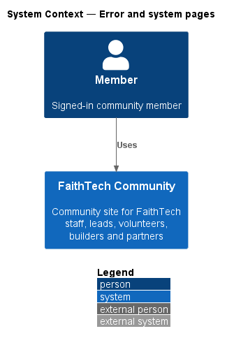
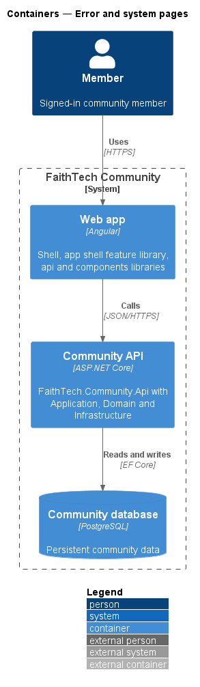
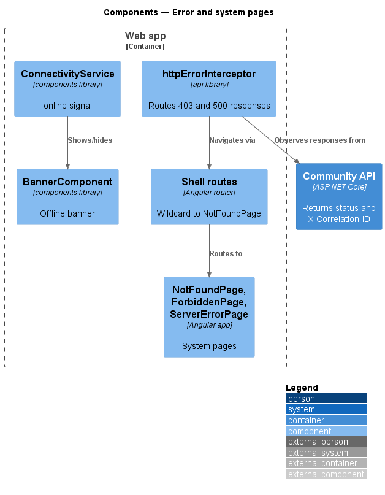
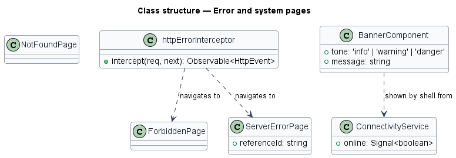
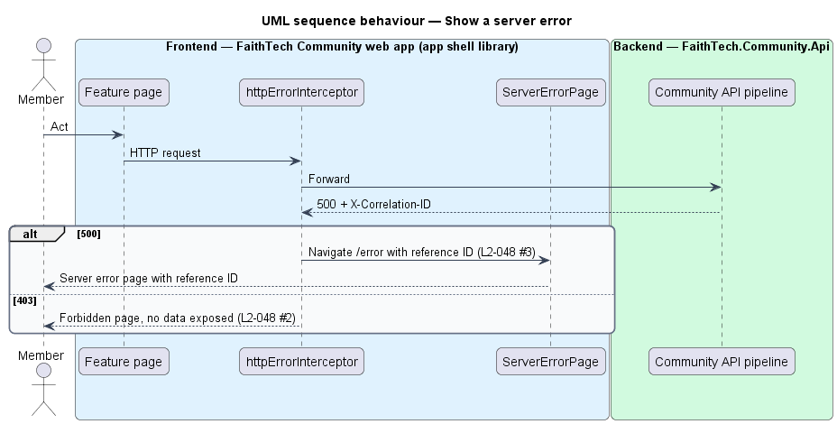
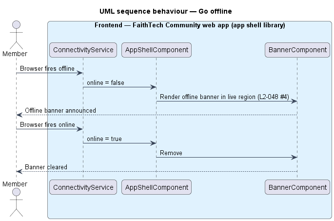

# Error and system pages

## Overview

FaithTech Community shows a clear, recoverable page when a route is unknown, an action is forbidden, the server fails or the browser goes offline. These pages live in the app shell so every feature library reaches them the same way. The mocks are `pages/not-found`, `pages/forbidden`, `pages/server-error`, `pages/offline` and `notifications/banner`.

- **reference ID** — correlation ID shown on the server error page so a member can quote it and an operator can find the matching log entry (`L2-047`)
- **offline banner** — persistent banner shown while the browser reports no network connection

## Description

- **`NotFoundPage`**, **`ForbiddenPage`**, **`ServerErrorPage`** — standalone pages in the `faithtech-community` app, composed from `components`. `NotFoundPage` links home and to search; `ForbiddenPage` explains missing access without naming the resource; `ServerErrorPage` shows the reference ID.
- **Wildcard route** — `{ path: '**', component: NotFoundPage }` registered last in the shell routes.
- **`httpErrorInterceptor`** — functional HTTP interceptor in the `api` library. On 403 it navigates to `/forbidden`; on 500 it navigates to `/error` with the `X-Correlation-ID` response header as state. A 404 from the API leaves handling to the page, which shows its not-found state.
- **`ConnectivityService`** — `components` service exposing an `online` signal from `navigator.onLine` and the `online`/`offline` window events.
- **`BannerComponent`** — `components` banner that the shell renders while `online` is false, inside a live region.

## Requirements

The feature realizes the following level-2 (L2) requirements. Each L2 requirement refines a level-1 (L1) requirement, cited by identifier.

| L2 ID | Refines (L1) | Requirement |
|-------|--------------|-------------|
| `L2-048` | `L1-018` | Error and system pages |

### Acceptance criteria

**`L2-048` — Error and system pages**

1. Given an unknown route, when it is opened, then a 404 page offers a link home and search.
2. Given a forbidden action, when the user reaches it, then a 403 page explains that they lack access, without exposing data.
3. Given an unhandled server error, when it occurs, then a 500 page shows a reference ID that matches the logged correlation ID.
4. Given the browser goes offline, when the user acts, then an offline banner appears, and it clears when the connection returns.

## Diagrams

### System context

A member uses FaithTech Community and sees a recoverable page when something fails.

### Containers

System pages live in the web app; the Community API supplies the status code and correlation ID.

### Components

The shell wildcard route serves `NotFoundPage`. `httpErrorInterceptor` routes 403 and 500 responses to their pages, and `ConnectivityService` drives the offline banner.

### Class structure

`httpErrorInterceptor` navigates to `ForbiddenPage` or `ServerErrorPage`; `ServerErrorPage` holds the reference ID.

### Behaviour — show a server error

A 500 response carries the correlation ID, which the server error page shows as its reference ID (`L2-048`).

### Behaviour — go offline

The offline banner appears when the browser loses its connection and clears when it returns (`L2-048`).

