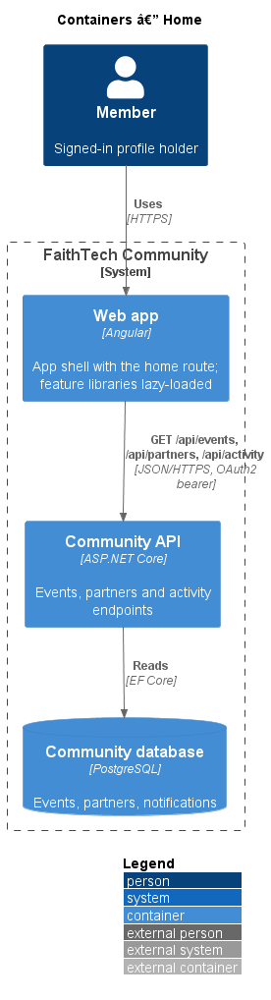
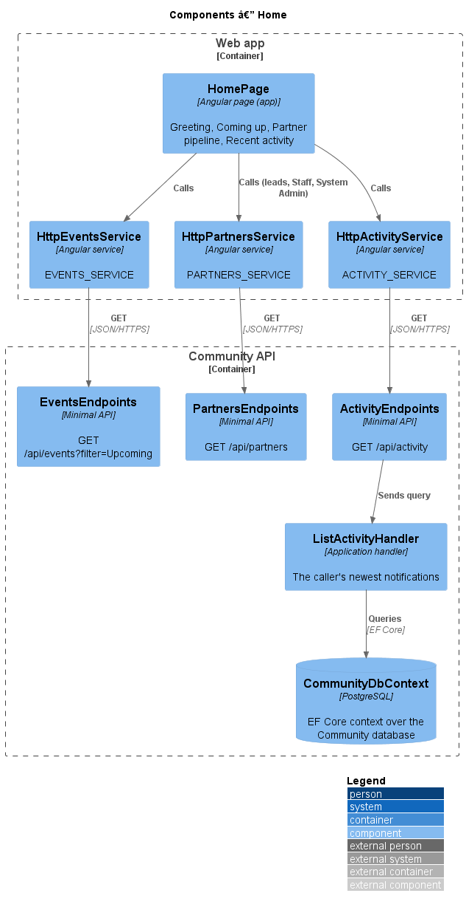
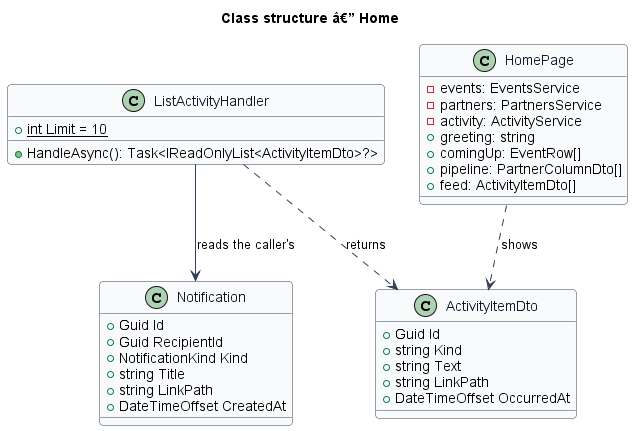
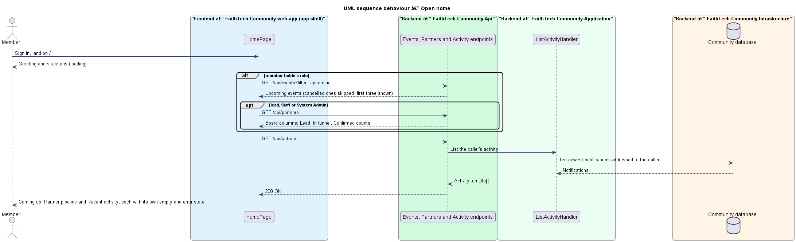

# Home

## Overview

**Home** is the page every signed-in member lands on at `/`. It summarizes what is coming up and what has happened, tailored to the member's roles (`L1-019`). It composes data that other features own: upcoming events, the partner pipeline, and the member's recent activity. It owns no data of its own.

The page follows the `docs/mocks/pages/home` mock in its states: `default` (a lead), `staff`, `empty` (a member with no role), `loading`, `error`, `pipeline-zero`, `pipeline-error` and `activity-error`.

## Description

- **`HomePage`** — the component of the shell's default child route, in the app project at `frontend/projects/faithtech-community/src/app/pages/home`. Home is not one feature's page: it reads from events, partners and notifications, and feature libraries must not depend on each other. So it stays a top-level route in the app, composed only of `components` and `api` services ([ADR 0016](../../../adr/0016-home-page-lives-in-the-app-shell.md)).
- **Greeting** — a `PageHeaderComponent` whose title is "Good morning", "Good afternoon" or "Good evening" (before 12:00, before 18:00, after) and the member's first name. Its subtitle is today's date and the count of upcoming events, for example "Tuesday 21 October · 3 events coming up", "1 event coming up" or "No events coming up". A skeleton stands in for the subtitle while events load. A member with no role sees "Welcome, {first name}" and "You’re part of the FaithTech community. Here’s how to get started."
- **Quick actions** — in the header's actions slot. *New event* (`/events/new`) for Event Leads, City Leads and System Admins (`canManageEvents`). *Add contact* (`/contacts/new`) for leads and System Admins (`isLead`). Staff, volunteers and attendees see neither.
- **Staff banner** — an info `AlertComponent`, "You’re viewing as Staff", for a member holding Staff and no lead role (`L2-049` AC4).
- **Coming up** — a flush `CardComponent` headed "Coming up" with a `ListComponent` of `EventCardComponent`s: the first three events from `EVENTS_SERVICE.listEvents({ filter: 'Upcoming' })` that are not cancelled, soonest first. Each title links to `/events/{id}`. The meta line reads "Thu 6 Nov · 6:30 pm · Kestrel Labs, 220 King St W · 34 going", as on the events list. A `CardFooterComponent` holds the *All events* link. With no upcoming events the card reads "Nothing coming up yet." While loading, a `ListSkeletonComponent` with date-badge rows stands in.
- **Page error** — when the events request fails, the whole page body is an error `EmptyStateComponent`, "We couldn’t load your home page", with *Try again*, which reloads every card (mock `error`).
- **Partner pipeline** — a `CardComponent` headed "Partner pipeline" with an *Open board* link to `/partners`, for leads, Staff and System Admins, the roles that may open partners (ADR 0009). Three `StatComponent`s in a `ClusterComponent` show the counts of the Lead, In funnel and Confirmed columns from `PARTNERS_SERVICE.getBoard()`. While loading the stats show skeleton values under their labels. When every count is 0 the card adds "No partners yet. Add the first one from the board." When the request fails the card holds a danger `AlertComponent`, "We couldn’t load the partner pipeline", "The rest of the page is up to date.", with *Try again*, which reloads only the pipeline.
- **Recent activity** — a `CardComponent` headed "Recent activity" in the split's aside, holding a `FeedComponent` of `FeedItemComponent`s from `ACTIVITY_SERVICE.recent()`. Each item's text links to the item it is about; its meta line is the time, "Today, 11:42 am", "Yesterday, 4:10 pm" or "Mon 20 Oct" (`formatFeedTime` in `components`). The feed's own states cover loading (skeleton rows), empty ("No activity yet. New sign-ups, events and announcements show up here.") and error ("We couldn’t load recent activity" with *Try again*, which reloads only the feed).
- **Onboarding** — a member with no role sees, instead of Coming up and the pipeline, a `GridComponent` `auto` of three cards: "Finish your profile" (*Edit profile*, `/people/me/edit`), "Find an event" (*Browse events*, `/events`) and "Want to get involved?" (*Meet the team*, `/team`), then the Recent activity card (mock `empty`).
- **`ActivityService`** / **`ACTIVITY_SERVICE`** / **`HttpActivityService`** — API client in `api` calling `GET /api/activity`.
- **`ActivityEndpoints`** — minimal API mapping `GET /api/activity`. It requires a signed-in caller (`401` anonymous) and only dispatches.
- **`ListActivityHandler`** in Application `Notifications/`. It returns the ten newest notifications addressed to the caller, newest first, as `ActivityItemDto` (`Id`, `Kind`, `Text`, `LinkPath`, `OccurredAt`). A caller without a profile gets `403`.

### Permissions

The feed holds only notifications addressed to the caller, so it can never show another member's data. A private contact's sign-up reaches only the lead who owns the contact (`L2-012`, `L2-015`), and nothing in the feed reaches Staff or anyone else. The pipeline counts come from `GET /api/partners`, which already refuses every role but leads, Staff and System Admin; the page does not even ask for other roles. Events come from the events list, which every member may read.

## Requirements

| L2 ID | Refines (L1) | Requirement |
|-------|--------------|-------------|
| `L2-049` | `L1-019` | Home page |
| `L2-045` | `L1-016` | Responsive layout and theming |

### Acceptance criteria

**`L2-049` — Home page**

1. Given a signed-in member, when they open home, then they see a greeting with today's date, a "Coming up" list of their next events, and a recent-activity feed of things they are permitted to see.
2. Given a lead, when home is shown, then the quick actions "New event" and "Add contact" and a partner pipeline summary (stage counts and "Open board") are shown.
3. Given a member with no role, when home is shown, then an onboarding state offers "Finish your profile", "Find an event" and "Meet the team".
4. Given Staff, when home is shown, then a "You're viewing as Staff" banner is shown and no write actions appear.
5. Given the recent-activity feed is loading, has nothing to show or fails to load, when home is shown, then the "Recent activity" card stays in place with skeleton rows, the line "No activity yet. New sign-ups, events and announcements show up here." or a "We couldn't load recent activity" alert with a Try again button, and the rest of home is unaffected.
6. Given a lead, when the partner pipeline summary is loading, has no partners or fails to load, then the "Partner pipeline" card stays in place with its stage labels over skeleton values, the counts 0, 0 and 0 with "No partners yet. Add the first one from the board.", or a "We couldn't load the partner pipeline" alert with a Try again button, and the rest of home is unaffected.
7. Given a signed-in member, when the recent-activity feed loads, then it lists at most the ten newest notifications addressed to that member, newest first, each linking to its item, and never anything addressed to another member.
8. Given the upcoming events fail to load, when home is shown, then "We couldn't load your home page" is shown with a Try again button that loads home again.

## Diagrams

### System context

Any signed-in member opens home. Anonymous visitors are sent to sign in (`L2-005`).

### Containers

The app shell's home route calls the Community API for events, partners and activity.

### Components

`HomePage` composes three API services. Only the activity endpoint is new.

### Class structure

`ListActivityHandler` reads the caller's `Notification` rows and returns `ActivityItemDto` items.

### Behaviour — open home

Each card loads on its own, so one failure leaves the rest of home in place (`L2-049` AC5, AC6).

## Open questions

- Where Home lives: the app project, as a top-level route composed of `components` and `api`. Resolved in [ADR 0016](../../../adr/0016-home-page-lives-in-the-app-shell.md).
- What feeds Recent activity: the caller's own notifications, because they are addressed to one member and so can never leak private data. Resolved for v1.
- Community-wide activity is a gap. The mock also shows items such as "Marcus Lee published Toronto Builders Night" and "Hannah Kim sent “November hackathon: teams are forming”" to members those items were not addressed to. Events record no publish time, announcements and the notification actor are being built in draft PR #335, and sign-ups record no time. Until those land, the feed shows only the caller's notifications. Each item's avatar is "FaithTech Community" until notifications carry their actor (PR #335), when the avatar shows the person who acted.
- "Their next events" is read as the next upcoming events across every city, not only those the member RSVP'd to, because events are global and the mock's Coming up shows events with their RSVP counts. Cancelled events are left out of Coming up. Resolved.
- The mock has no state for a member with a role and no upcoming events. The Coming up card then reads "Nothing coming up yet." Resolved.
- The onboarding card links to "Meet the team"; the mock's "Meet the Toronto team" needs the member's home city, which the signed-in user does not carry. Resolved: "Meet the team".
