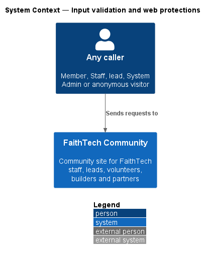
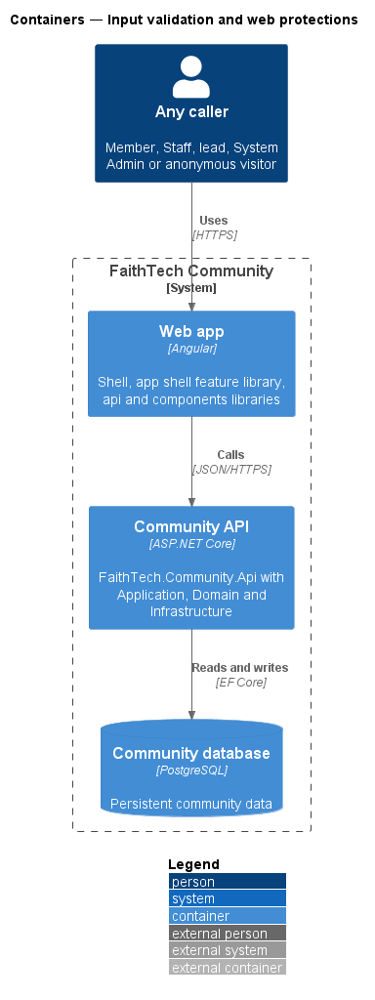
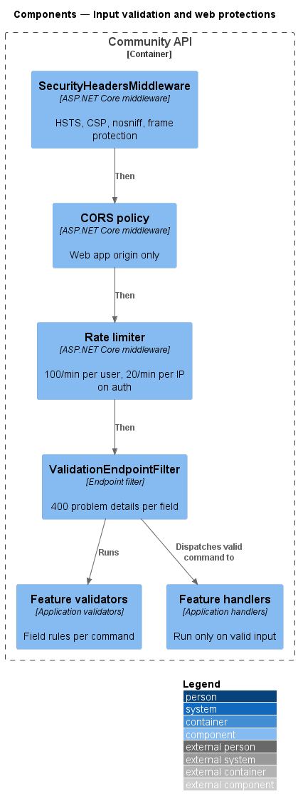
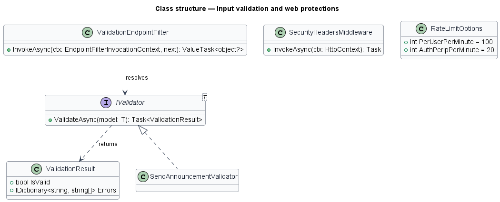
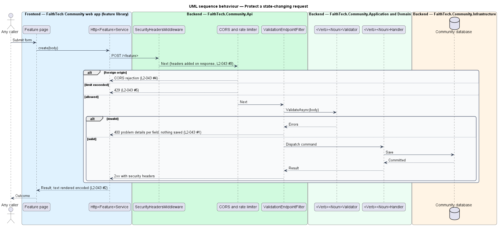

# Input validation and web protections

## Overview

FaithTech Community accepts input from members and anonymous visitors, so every request passes the same set of protections before any business rule runs. This design describes the shared validation pipeline and the HTTP protections configured once in `FaithTech.Community.Api`.

- **validation problem details** — RFC 9457 response body with an `errors` map from field name to messages
- **security headers** — HSTS, Content-Security-Policy, `X-Content-Type-Options` and frame protection added to every response
- **rate limit** — cap on requests per window, partitioned by user or by IP address

Output encoding is the frontend's responsibility: Angular templates encode interpolated text, and no page binds untrusted HTML.

## Description

- **`ValidationEndpointFilter`** — endpoint filter in the Api project that resolves the `IValidator<T>` for the request body, runs it before the handler, and returns `Results.ValidationProblem` (400) on failure, so nothing is saved.
- **Feature validators** — `<Verb><Noun>Validator` classes in each Application feature folder. The validation library is `<TO SUPPLY>`.
- **`SecurityHeadersMiddleware`** — adds `Strict-Transport-Security`, a `Content-Security-Policy` with no `unsafe-inline` in `script-src`, `X-Content-Type-Options: nosniff` and `frame-ancestors 'none'` with `X-Frame-Options: DENY`.
- **CORS policy** — `AddCors` with a single named policy allowing only the configured web app origin; state-changing cross-origin requests from other origins fail the preflight.
- **Rate limiter** — `AddRateLimiter` with a per-user fixed window of 100 requests per minute and an `auth` policy of 20 requests per minute per IP address applied to the sign-in, sign-up, reset and verification endpoints. Rejections return 429.
- **Secret handling** — secrets come from configuration and environment variables. Credentials (passwords, reset, verification and invite tokens) travel only in request bodies, which are never logged, so none of them is ever part of a URL. The invite lookup is `POST /api/invites/lookup` with `{ token }`. The request log records method, path, status, elapsed time and correlation ID, and never headers, cookies or bodies. `LogRedaction` replaces any credential segment that a stale client still puts in a path (`/by-token/{token}`) with `[redacted]`, both in the request log and in the `RequestPath`/`Path` scope properties. ASP.NET Core's own per-request events, which carry raw paths, are logged only at Warning and above.
- **Angular output encoding** — templates use interpolation and property binding only; `bypassSecurityTrust*` is not used.

## Requirements

The feature realizes the following level-2 (L2) requirements. Each L2 requirement refines a level-1 (L1) requirement, cited by identifier.

| L2 ID | Refines (L1) | Requirement |
|-------|--------------|-------------|
| `L2-043` | `L1-015` | Input validation and web protections |

### Acceptance criteria

**`L2-043` — Input validation and web protections**

1. Given any request body, when it fails validation, then the response is 400 with problem details per field, and nothing is saved.
2. Given user-entered text, when it is rendered, then it is encoded, and script injection does not execute.
3. Given any response, when it is sent, then it carries HSTS, a Content-Security-Policy without unsafe-inline scripts, X-Content-Type-Options and frame protection.
4. Given a state-changing request from another origin, when it arrives, then CORS rejects it.
5. Given more than 100 requests per minute from one user, or 20 per minute from one IP address to the auth endpoints, when another arrives, then the response is 429.
6. Given the repository and logs, when they are inspected, then no secrets, passwords or tokens appear in them.

## Diagrams

### System context

Every caller sends requests to FaithTech Community through the same protections.

### Containers

The web app renders encoded output; the Community API applies headers, CORS, rate limits and validation.

### Components

The middleware runs in the order shown, then `ValidationEndpointFilter` runs the feature validator before any handler executes.

### Class structure

`ValidationEndpointFilter` resolves an `IValidator<T>` for the request body; each feature supplies its own validator.

### Behaviour — protect a state-changing request

Requests from another origin fail CORS; excess requests receive 429; invalid bodies receive 400 per field; every response carries the security headers (`L2-043`).

