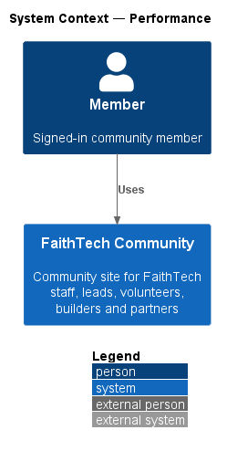
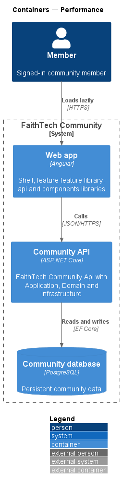
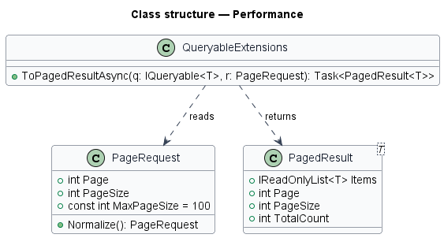
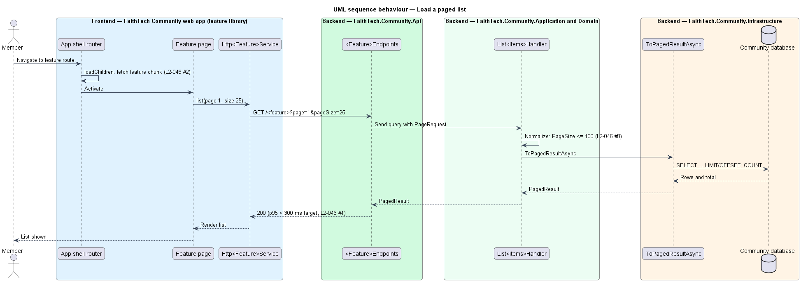

# Performance

## Overview

This design describes the shared measures that keep FaithTech Community responsive: bounded, paged queries on the server and a small, lazy-loaded bundle on the client.

- **p95 latency** — response time under which 95 percent of requests complete
- **page** — bounded slice of a list result, described by page number and page size
- **lazy loading** — loading a feature library only when its route is first visited
- **LCP** — Largest Contentful Paint, the time until the largest visible element renders

## Description

- **`PageRequest`** / **`PagedResult<T>`** — Application types shared by every list query. `PageRequest` clamps `PageSize` to a maximum of 100.
- **`ToPagedResultAsync`** — Infrastructure `IQueryable` extension that applies `Skip`/`Take` and a count in the database.
- **Keyset pages** — lists that grow at the top while someone reads them, or that people page through with filters, use a keyset continuation instead of a page number. A page returns `{ items, next, totalCount }`, where `next` encodes the sort key of the last row. The invites list (newest first, then id) and the team list (lower-cased name, then id, ADR 0015) work this way. They clamp the page size to the same maximum of 100, default to 50, and answer `400` for a continuation they did not give out.
- **Read queries** — use `AsNoTracking()` and projections to DTOs, so only needed columns load.
- **Indexes** — EF Core migrations add indexes for foreign keys, sort keys and the Postgres full-text `tsvector` columns used by search.
- **Shell routes** — the app shell lazy-loads each feature library with `loadChildren`, keeping the initial bundle small.
- **Angular budgets** — `angular.json` sets an initial bundle budget; the gzipped initial JavaScript limit is 300 KB.
- **Load test** — `eng/load-test.js` is a k6 scenario of 200 concurrent members, each with their own identity and token, run only against an isolated performance environment (its own database and API, with email going nowhere). See *Load test* below.

## Requirements

The feature realizes the following level-2 (L2) requirements. Each L2 requirement refines a level-1 (L1) requirement, cited by identifier.

| L2 ID | Refines (L1) | Requirement |
|-------|--------------|-------------|
| `L2-046` | `L1-017` | Performance |

### Acceptance criteria

**`L2-046` — Performance**

1. Given 200 concurrent users, when read endpoints are called, then the p95 latency is under 300 ms, and under 600 ms for writes.
2. Given a cold load over a 4G connection, when the app opens, then Largest Contentful Paint is under 2.5 seconds, and the initial JavaScript is under 300 KB gzipped, with feature libraries lazy-loaded.
3. Given a list endpoint, when it is called, then the results are paged, with a maximum page size of 100.

## Diagrams

### System context

A member uses FaithTech Community, which answers within the latency targets of `L2-046`.

### Containers

The web app loads feature libraries lazily, and the Community API returns paged results from indexed tables.

### Components

List endpoints bind a `PageRequest`, and handlers page in SQL through `ToPagedResultAsync`.

### Class structure

`PageRequest` clamps the page size to 100; `ToPagedResultAsync` returns a `PagedResult<T>`.

### Behaviour — load a paged list

The first visit to a feature route loads its library lazily; the list request returns at most 100 items (`L2-046`).

## Load test

`eng/load-test.js` checks `L2-046` AC1 with real persistence and 200 distinct identities. It is never run against production, a shared environment or the e2e fake. Normal backend tests stay on the EF in-memory provider.

1. **Members.** `LOADTEST_PASSWORD=<12+ characters> dotnet run --project backend/src/FaithTech.Community.Cli -- seed-load-users 200` creates verified members `load-001@loadtest.invalid` onwards. `.invalid` is a reserved top-level domain, so no mail can reach a person. The members have no role. The password comes only from the environment, the count is 1 to 1000, and the command is safe to re-run.
2. **API settings.** The isolated environment sets `RateLimits__AuthPerMinute=1000` and `RateLimits__PerMinute=1000`, because setup signs 200 members in from one load-generator address. Nothing else sets them. Without them the production defaults stay at 20 auth requests and 100 requests a minute, and `WebProtectionTests` proves both.
3. **Run.** `k6 run -e BASE_URL=https://<api> -e WEB_ORIGIN=https://<web app> -e LOADTEST_PASSWORD=<password> -e SUMMARY_PATH=load-test-summary.json eng/load-test.js`.
   - Setup signs each member in through the real sign-in, code + PKCE and token flow.
   - Each of the 200 virtual users then works as its own member for 5 minutes, at about 60 requests a minute, which is inside the default per-member limit.
   - The reads are `/api/me`, `/api/profiles/me` and `/api/team?pageSize=50`. The write is an authorized `PUT /api/profiles/{own id}` that changes the bio and home city. Every tenth iteration reads the profile back to check that the write was stored.
4. **Pass criteria.** Read p95 is under 300 ms and write p95 under 600 ms. No request in the measured scenario answers anything but 2xx, a 429 included, and every check passes. Any other result fails the run.
5. **Evidence.** The run writes the full k6 summary to `SUMMARY_PATH` and prints the read and write p95. Keep that file with the release as the record. A run against an unknown email, a mocked API or a no-op write is not evidence.

