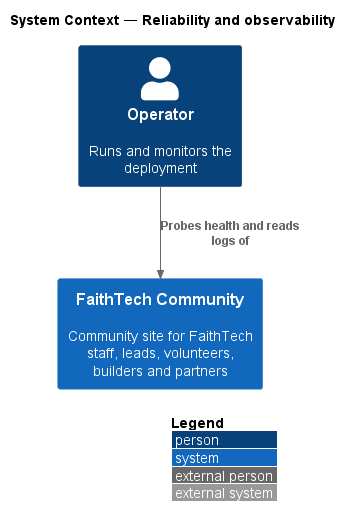
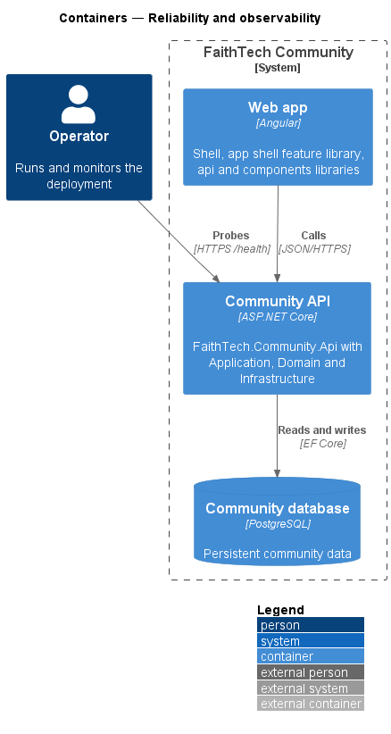
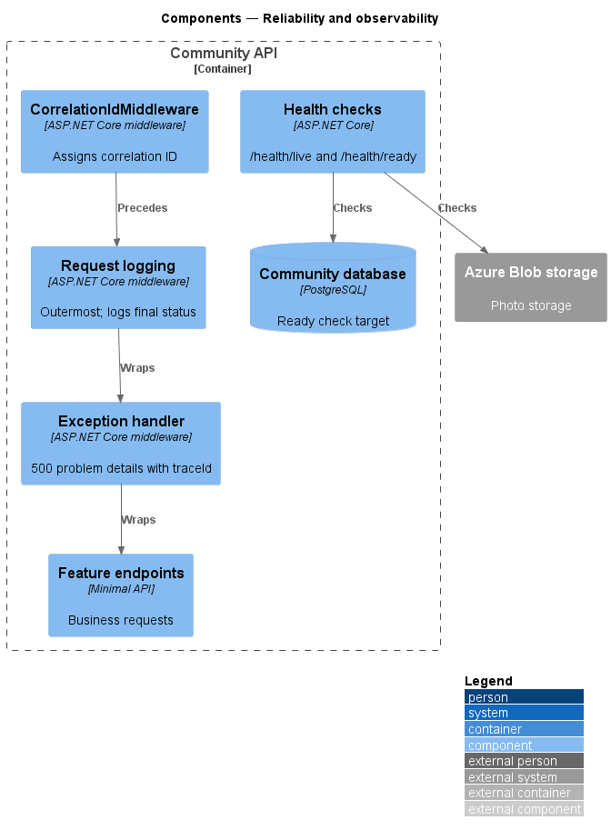
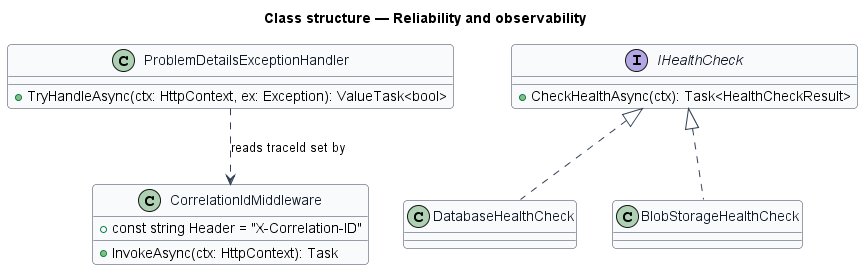
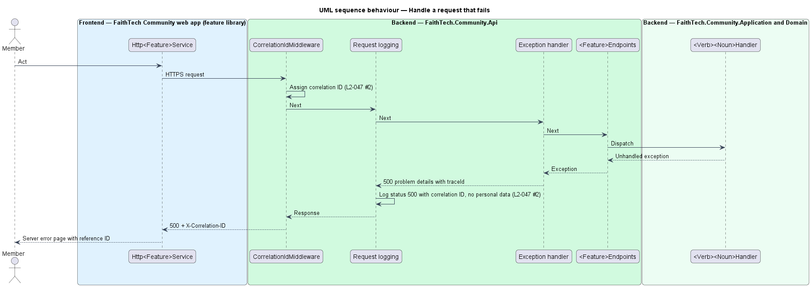
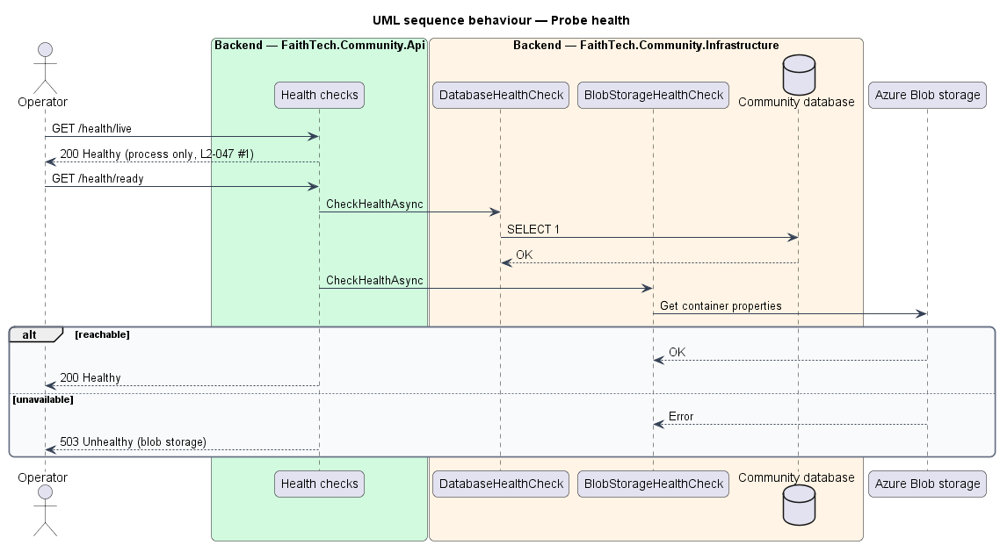

# Reliability and observability

## Overview

This design describes how FaithTech Community stays available when a dependency fails and how operators see what happens in production.

- **liveness probe** — `/health/live`, reporting whether the API process runs
- **readiness probe** — `/health/ready`, reporting whether the database and blob storage are reachable
- **correlation ID** — identifier assigned to each request and attached to every log entry, response and error page for that request
- **side effect** — work that follows a core action, such as sending email or resizing a photo, and that may be retried separately

The middleware order is fixed: request logging sits outside the exception-handling middleware, so the logged status is the status the client receives.

## Description

- **`CorrelationIdMiddleware`** — reads `X-Correlation-ID` or generates one, stores it in `HttpContext.TraceIdentifier` and the log scope, and echoes it in the response header.
- **Request logging** — `UseSerilogRequestLogging` registered before `UseExceptionHandler`, so it observes the final status. It writes through this host's Serilog logger and logs `RequestMethod`, the redacted `RequestPath`, `StatusCode`, `Elapsed` and the `CorrelationId` from the log context (see `LogRedaction` in the input-validation design).
- **`UseExceptionHandler`** with **`ProblemDetailsExceptionHandler`** — converts unhandled exceptions to a 500 problem details body that includes the correlation ID as `traceId`.
- **Log redaction** — structured log enrichers exclude personal data such as names, emails and request bodies.
- **Health checks** — `AddHealthChecks()` with a `live` check (no dependencies) and `ready` checks for PostgreSQL and Azure Blob storage, mapped to `/health/live` and `/health/ready` as anonymous endpoints.
- **Outbox-based side effects** — email (see email notifications design) and photo blob writes and deletes are queued and retried, so the core action commits even when the email provider or blob storage is down. Photos are resized and validated in the request, which needs no external service. If the blob write fails, the photo commits as storing and a `PhotoBlobTask` carries the processed image until `PhotoStorageRetryWorker` stores it (ADR 0013, manage-profile-photos design).
- **Migrations** — the API does not call `Database.Migrate()`. `FaithTech.Community.Cli` runs `migrate`.

## Requirements

The feature realizes the following level-2 (L2) requirements. Each L2 requirement refines a level-1 (L1) requirement, cited by identifier.

| L2 ID | Refines (L1) | Requirement |
|-------|--------------|-------------|
| `L2-047` | `L1-017` | Reliability and observability |

### Acceptance criteria

**`L2-047` — Reliability and observability**

1. Given the API, when health probes call /health/live and /health/ready, then they report the status of the process and of its dependencies (database, blob storage).
2. Given any request, when it is logged, then it carries a correlation ID, and structured logs exclude personal data.
3. Given the email or blob service is unavailable, when a dependent action runs, then the core action still succeeds, and the side effect is retried.
4. Given startup, when the API starts, then it does not apply database migrations; the Cli project applies them.

## Diagrams

### System context

An operator probes FaithTech Community health and reads its logs.

### Containers

The operator probes the Community API health endpoints directly.

### Components

`CorrelationIdMiddleware` runs first; request logging wraps the exception handler, which wraps the endpoints. Health checks probe the database and blob storage.

### Class structure

`DatabaseHealthCheck` and `BlobStorageHealthCheck` realize `IHealthCheck`. `ProblemDetailsExceptionHandler` includes the correlation ID in error responses.

### Behaviour — handle a request that fails

An unhandled exception becomes a 500 with the correlation ID; the outer request logger records the 500 with the same ID (`L2-047`).

### Behaviour — probe health

The liveness probe reports the process; the readiness probe reports the database and blob storage (`L2-047`).

