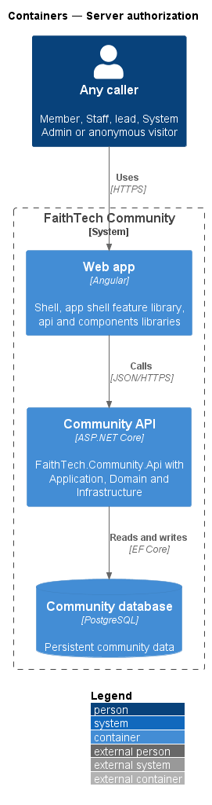
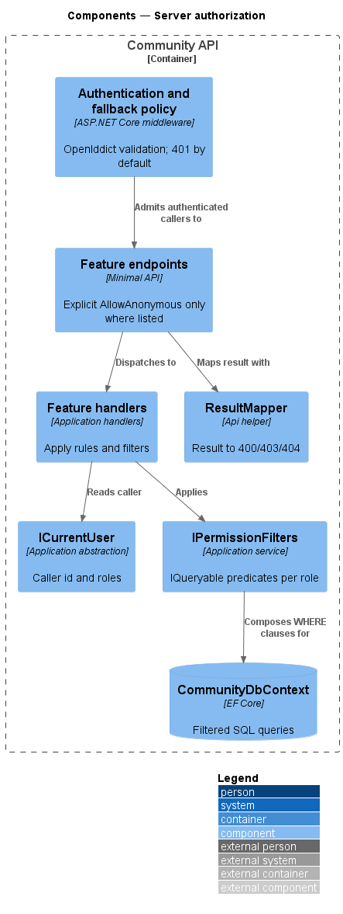
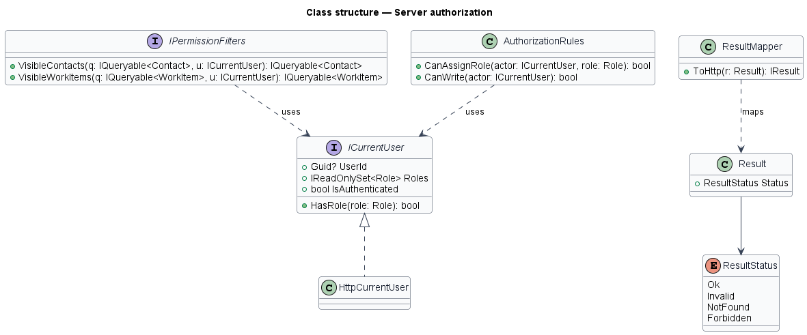

# Server authorization

## Overview

FaithTech Community enforces every permission on the server. The UI may hide controls, but no data reaches a caller that the server has not authorized. This design describes the shared authorization mechanism that every feature endpoint and handler uses.

- **fallback policy** — ASP.NET Core authorization policy applied to every endpoint that does not opt out, requiring an authenticated caller
- **anonymous endpoint** — endpoint explicitly marked with `AllowAnonymous`; `L2-042` lists the permitted set
- **permission filter** — predicate added to an EF Core query so that the database returns only rows the caller may see
- **existence hiding** — answering 404 rather than 403 for a resource the caller may not see

The domain rules in `AGENTS.md` define what each role may see: private contacts and their notes belong to the lead who created them and to System Admin, Staff is read-only, and profiles are visible to signed-in members only.

## Description

- **Fallback authorization policy** — configured in `Program.cs` with `RequireAuthenticatedUser()`, so every endpoint answers 401 to an unauthenticated call by default.
- **`AllowAnonymous` endpoints** — public events, guest RSVP, sign-up, sign-in, password reset, verification, invite acceptance and announcement unsubscribe. No other endpoint carries the marker.
- **Private preview wall** — while `PrivatePreview:Enabled` is on, `PrivatePreviewGateMiddleware` refuses every request without a valid unlock before routing and authentication run, so even the `AllowAnonymous` endpoints above (public events, guest RSVP, sign-up, sign-in) are reachable only past the wall. The wall adds a gate in front; it changes none of the rules in this design, which apply unchanged once the visitor has unlocked (`L2-101` AC4, `docs/detailed-designs/platform/private-preview-wall`, ADR 0026).
- **`ICurrentUser`** — Application abstraction exposing `UserId`, `Roles`, `IsAuthenticated` and `HasRole(Role)`. `HttpCurrentUser` in the Api project takes `UserId` from the OpenIddict-validated principal's subject. It takes `Roles` from `CurrentRolesMiddleware`, which runs right after authentication and loads the caller's roles from their profile on every request.
- **Role freshness policy** — the server never authorizes with the role claims inside a token. Those claims are a snapshot from the moment the token was issued and survive refresh. Instead, every request reads the caller's current profile roles. A removed City Lead or System Admin role stops working on the very next call, even with an old access token or one obtained by refreshing it. An added role works at once. `/api/me` returns the current roles, and the web app reloads them whenever it restores the session. Role changes therefore need no token revocation, and role assignment limits, last-admin protection, notifications and auditing are unchanged (`L2-009`, `L2-042` AC4).
- **`IPermissionFilters`** — Application service with query extensions such as `VisibleContacts(ICurrentUser)` and `VisibleWorkItems(ICurrentUser)` that compose `IQueryable` predicates, so list, search and export filters run in SQL.
- **`AuthorizationRules`** — Application helpers for write checks such as `CanAssignRole(actor, role)` and `CanWrite(actor)` (false for Staff-only callers).
- **`NotFoundOrForbidden` convention** — handlers that load by ID through a permission filter return `Result.NotFound` when the filtered query finds nothing; endpoints map it to 404.
- **`ResultMapper`** — Api helper that maps `Result` states to HTTP: `NotFound` → 404, `Forbidden` → 403 (used only for actions on resources the caller may see), `Invalid` → 400.

## Requirements

The feature realizes the following level-2 (L2) requirements. Each L2 requirement refines a level-1 (L1) requirement, cited by identifier.

| L2 ID | Refines (L1) | Requirement |
|-------|--------------|-------------|
| `L2-042` | `L1-015` | Authorization on the server |

### Acceptance criteria

**`L2-042` — Authorization on the server**

1. Given any API endpoint, when it is called without authentication, then the response is 401, except for the endpoints explicitly marked anonymous: public events, guest RSVP, sign-up, sign-in, password reset, verification, invite acceptance and announcement unsubscribe.
2. Given a resource the caller is not permitted to see, when it is requested by ID, then the response is 404, not 403, so that its existence is not revealed.
3. Given a list, search or export, when it is built, then the permission filters are applied in the database query, not after loading the data.
4. Given a role added to or removed from a user, when that user next calls the API, including with an access or refresh token issued before the change, then the server authorizes with the profile's current roles, and `/api/me` reports them.

## Diagrams

### System context

Every caller, signed in or anonymous, reaches FaithTech Community data only through API checks.

### Containers

The web app hides controls by role, but the Community API decides; the Community database returns only rows the API query permits.

### Components

The fallback policy rejects unauthenticated calls before any endpoint runs. Handlers read `ICurrentUser` and apply `IPermissionFilters` inside the query, and `ResultMapper` turns results into status codes.

### Class structure

`HttpCurrentUser` realizes `ICurrentUser`. `IPermissionFilters` and `AuthorizationRules` depend on it, and `ResultMapper` maps `ResultStatus` to HTTP.

### Behaviour — authorize a request

An unauthenticated call stops at 401. An authenticated request by ID for an invisible resource returns 404, and list queries apply filters in SQL (`L2-042`).

