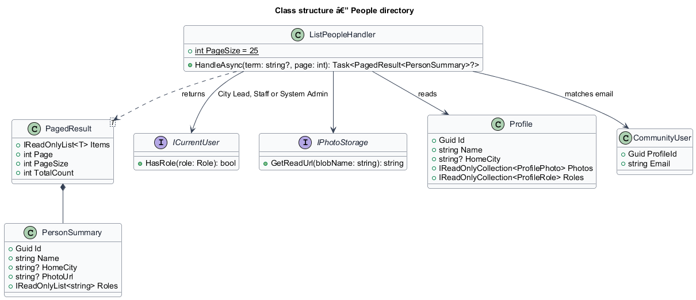

# People directory

## Overview

The **people directory** — the *People and roles* page at `/people`, where City Leads, Staff and System Admins find any member by name or email and see their photo, roles and home city. City Leads and System Admins also add and remove roles from a member's row, within the limits of `L2-009`; Staff see the same list read-only. Every other member gets a forbidden page, and anonymous visitors are sent to sign in.

**member** — any signed-in account with a profile, whatever roles it holds

The directory is not the System Admin users page (`docs/detailed-designs/admin/admin-users-and-override`): it never returns email addresses or account status, and it has its own endpoint, so a City Lead gains no access to administrative data.

## Description

- **`PeoplePage`** — page at `/people` in the `profiles` feature library, matching the `people` mocks (default, admin, read-only, loading, error, no-results, forbidden). It composes `PageHeaderComponent` ("People and roles" with a subtitle by role, and for City Leads and System Admins *Invite someone*, a link to `/invites` because `profiles` cannot depend on `invites`), a search form with `TextFieldComponent` (`type="search"`, "Search people", placeholder "Search members by name or email"), `TableComponent` (caption "Members and their roles": Member with `AvatarComponent` `sm` showing the featured photo and a `LinkComponent` to `/people/:id`, Roles as `BadgeComponent` `role` or "No role yet", City, and a visually hidden Actions column), `ListSkeletonComponent` (5 rows, "Loading people"), `EmptyStateComponent` for the error, no-results and forbidden states and *Show more people* when more pages exist.
- **Row actions** — *Add role* (`ButtonComponent`, `object` = the member's name) when the caller may grant a role the member does not hold, *Remove* (`ghost`) when the member holds a role the caller may remove, and the caption "Only System Admin can change" when the member holds a role the caller may not change (City Lead, Staff or System Admin for a City Lead). Both actions open the shared `RoleDialogComponent` (ADR 0005) through `DialogService` and call `ROLES_SERVICE`; the row's badges update from the returned role set without a reload (`L2-009` AC5). The role-dialog wiring is shared with `ProfilePage` inside the `profiles` library (`role-actions.ts`).
- **`PeopleService`** / **`PEOPLE_SERVICE`** / **`HttpPeopleService`** — contract, injection token and HTTP client in `api` calling `GET /api/people?q=&page=`. The client marks the call `HANDLES_FORBIDDEN` so the page shows its own forbidden state.
- **`PeopleEndpoints`** — minimal API mapping of `GET /api/people` in `FaithTech.Community.Api`; authentication is required (`401` anonymous) and it only dispatches. A `null` result from the handler answers `403`.
- **`ListPeopleHandler`** — Application handler in `Profiles/`. It returns `null` unless the caller holds City Lead, Staff or System Admin, then joins profiles to their accounts, matches the trimmed term case-insensitively against name or email, orders by name then id and returns 25 per page.
- **`PersonSummary`** — `Id` (profile id), `Name`, `HomeCity`, `PhotoUrl` (the featured photo's read URL or `null`) and `Roles` (every role held, enum names). Email is matched, never returned.

## Requirements

The feature realizes the following level-2 (L2) requirements. Each L2 requirement refines a level-1 (L1) requirement, cited by identifier.

| L2 ID | Refines (L1) | Requirement |
|-------|--------------|-------------|
| `L2-053` | `L1-003` | People directory and role management |
| `L2-009` | `L1-003` | Role assignment limits (actions on each row) |
| `L2-005` | `L1-002` | Profile visibility (sign-in required, avatar colour) |

### Acceptance criteria

**`L2-053` — People directory and role management**

1. Given a City Lead, Staff or System Admin, when they open people, then all members are listed with their roles and city, with search.
2. Given a City Lead or System Admin, when they view people, then the add-role and remove-role actions follow L2-009. Staff see the list read-only.
3. Given any other user, when they open people, then a forbidden page is shown.
4. Given a search with no matches, when it completes, then an empty state offers to send an invite.
5. Given a City Lead, Staff or System Admin, when they search people by name or email, then matching members are listed 25 at a time by name with their photo, roles and home city, and a member's email is never shown.
6. Given an anonymous visitor, when they request the people page or the people API, then they are redirected to sign in (page) or receive 401 (API); any other signed-in caller of the people API receives 403 and no member data.

**`L2-009`** AC1–AC6 apply unchanged to the row actions; the server's `RoleAssignmentPolicy` stays the authority.

## Diagrams

### Class structure

`ListPeopleHandler` checks the caller's roles, reads `Profile` with its account's email for matching and returns `PersonSummary` pages.

### Behaviour — browse people and change a role

The handler refuses anyone but a City Lead, Staff or System Admin. A row's role change goes through the existing roles endpoints and their policy, then updates the row in place.

## Open questions

Decisions recorded while implementing the feature:

- The directory has its own endpoint and DTO instead of reusing `GET /api/admin/users`, which stays System Admin only and returns email and status. Resolved.
- Paging: 25 per page by name with *Show more people*, like the admin users page; the mocks show one page. Resolved.
- Suspended accounts stay listed, as on the team list; hiding them is deferred to the admin subsystem. Resolved.
- The mock's City Lead row showed only "Only System Admin can change"; `L2-009` lets a City Lead add a non-administrative role to anyone, so the row offers *Add role* beside that caption. The mocks were aligned. Resolved.
- The forbidden mock named a specific City Lead; the app cannot know whom to name, so it says "Ask your City Lead". The mock was aligned. Resolved.
- *Invite someone* links to `/invites`, as on the team page (ADR 0007), because `profiles` cannot open the invites library’s dialog; the mocks’ separate *Invites* button went to the same page, so it was dropped from the mocks. Resolved.
