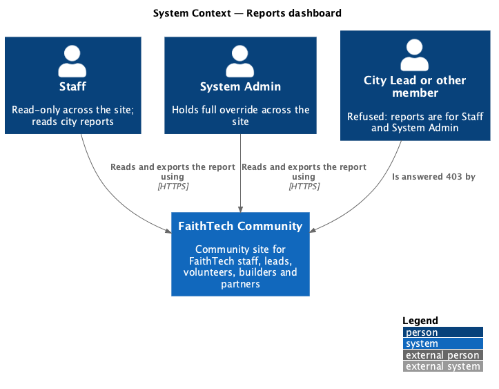
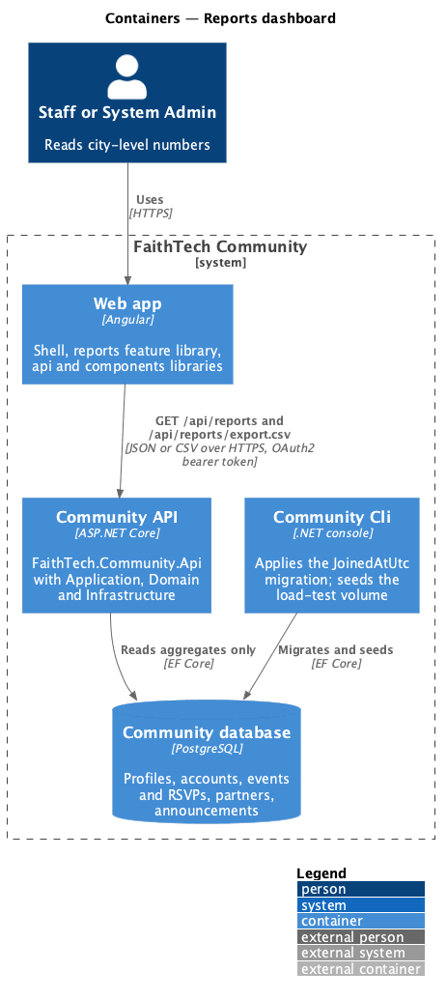
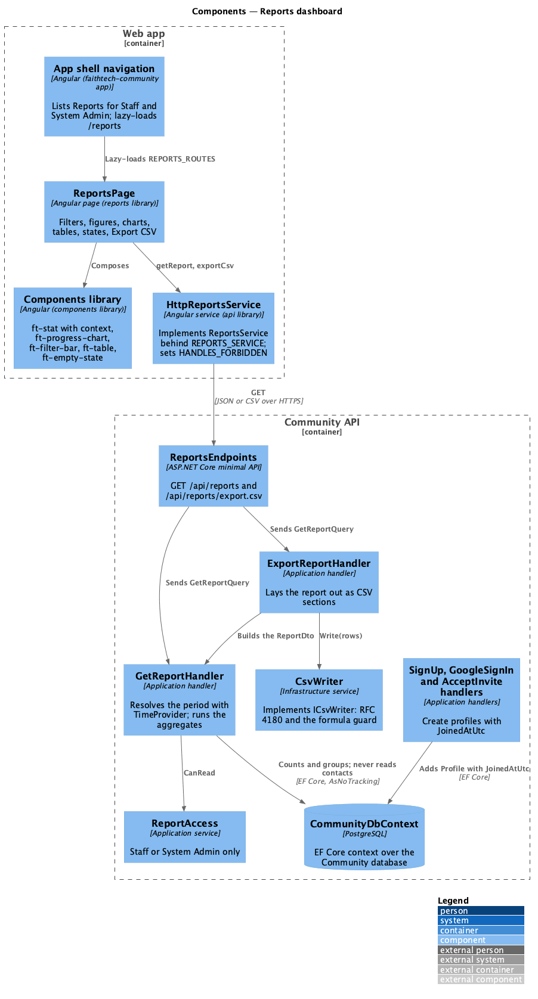
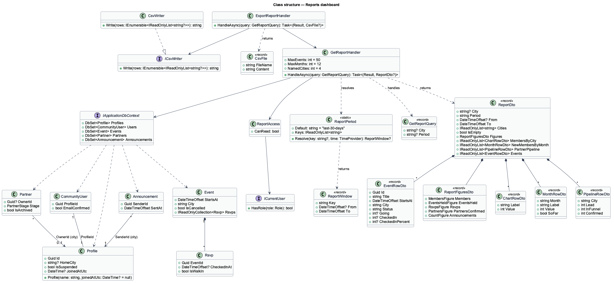
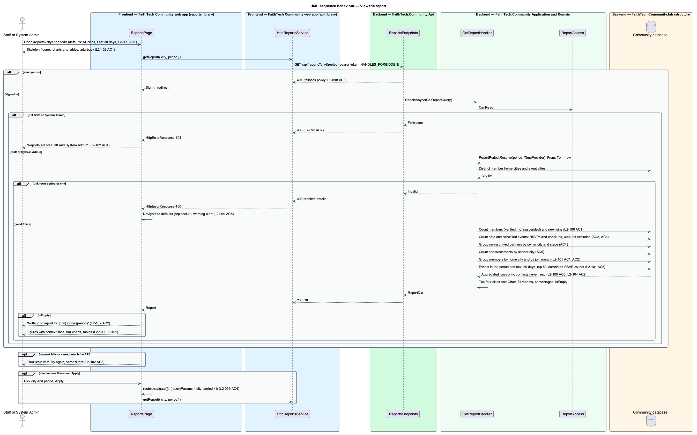
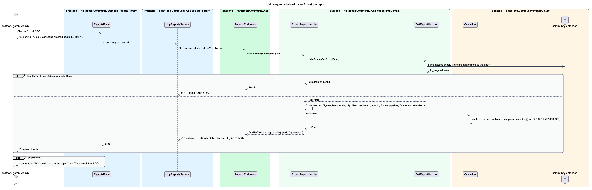
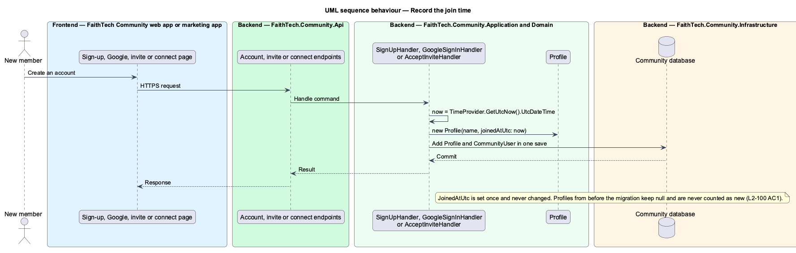

# Reports dashboard

## Overview

**Reports** — one fixed, read-only page at `/reports` that gives Staff and System Admins city-level numbers about QuinntyneBrown.Community: how many members there are and how many joined, how many events ran and how many people came, how far the partner pipeline has got, and how many announcements went out. It answers the questions Staff are asked for board updates and city reviews without anyone counting by hand. It is not a configurable dashboard: the figures, charts and tables are fixed, and only two filters change them.

- **Filter** — the **city** (All cities, or one city) and the **period** (Last 30 days, Last 90 days, This year, All time). The URL carries both (`?city=&period=`), so a view can be bookmarked and shared.
- **Figure** — a headline count with a **context line** under it, such as Members `412` with "+18 in the last 30 days".
- **Chart** — a bar chart drawn as rows of text with a decorative bar: Members by city, and New members by month.
- **Report table** — Partner pipeline by city, and Events and attendance.
- **Join time** — `Profile.JoinedAtUtc`, a new, optional time stamp set when an account is created. It is what "new members" counts. Profiles created before this feature have none and are never counted as new.
- **Partner city** — a partner has no city of its own; it counts for its owner's home city, and under "No city" when it has no owner or the owner has no home city.

Reports sits in its own subsystem, `reports` (ADR 0031). It owns no data: it reads profiles, accounts, events, RSVPs, partners and announcements that other features write, and it never reads private contacts or their notes. Every number is computed on the server from the definitions in [ADR 0030](../../../adr/0030-report-metric-definitions.md), so the page, the CSV export and the e2e fake agree. The check-in fields it reads (`Rsvp.CheckedInAt`, `Rsvp.IsWalkIn`) come from [event check-in](../../events/event-check-in/README.md) (ADR 0029) and the partner archive from [duplicate detection and merge](../../partners/duplicate-detection-and-merge/README.md) (ADR 0028).

## Description

### Backend (`QuinntyneBrown.Community.*`)

There is no `Domain/Reports/`: a report is a read model over other features' entities.

- **`Profile.JoinedAtUtc`** — new `DateTime?` on `Domain/Profiles/Profile.cs`, set once through a new optional constructor argument, `Profile(string name, DateTime? joinedAtUtc = null)`, and never changed. Three places create a new member's profile, and each passes `time.GetUtcNow().UtcDateTime`:
  - `SignUpHandler.CreateAsync` (`Application/Identity/SignUp.cs`), which also serves connect-link sign-up (`ConnectHandler.SignUpAsync`). It gains a `TimeProvider` dependency.
  - `GoogleSignInHandler` when it creates an account (`Application/Identity/GoogleSignIn.cs`).
  - `AcceptInviteHandler` for a new account (`Application/Invites/AcceptInvite.cs`).
  - The join time is when the account is created, not when the email is verified; the Members figure still requires a verified email.
  - `CommunitySeeder.SeedLoadTestUsersAsync` sets join times spread over the last 18 months, so the load test exercises the month chart.
- **Migration `ReportsJoinedAtAndIndexes`** (`Infrastructure/Persistence/Migrations/`) — adds the nullable `Profiles.JoinedAtUtc` column (`timestamp with time zone`) with no backfill, since Identity holds no creation time to copy, and adds `IX_Profiles_HomeCity`. It is applied by the Cli, never by the API. It runs after the event check-in and partner merge migrations, whose columns the report reads.
- **`ReportAccess`** (`Application/Reports/ReportAccess.cs`) — `bool CanRead` is true when `ICurrentUser` holds `Role.Staff` or `Role.SystemAdmin`. Every other signed-in member, the four lead roles included, is refused with `Result.Forbidden()` (`403`). A member who holds a lead role and Staff may read. Reading a report is not an admin action, so nothing is audited.
- **`ReportPeriod`** (`Application/Reports/ReportPeriod.cs`) — the four periods and their URL keys `last-30-days` (the default), `last-90-days`, `this-year` and `all-time`. `Resolve(key, TimeProvider)` returns a **`ReportWindow`** (`From`, `To`, `Key`): `To` is always now (`time.GetUtcNow()`); `From` is now minus 30 or 90 days, 1 January of the current year at 00:00 UTC, or `null` for All time. Every window is `From <= t <= To`. Months and the year are UTC calendar months and years.
- **`GetReportQuery`** (`City`, `Period`) and **`GetReportHandler`** (`Application/Reports/GetReport.cs`) — `HandleAsync` returns `(Result Result, ReportDto? Report)`:
  1. `403` unless `ReportAccess.CanRead`.
  2. Resolves the period; an unknown key is `Result.Invalid("period", …)` (`400`). An empty or missing period is the default.
  3. Loads the **city list**: the distinct non-blank `HomeCity` of member profiles (below), unioned with the distinct `Event.City` of all events, sorted with an ordinal-ignore-case comparer. An empty or missing city is All cities; a city that is not in the list (ordinal match) is `Result.Invalid("city", …)` (`400`).
  4. Runs the aggregates below. Each is one `IQueryable` ending in `CountAsync` or a `GroupBy(…).Select(g => new { g.Key, Count = g.Count() })` projection, all `AsNoTracking`. No query runs per row, and no entity is loaded to be counted (`L2-129` AC2). Shaping (top four cities, filling empty months, percentages) happens in memory on the grouped results, which hold at most one row per city, stage or month. The queries use only operators that both Npgsql and the EF Core in-memory provider translate.
- **Metric queries** — `members` is `from p in db.Profiles join u in db.Users on p.Id equals u.ProfileId where u.EmailConfirmed && !p.IsSuspended select p`; `events` is `db.Events`; both narrowed by `p.HomeCity == city` and `e.City == city` under one city. `window.Contains(x)` stands for `(From == null || x >= From) && x <= To`.

  | Output | Query |
  |--------|-------|
  | Members | `members.CountAsync()` |
  | Members, context "+N" | `members.Count(p => p.JoinedAtUtc != null && window.Contains(p.JoinedAtUtc))`; `null` for All time, so the context line is hidden |
  | Events held | `events.Count(e => !e.IsCancelled && window.Contains(e.StartsAt))` |
  | Events held, context "{n} cancelled" | `events.Count(e => e.IsCancelled && window.Contains(e.StartsAt))` |
  | RSVPs | `held.SelectMany(e => e.Rsvps).Count(r => !r.IsWalkIn)`, where `held` is the Events held query |
  | RSVPs, context "{p}% checked in" | `held.SelectMany(e => e.Rsvps).Count(r => !r.IsWalkIn && r.CheckedInAt != null)`; percent is rounded half away from zero, and `null` when RSVPs is 0 |
  | Partner groups | `from p in db.Partners where !p.IsArchived join o in db.Profiles on p.OwnerId equals (Guid?)o.Id into owners from o in owners.DefaultIfEmpty() group p by new { City = o == null ? null : o.HomeCity, p.Stage } into g select new { g.Key.City, g.Key.Stage, Count = g.Count() }` — the owner's home city whatever the owner's account state; blank cities fold into "No city" in memory |
  | Partners confirmed / "of {n} in the pipeline" | Sums of the partner groups: Confirmed, and every stage, for the chosen city or for all groups including "No city" under All cities |
  | Announcements | `db.Announcements.Count(a => window.Contains(a.SentAt) && (city == null \|\| db.Profiles.Any(s => s.Id == a.SenderId && s.HomeCity == city)))` |
  | Members by city | `members.GroupBy(p => p.HomeCity).Select(g => new { City = g.Key, Count = g.Count() })`, then the four largest named cities (ties by name) and "Other" for the rest plus blank cities, shown only when above 0. Under one city: that city's single row with the Members value |
  | New members by month | Months from the month of `From` (or of the earliest join time for All time) to the current month, keeping the last 12. `members.Where(p => p.JoinedAtUtc != null && p.JoinedAtUtc >= start && p.JoinedAtUtc <= To).GroupBy(p => new { p.JoinedAtUtc!.Value.Year, p.JoinedAtUtc!.Value.Month })`, where `start` is the later of `From` and the first shown month; missing months are 0, and the current month is marked `soFar` |
  | Events and attendance | `events.Where(e => (From == null \|\| e.StartsAt >= From) && e.StartsAt <= To.AddDays(30)).OrderByDescending(e => e.StartsAt).Take(50).Select(e => new { e.Id, e.Title, e.StartsAt, e.City, e.IsCancelled, Going = e.Rsvps.Count(r => !r.IsWalkIn), CheckedIn = e.Rsvps.Count(r => !r.IsWalkIn && r.CheckedInAt != null) })` — one statement with correlated counts. Status is `Cancelled`, else `Upcoming` when `StartsAt > To`, else `Held` |
  | Empty | Members is 0 and the Events and attendance list is empty |

  No query touches `db.Contacts`, `db.ContactNotes`, `db.PendingConnections` or contact photos (`L2-125` AC6); the e2e privacy spec proves the result does not move when contacts change.
- **`ReportDto`** (`Application/Reports/ReportDto.cs`) — the whole report in one response, serialized camelCase:

  ```json
  {
    "city": null,
    "period": "last-30-days",
    "from": "2026-09-22T15:05:00+00:00",
    "to": "2026-10-22T15:05:00+00:00",
    "cities": ["Austin", "Calgary", "Toronto", "Vancouver"],
    "isEmpty": false,
    "figures": {
      "members": { "value": 412, "newInPeriod": 18 },
      "eventsHeld": { "value": 9, "cancelled": 1 },
      "rsvps": { "value": 286, "checkedIn": 232, "checkedInPercent": 81 },
      "partnersConfirmed": { "value": 5, "inPipeline": 12 },
      "announcements": { "value": 4 }
    },
    "membersByCity": [
      { "label": "Toronto", "value": 186 },
      { "label": "Other", "value": 24 }
    ],
    "newMembersByMonth": [
      { "month": "2026-09", "label": "Sep", "value": 23, "soFar": false },
      { "month": "2026-10", "label": "Oct", "value": 18, "soFar": true }
    ],
    "partnerPipeline": [
      { "city": "Austin", "lead": 1, "inFunnel": 1, "confirmed": 1 },
      { "city": "No city", "lead": 0, "inFunnel": 1, "confirmed": 0 }
    ],
    "events": [
      {
        "id": "…", "title": "Vancouver Builders Night", "startsAt": "2026-10-09T01:00:00+00:00",
        "city": "Vancouver", "status": "Held", "going": 41, "checkedIn": 36, "checkedInPercent": 88
      }
    ]
  }
  ```

  `city` is `null` for All cities. Month labels are `MMM` when every shown month is in the current year and `MMM yyyy` otherwise. `partnerPipeline` lists every city in `cities` plus any owner city outside it, alphabetically, then "No city" when it has partners, under All cities; under one city it holds that city's row. `going`, `checkedIn` and `checkedInPercent` are `null` for a cancelled event; `checkedIn` and `checkedInPercent` are `null` for an upcoming one, and `checkedInPercent` is `null` when `going` is 0. The page writes the copy ("+18 in the last 30 days", "1 cancelled", "81% checked in", "of 12 in the pipeline", "sent by leads") from these numbers.
- **`ExportReportHandler`** (`Application/Reports/ExportReport.cs`) — `HandleAsync(GetReportQuery)` returns `(Result, CsvFile?)`. It calls `GetReportHandler` (same access and validation), then lays the report out as rows, one section after another with a blank row between: a header block (Report, City, Period, From, To, Generated), Figures (Figure, Value, Context), Members by city (City, Members), New members by month (Month, New members, with "(so far)"), Partner pipeline by city (City, Lead, In funnel, Confirmed) and Events and attendance (Event, Date (UTC), City, Status, Going, Checked in, Checked in %). The members context reads "18 new in the last 30 days" so a leading `+` is never altered by the formula guard. The file name is `faithtech-report-{city slug or all-cities}-{period}-{yyyy-MM-dd}.csv`, using `EventFileNames.Slug`.
- **`ICsvWriter`** (`Application/Common/ICsvWriter.cs`) — shared with [event check-in](../../events/event-check-in/README.md) (`ExportCheckIns`):

  ```csharp
  public interface ICsvWriter
  {
      /// RFC 4180: every cell quoted, quotes doubled, CRLF after every row; a null cell is "".
      /// A cell starting with =, +, -, @, tab or carriage return is prefixed with ' (formula-injection guard).
      string Write(IEnumerable<IReadOnlyList<string?>> rows);
  }
  ```

  `CsvFile(string FileName, string Content)` moves from `Application/Events/Rsvps.cs` to the same file, so both features and `RsvpHandler` share it. An empty row writes an empty line.
- **`CsvWriter`** (`Infrastructure/Csv/CsvWriter.cs`) — implements `ICsvWriter`; stateless, registered as a singleton in `Infrastructure/DependencyInjection.cs`. The tab and carriage-return prefixes widen the brief's four characters, following the OWASP CSV-injection guidance.
- **`ReportsEndpoints`** (`Api/Endpoints/ReportsEndpoints.cs`), mapped in `Program.cs` with `app.MapReportsEndpoints()`; both routes need a signed-in caller through the fallback policy (`401` when anonymous) and have no business logic:
  - `GET /api/reports?city=&period=` → `200 ReportDto` · `400` problem details naming `city` or `period` · `401` · `403`
  - `GET /api/reports/export.csv?city=&period=` → `200 text/csv; charset=utf-8` with `Content-Disposition: attachment`, written as UTF-8 with a byte-order mark so spreadsheet apps read accented names · `400` · `401` · `403`
  - Both use `ResultMapper.ToHttp`. The application registers `ReportAccess`, `GetReportHandler` and `ExportReportHandler` as scoped in `Application/DependencyInjection.cs`.
- **Performance (`L2-129` AC1)** — the existing `IX_Events_StartsAt`, the new `IX_Profiles_HomeCity`, the unique `ProfileId` index on the Identity users table, and `IX_Rsvps_EventId_GuestEmail` (whose leading column is `EventId`, so no separate `Rsvp.EventId` index is added) serve the queries; `IX_Announcements_SentAt` and `IX_Partners_Stage` already exist. The Cli command `seed-report-records <members>` (`CommunitySeeder.SeedReportRecordsAsync`) seeds the reports volume: `seed-report-records 10000` gives 10,000 verified members across six cities with join times over 18 months, 1,000 events and 50,000 RSVPs with check-ins. `eng/load-test.js` gains a `reports` scenario that calls both endpoints for every period and a few cities as a System Admin (load member VUS + 2, granted with `grant-admin`, since the Cli cannot grant Staff), with the threshold `p(95)<1000` on `kind:report`. The 1-second p95 budget is verified against PostgreSQL by that load test in the isolated performance environment; `Reports/ReportVolumeTests` checks only that the report and export answer with the right totals over 10,000 members, 1,000 events and 3,000 RSVPs in the in-memory provider, which cannot measure latency or SQL shape.

### Frontend

- **`ReportsService`** contract, **`REPORTS_SERVICE`** token and **`HttpReportsService`** (`api/src/lib/reports/`), exported from `api/src/lib/index.ts` and registered in `provideApi`. Types: `ReportPeriod` (`'last-30-days' | 'last-90-days' | 'this-year' | 'all-time'`), `ReportFilters` (`city: string | null`, `period: ReportPeriod`), `Report` and its parts mirroring `ReportDto`. `getReport(filters)` calls `GET /api/reports`; `exportCsv(filters)` calls `GET /api/reports/export.csv` for a `Blob`. Both set `HANDLES_FORBIDDEN`, so a `403` reaches the page instead of the global redirect.
- **`reports` library** (`frontend/projects/reports/`, `@faithtech-community/reports`) — `ng-package.json`, `package.json`, `tsconfig.lib*.json`, `tsconfig.spec.json` and `eslint.config.js` like `resources`; an `angular.json` project; a `tsconfig.json` path; and `ng build reports` / `ng test reports` in the `build:libs` and `test` scripts. `src/public-api.ts` exports `src/lib/index.ts`, which exports **`REPORTS_ROUTES`** (`[{ path: '', component: ReportsPage }]`) and the page.
- **App shell** — `app.routes.ts` adds `{ path: 'reports', loadChildren: () => import('@faithtech-community/reports').then((m) => m.REPORTS_ROUTES) }` inside the `authGuard` children. `shell/navigation.ts` adds `{ label: 'Reports', href: '/reports', icon: 'reports', secondary: true, opens: has('Staff', 'SystemAdmin') }` between People and Admin (ADR 0009). As a secondary section it folds into the top bar's More from MD up to 1535px and joins the top bar from 2XL; on phones it is in the More menu. It never becomes a phone tab: a Staff member's next section is Partners and a System Admin's is Contacts.
- **`ReportsPage`** (`reports/src/lib/pages/reports/`) — reads `city` and `period` from the query parameters and reloads whenever they change; a newer request drops an older one's answer.
  - Header: `PageHeaderComponent` "Reports" with the subtitle "{city or All cities} · {period label} · updated {today at 3:05 pm}" from `to`.
  - Filters: City and Period `SelectComponent`s in `FormFieldComponent`s, **Apply** (`ButtonComponent`), and **Export CSV** pushed to the end, inside `FilterBarComponent`. Apply navigates with `queryParams: { city, period }` (city empty for All cities), so the URL always carries both. The city options are `cities` from the last report.
  - Figures: five `StatComponent`s with their context line in an `ft-cluster` stat row; each wraps to a single column at XS.
  - Charts: two `CardComponent`s holding `ProgressChartComponent` ("Members by city" with the footer "Members with a verified email. Private contacts are never counted.", "New members by month" with "Oct so far").
  - Tables: `TableComponent` "Partner pipeline by city" (City as the row header) with the footer "One shared pipeline; a partner counts for the city of its owner.", and "Events and attendance" with the title linking to `/events/{id}`, the date as `EEE d MMM`, going, and "36 (88%)", "Upcoming" or "Cancelled". Each table scrolls inside its own wrapper at XS.
  - States: loading keeps the header and filters, and shows `StatComponent` `loading`, skeleton chart rows (`ProgressChartComponent` `loading`) and `TableComponent` `loading`, with `aria-busy` on the report region; empty is `EmptyStateComponent` "Nothing to report for {city} in the {period}" ("…for All cities yet" for All time) with All cities and Last 90 days actions; error is `EmptyStateComponent` `variant="error"` "We couldn’t load the reports" with **Try again**, which reloads the same filters; forbidden is `EmptyStateComponent` "Reports are for Staff and System Admin" with Go to Home, as in `reports/forbidden`.
  - A `400` navigates to `/reports?city=&period=last-30-days` with `replaceUrl` and shows a warning `AlertComponent`: "That city or period isn’t available, so the report shows All cities for the last 30 days."
  - Export: `ButtonComponent` `loading` reads "Exporting…" and cannot be pressed again; the blob downloads through an object URL with the server's file name pattern; a failure shows a danger toast (`ToastService`) "We couldn’t export the report" with **Try again**.
  - The page has no write action (`L2-123` AC5).

### Components (`frontend/projects/components/`)

Used as they are: `PageHeaderComponent`, `FormFieldComponent`, `SelectComponent`, `ButtonComponent`, `ClusterComponent`, `SplitComponent`, `CardComponent`, `TableComponent`, `EmptyStateComponent`, `SkeletonComponent`, `AlertComponent`, `ToastService` and `IconComponent`.

Missing, to be added to `components` first (design system pages `stat`, `progress`, `table`, `patterns/lists-and-tables`):

- **`ProgressChartComponent`** (`ft-progress-chart`) — the `.progress-chart` bar chart: a `<ul>` with an accessible `label`, rows of `{ label, value, caption? }`, one shared label column (subgrid), fills scaled to the largest value, tracks `aria-hidden`, the row text carrying label and value, and a `loading` state of skeleton rows. `ProgressComponent` stays the `role="progressbar"` meter.
- **`StatComponent` `context` input** — the context line (`text-caption`) under the value, hidden when `null`, kept as a skeleton line while `loading`.
- **`FilterBarComponent`** (`ft-filter-bar`) — the `.cluster.filter-bar` layout: filter fields and Apply first, a trailing slot pushed to the end, stacking at XS without horizontal scroll. The audit log's local `.filters` wrapper is a hand-rolled substitute and should move to it.
- **`TableComponent` row-header column** — `TableColumn.rowHeader` renders that column's cells as `<th scope="row">`, as the report tables need.
- **`reports` icon** — a bar-chart glyph in `icon/icons.ts` for the navigation entry.

### Fake backend and tests

- **`MockReports`** (`e2e/fixtures/mock-reports.ts`) — `ReportsEndpoints` in the browser. It computes the report from the fake's own state: `api.accounts` (verified, suspended) and `api.profiles` (home city, a new optional `joinedAtUtc` on `MockProfile` and `addAccount`), `api.events` (RSVPs with `isWalkIn` and `checkedInAt` from the check-in fake), `api.partners` (`archived`, owner) and `api.announcements` (`senderId`, `sentAt`), using `api.now` and the definitions of ADR 0030. It never reads `api.contacts`. It answers `401` with no caller, `403` unless Staff or System Admin, `400` problem details for an unknown city or period, and the CSV with the same sections. Failures are arranged with `api.on('GET', '/api/reports', …)`.
- **`mock-api.ts`** — `readonly reports = new MockReports(this);` and, in `handle`, `const reports = this.reports.handle(route, method, url, this.caller(authorization)); if (reports) return reports;` before search. Any other `/api/reports` request falls through to the unrecognised list and fails the test.
- **Page object** `e2e/pages/reports.page.ts` (`ReportsPage`): `open(query)`, `filter(city, period)`, `figure(label)`, `figureText(label)`, `chart(title)`, `chartRows(title)`, `card(title)`, `tableRows(title)`, `eventLink(title)`, `cityOptions()`, `periodOptions()`, `emptyAction(name)`, `toast(heading)`, `heading`, `subtitle`, `city`, `period`, `apply`, `exportCsv`, `loading`, `empty`, `error`, `tryAgain`, `forbidden`, `goHome`, `filterAlert`; the Reports nav entry is reached through `AppShell`'s existing `navLink(name)` and `drawerLink(name)`.
- **E2E specs** (`e2e/tests/reports/`, axe on every state): `reports-access.spec.ts` (Staff and System Admin see it; City Lead, Event Lead, Volunteer and no-role members see the forbidden state; anonymous goes to sign in; nav shows Reports only for Staff and System Admin, in More at MD), `report-filters.spec.ts` (defaults, city list, Apply and the URL, bookmark reload, unknown filter fallback), `report-figures.spec.ts` (each definition, including unverified, suspended, archived, cancelled and walk-in exclusions, partner "No city", and a lead's private contacts in Toronto leaving every number unchanged), `report-charts-and-tables.spec.ts`, `report-states.spec.ts` (loading, empty, error and Try again), `report-export.spec.ts` (sections, formula guard, busy, failure toast) and `responsive.spec.ts` (XS single column, no horizontal page scroll).
- **Backend integration tests** (`backend/tests/QuinntyneBrown.Community.Api.Tests/Reports/`, EF Core in-memory with a unique database per fixture and `FakeTimeProvider`): `ReportAccessTests` (Staff and System Admin `200`; each lead role, Volunteer, no role `403` on both routes; anonymous `401`), `ReportFiltersTests` (defaults, city list from verified members and events, `400` for unknown values), `ReportFiguresTests` (one test per definition and exclusion, period edges at `From` and now, All time, private contacts never counted), `ReportChartsTests`, `ReportExportTests` (sections, every cell quoted, guarded cells, file name) and `JoinedAtTests` (sign-up, Google, invite and connect sign-up stamp the join time). `backend/tests/QuinntyneBrown.Community.Infrastructure.Tests/Csv/CsvWriterTests.cs` covers quoting, doubled quotes, line breaks, nulls, empty rows and each guarded character.
- **Angular unit tests** sit next to `ReportsPage`, `HttpReportsService` and the new components.

## Requirements

| L2 ID | Refines (L1) | Requirement |
|-------|--------------|-------------|
| `L2-123` | `L1-024` | Reports access |
| `L2-124` | `L1-024` | Report filters |
| `L2-125` | `L1-024` | Report figures |
| `L2-126` | `L1-024` | Report charts and tables |
| `L2-127` | `L1-024` | Report states |
| `L2-128` | `L1-024` | Export a report |
| `L2-129` | `L1-024` | Report performance |
| `L2-045` | `L1-016` | Responsive layout and theming (AC4 and AC5: Reports in the navigation and the More menu) |

The acceptance criteria are in [`docs/specs/L2.md`](../../../specs/L2.md).

## Diagrams

### System context

Staff and System Admins read the report in QuinntyneBrown.Community. No external system takes part; the CSV is a download.



### Containers

The `reports` feature library in the Angular web app calls the Community API through the `api` library. The API reads the PostgreSQL Community database and writes nothing.



### Components

`ReportsPage` reaches `ReportsEndpoints` through `HttpReportsService`. `GetReportHandler` checks `ReportAccess`, resolves the period and runs the aggregates; `ExportReportHandler` reuses it and writes rows through `ICsvWriter`. The sign-up handlers stamp `Profile.JoinedAtUtc`.



### Class structure

The handlers depend on `IApplicationDbContext`, `ICurrentUser`, `TimeProvider` and `ICsvWriter`; `ReportDto` composes the figures, chart rows and table rows.



### Behaviour — view the report

The page sends the filters from the URL; the server refuses anyone but Staff and System Admin, validates the filters and answers the whole report from aggregates (`L2-123` to `L2-127`, `L2-129`).



### Behaviour — export the report

The export applies the same access, filters and figures, then writes every section through `ICsvWriter` (`L2-128`).



### Behaviour — record the join time

Creating an account stamps the profile's join time once, which "+N in the period" and New members by month count (`L2-125` AC1).



## Open questions

Resolved while designing (ADR 0030, ADR 0031):

- **More at MD** — Reports is a secondary section, like People and Admin: hidden from the top bar from MD up to 1535px and reached through More, shown in the top bar from 2XL, and listed in the phone More menu. `L2-045` AC5 lists it.
- **City list and suspended members** — the list uses the same member set as Members (verified and not suspended) plus every event's city, cancelled events included. City names are matched exactly; "Toronto" and "toronto " would be two cities. Normalising free-text home cities is deferred.
- **All time** — the "+N" context line is hidden, because every member would be new; New members by month shows the last 12 months up to the first join time; the empty state reads "Nothing to report for {city} yet".
- **Period edges** — windows are UTC and inclusive at both ends; months follow UTC calendar months. A city-local time zone is deferred.
- **Walk-ins** — excluded from RSVPs, from the checked-in rate and from the Events and attendance columns, so the rate never passes 100%. Showing a walk-in count per event is deferred.
- **Partner owner state** — a partner counts for its owner's home city whether or not the owner is verified or suspended.
- **Archived partners** — the filter is written here as `Partner.IsArchived`; it follows whatever archive marker the merge design gives `Partner` (ADR 0028, "archived with `MergedIntoId`").
- **Mock drift** — `reports/default` draws chart bars as `role="progressbar"` with the overall total as the maximum and shows New members by month as Jul to Oct for Last 30 days; the design follows the brief and the design system (tracks `aria-hidden`; only the months the period touches). The mocks have no state for an unknown filter (`L2-124` AC5) or for exporting and export failure (`L2-128` AC4); those states should be added to `docs/mocks/pages/reports/` before the slices that build them.
- **CSV writers elsewhere** — the audit log and RSVP exports keep their own cell functions, which quote only when needed. Moving them to `ICsvWriter` is a follow-up behaviour change for those features, not part of this one.
- **Home** — the mocks' "Open reports" action on the Staff home page belongs to [Home](../../platform/home/README.md) and has no requirement yet.
- **Proving `L2-129` AC1** — the in-memory provider cannot prove latency or SQL shape; the budget is checked by the load test against PostgreSQL, and the query shapes by review.
- **Recorded while building** (slice 11a):
  - The unknown-filter warning reads as the later `reports/unknown-filter` mock, "We couldn’t use that filter, so this shows all cities for the last 30 days.", not the wording above.
  - The Events and attendance footer reads "Events in the period and the next 30 days. Walk-ins aren’t counted as RSVPs or check-ins." The `reports/default` mock's "Walk-ins count as checked in but not as RSVPs" contradicts ADR 0030, which leaves walk-ins out of both columns.
  - Layout: `SplitComponent` holds the two tables in the main column and the two charts in the aside; at XS (`BreakpointService` below SM) the stat row is a `StackComponent` instead of a `ClusterComponent`, so the figures are one column.
  - The join-time tests sit with the flows they exercise (`Identity/SignUpTests`, `Identity/GoogleSignInTests`, `Invites/AcceptInviteTests`, `Invites/ConnectSignUpTests`) rather than in a separate `Reports/JoinedAtTests`.
  - Slice 12: each CSV section opens with a title row ("Figures", "Members by city", …) before its column headers; the header block's dates read "From (UTC)", "To (UTC)" and "Generated (UTC)" as `yyyy-MM-dd HH:mm`, and From is empty for All time. The page writes the server's file name pattern itself, from the shown report's city, period and `to`. Reports shows no success toast after an export, as the mocks have none.
  - Performance: measured on 2026-10-22 against a local PostgreSQL with `seed-report-records 10000` (10,000 members, 1,000 events, 50,000 RSVPs), the Release API and `k6 run -e VUS=5 -e DURATION=3m eng/load-test.js`: the `reports` scenario's p95 was 68 ms against the 1,000 ms budget, with no failed requests. The run also fixed the script: k6 numbers VUs across both scenarios, so it now signs in VUS + 1 members for the members scenario and the System Admin as member VUS + 2. A run in the isolated performance environment at 200 VUs remains the release check. `ReportVolumeTests` passed on its first run, since the aggregates were already server-side from slice 11a; it guards correctness at volume.
- **Spec wording (2026-10-22)** — `L2-127` AC2 now names the All time heading, "Nothing to report for {city} yet", which the All time decision above already used. The `reports/*` mocks now carry the shipped events footer ("Walk-ins aren’t counted as RSVPs or check-ins.") and the filter bar's end slot.
- **Deferred** — configurable dashboards, numbers linking to the lists behind them (only event titles link), per-lead or per-city access for City Leads, scheduled or emailed reports, and charts beyond the two fixed ones.
