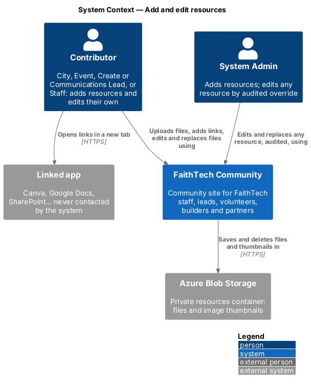
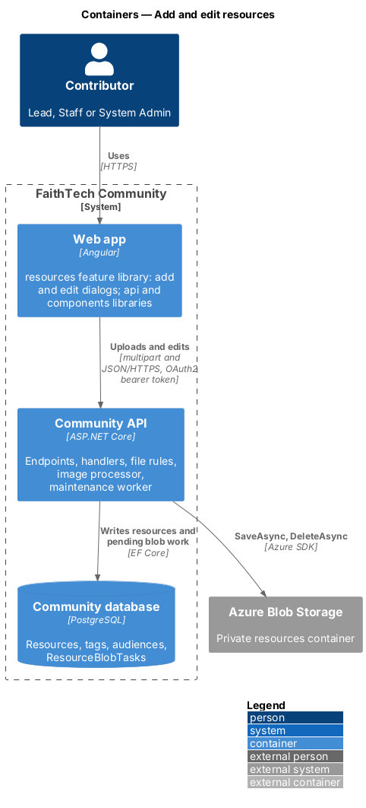
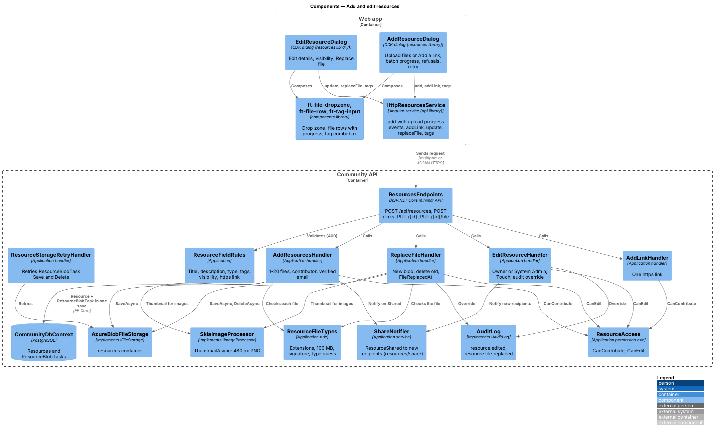
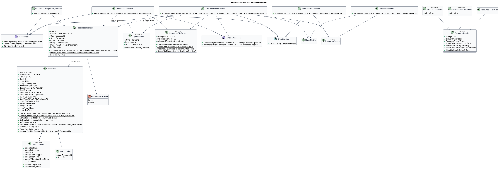
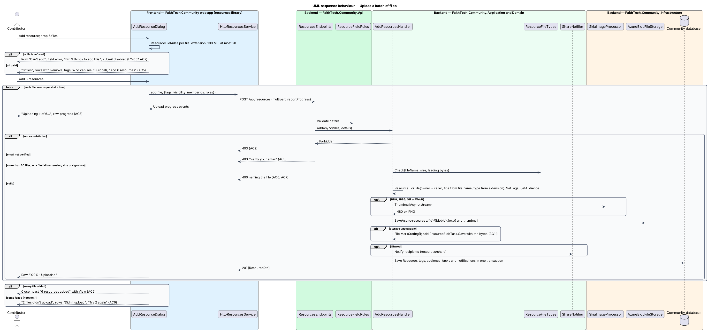
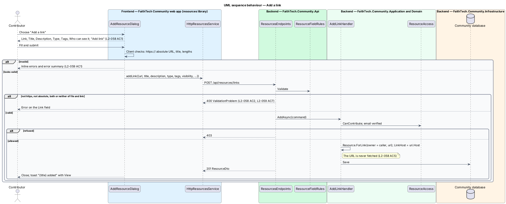
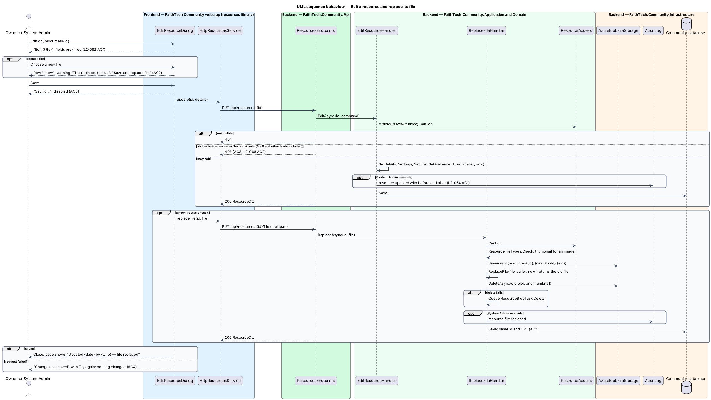
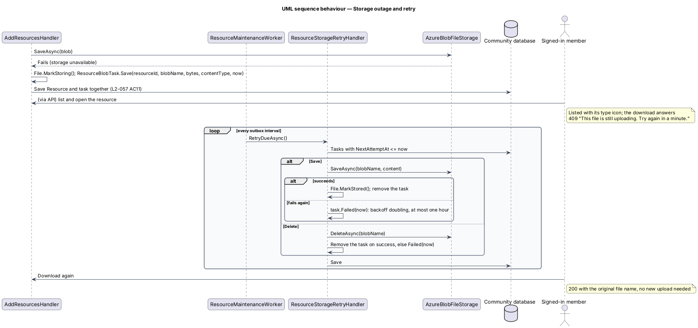

# Add and edit resources

## Overview

Contributors add resources in two ways: by uploading files, up to 20 in one batch with each file becoming its own resource, or by linking to one https address that stays live in another app. The owner, and a System Admin by audited override, edits the details later and can replace an uploaded file in place.

Key terms:

- **contributor** — City Lead, Event Lead, Create Lead, Communications Lead, Staff or System Admin (`ResourceAccess.CanContribute`); Staff adding and owning resources is the deliberate carve-out from the Staff read-only rule (`L2-066`, `AGENTS.md`)
- **batch** — the files chosen in one add; titles come from the file names, types are guessed from the extensions, and the tags and visibility chosen once apply to every file
- **allowed file** — an extension in the allowed list (`pptx`, `ppt`, `key`, `pdf`, `docx`, `doc`, `xlsx`, `csv`, `png`, `jpg`, `svg`, `gif`, `webp`, `mp4`, `zip`), at most 100 MB, whose leading bytes match its extension
- **replace** — swapping the file of an existing resource: same id and URL, new blob, no version history

The "Who can see it" picker is part of both dialogs. Its Private and Global choices are covered here; the Shared choice, its audience and the `ResourceShared` notification are in `resources/share`. Decisions on storage, signature checks and storage outages are in [ADR 0017](../../../adr/0017-resources-storage-access-and-lifecycle.md).

## Description

### Web app

- **`AddResourceDialog`** — CDK dialog in the `resources` feature library opened by *Add resource* on `ResourcesPage` (mock `dialogs/add-resource`: default, single, batch, link, shared, invalid, busy, failed). "Add a resource", "Upload files or link to something that lives in another app." and the tablist "What are you adding?" (`ft-tabs` in panel mode: *Upload files*, *Add a link*).
  - **Upload files**: an `ft-file-dropzone` ("Drop files here or choose files", the limits line) that accepts drops, a click, Enter or Space. Each chosen file becomes an `ft-file-row` (file name · EXT · size, *Remove*). With one file the dialog shows Title (from the file name without its extension, counter "{n} / 120"), Description, Type (`ft-select`, guessed from the extension with "Guessed from .{ext} — change it if it’s wrong.") and the submit *Add resource*. With two to twenty it shows "{N} files", "Each file becomes its own resource", the caption about titles and types, *Add more files* (the dropzone again) and *Add {N} resources*. A file that is too big, of the wrong type or over the 20-file limit is checked on the client by `ResourceFileRules` (mirroring `ResourceFileTypes`), and its row turns `refused` ("Can’t add") with the error message and an entry in the error summary "Fix {N} things to add this".
  - **Add a link**: Link (`ft-text-field` `type="url"`, hint "Must start with https://…"), Title, Description, Type and the submit *Add link*. One link per add; links never join a batch.
  - Both tabs share Tags (`ft-tag-input`, suggestions from `ResourcesService.tags(q)` in a list named "Tags already in use", "{tag} · Used on {N} resources" and "Add “{text}” as a new tag") and "Who can see it" (`ft-radio-group`: Private, Shared, Global; Global checked by default).
  - **Submitting a batch** uploads the files one request at a time so each row shows its own progress: the status line "Uploading {k} of {N}…", each row `uploading` with its `ft-progress` ("Uploading {file name}") and then `uploaded` ("100% · Uploaded"), the submit "Adding {N} resources…" with `aria-busy`, and *Cancel remaining* stopping files not yet started. If some fail, the danger alert "{M} files didn’t upload" lists the rest as added, each failed row reads "Didn’t upload", and *Try {M} again* retries only those (`L2-057` AC9). The dialog closes on success and raises the toast "{title} added" (or "{N} resources added", or "{N−M} of {N} resources added" warning) with *View*.
- **`EditResourceDialog`** — CDK dialog opened by *Edit* or *Change who can see it* on `ResourcePage` (mock `dialogs/edit-resource`: default, replace, invalid, busy, failed). "Edit {title}", "Changes show for everyone who can see it.", the current `ft-file-row` with *Replace file* (an `ft-file-dropzone` in single-file mode) or the Link field, then Title, Description, Type, Tags and "Who can see it", pre-filled. *Change who can see it* opens the same dialog with focus on the visibility picker; there is no separate share dialog (`L2-061` AC5). Replacing shows the new row "· new", the warning "This replaces {old file name} for everyone who can see it. There’s no version history, so keep a copy if you need the old one." and the submit *Save and replace file*. Busy "Saving…"; failure "Changes not saved", "We couldn’t reach FaithTech. The old file and details are still in place — try again." with *Try again*.
- **`ResourceDetailsComponent`** — feature-local form shared by both dialogs, with its `resource-details` helpers (`detailsForm`, `detailErrors`, `fieldsOf`, `serverErrors`): the field rules of `L2-059` (title 1–120 after trimming, description at most 1,000, type required, tags normalised, Shared needs an audience), the error summary entries and the mapping of a `400` `ValidationProblem` back onto the fields.
- **`HttpResourcesService`** — `add(file, details)` posts multipart to `POST /api/resources` with `reportProgress: true` and `observe: 'events'`, emitting progress then the created resource; `addLink(details)`, `update(id, details)` and `replaceFile(id, file)` call the JSON and multipart endpoints below; `tags(q)` feeds the tag input.
- **Components** — new in `components` (design system pages in brackets): `FileDropzoneComponent` `ft-file-dropzone` (`components/file-dropzone.html`), `FileRowComponent` `ft-file-row` with states `ready`, `uploading`, `uploaded`, `failed`, `refused` (`components/file-row.html`) and `TagInputComponent` `ft-tag-input` (`components/tag-input.html`). The type icons on the file rows come from `IconTileComponent` (`components/type-icon.html`). Dialog, tabs, fields, radio group, error summary, alert, progress and toast are existing components.

### Community API

- **`ResourcesEndpoints`** — this slice maps `POST /api/resources` (multipart: `files[]` plus `title`, `description`, `type`, `tags`, `visibility`, `memberIds`, `roles`; answers `201` with the created `ResourceDto[]`), `POST /api/resources/links` (JSON `AddLinkCommand`, `201`), `PUT /api/resources/{id}` (JSON `EditResourceCommand`, `200`) and `PUT /api/resources/{id}/file` (multipart, one file, `200`). The multipart endpoints raise the request size limit to 20 × 100 MB plus form fields and are not antiforgery-bound (bearer token). Answers: `400` validation, `403` for a caller who may not add, `403` for a non-owner edit, `404` for a resource the caller may not see.
- **`ResourceFileTypes`** — Application rule in `Resources/`: the allowed extensions, the 100 MB limit, `TypeFromExtension` (pptx/ppt/key → Deck; png/jpg/gif/webp → Image; svg → Logo; pdf/docx/doc → Document; xlsx/csv → Document; mp4/zip → Other) and `MatchesSignature(extension, leading bytes)`: `%PDF`, the OLE header (PPT, DOC), `PK\x03\x04` (PPTX, DOCX, XLSX, KEY, ZIP), MP4 `ftyp` at offset 4, PNG, JPEG, GIF, RIFF…WEBP, SVG markup (`<svg` or `<?xml` then `<svg`) and CSV text (no NUL bytes). Any mismatch gives the same message as a wrong extension: "{file name} can’t be added. Use PPTX, PPT, KEY, PDF, DOCX, DOC, XLSX, CSV, PNG, JPG, SVG, GIF, WEBP, MP4 or ZIP, up to 100 MB. For longer video, add a link instead."
- **`ResourceFieldRules`** — the field rules the add, add-link and edit handlers check before they change anything (`L2-059`): Title required after trimming ("Give it a title so people can find it.") and at most 120; Description at most 1,000; Type one of the seven; tags at most 40 characters each; Shared with no member and no role refused ("Choose at least one person or role, or pick another visibility."); a link must be an absolute `https://` URL. A request with both a file and a link, or neither, is refused.
- **`AddResourcesHandler`** — `AddAsync(files, details)`: the caller must be a contributor (`403`) with a verified email (refused as `L2-002` AC3); 1–20 files (`400` above 20); each file is checked by `ResourceFileTypes` (a refused file answers `400` naming it, and nothing in the request is saved). For each file: `Resource.ForFile(...)` with the title from the details for one file or from the file name in a batch, the type from the details or guessed per file, `SetTags`, `SetAudience`; an image (PNG, JPEG, GIF, WebP) gets a thumbnail from `IImageProcessor.ThumbnailAsync`; the bytes go to `IFileStorage.SaveAsync("resources/{id}/{blobId}.{ext}")`. If storage fails, the resource is saved with `IsStored = false` and a `ResourceBlobTask.Save` holding the bytes (`L2-057` AC11). Sharing notifications are added through `ShareNotifier` (`resources/share`), then one save commits everything.
- **`AddLinkHandler`** — `AddAsync(AddLinkCommand)`: contributor and verified email checks, `Resource.ForLink(...)` with `LinkHost` from the parsed URI; the URL is never fetched (`L2-058` AC5).
- **`EditResourceHandler`** — `EditAsync(id, EditResourceCommand)`: loads through `VisibleOrOwnArchived` (`404` when not visible), requires `ResourceAccess.CanEdit` (`403` for anyone but the owner and System Admin, Staff included), then `SetDetails`, `SetTags`, `SetLink` for a link, `SetAudience` (returning the new recipients for `ShareNotifier`) and `Touch(caller, now)`. A System Admin override writes `resource.edited` with the before and after values (`L2-064` AC1).
- **`ReplaceFileHandler`** — `ReplaceAsync(id, file)`: the same access checks and file rules; the new file gets a new blob id, its thumbnail is made when it is an image, `Resource.ReplaceFile` records `FileReplacedAt` and `FileReplacedById` and returns the old file, whose blob and thumbnail are deleted (a `ResourceBlobTask.Delete` is queued if storage is down). The id and URL stay the same (`L2-062` AC2). Override audited as `resource.file.replaced`.
- **`ResourceStorageRetryHandler`** — retries due `ResourceBlobTask` rows with the photo backoff (as `PhotoStorageRetryHandler`): a `Save` writes the bytes, marks the file stored and deletes the task; a `Delete` removes the blob. Run by `ResourceMaintenanceWorker` (`resources/archive-and-transfer`).
- **`Resource`** — Domain aggregate in `Domain/Resources/`. `ForFile` and `ForLink` create it with the owner and `AddedAt` set by the server (`L2-059` AC8); `SetDetails(title, description, type)`, `SetTags(tags)` (lower-cased, trimmed, de-duplicated, empty dropped, kept in `TagText` for search), `SetAudience(ResourceAudience)`, `SetLink(uri)`, `Touch(by, now)` and `ReplaceFile(file, by, now)`. **`ResourceFile`** holds the file name, extension, size, content type, blob name, thumbnail blob name and `IsStored`. **`ResourceBlobTask`** holds pending `Save` or `Delete` work, like `PhotoBlobTask`.

### Infrastructure

- **`AzureBlobFileStorage`** — `IFileStorage` over the `resources` container of the shared `BlobServiceClient`; `SaveAsync` uploads with the content type, `DeleteAsync` deletes if it exists. Tests use an in-memory fake that can be switched to fail.
- **`SkiaImageProcessor.ThumbnailAsync`** — decodes PNG, JPEG, GIF or WebP with SkiaSharp (ADR 0001), fits it inside 480 px and re-encodes it as PNG without metadata. SVG gets no thumbnail.
- **`CommunityDbContext`** — maps `ResourceBlobTasks` beside the resource tables (migration `Resources`).

## Requirements

The feature realizes the following level-2 (L2) requirements. Each L2 requirement refines a level-1 (L1) requirement, cited by identifier.

| L2 ID | Refines (L1) | Requirement |
|-------|--------------|-------------|
| `L2-057` | `L1-020` | Add resources: upload and batch |
| `L2-058` | `L1-020` | Add a link |
| `L2-059` | `L1-020` | Fields and validation |
| `L2-062` | `L1-020` | Edit, replace file and ownership |
| `L2-066` | `L1-020` | Staff carve-out |

### Acceptance criteria

**`L2-057` — Add resources: upload and batch**

1. Given a member who may add resources, when they choose "Add resource", then the "Add a resource" dialog opens with "Upload files or link to something that lives in another app.", the segmented control "What are you adding?" ("Upload files", "Add a link"), the dropzone "Drop files here or choose files", the limits line "Up to 20 files, 100 MB each. PPTX, PPT, KEY, PDF, DOCX, DOC, XLSX, CSV, PNG, JPG, SVG, GIF, WEBP, MP4 or ZIP.", the Tags field and the "Who can see it" picker (`L2-059`), and "Add resource" stays disabled until a file is chosen.
2. Given a member who may not add resources (Volunteer, Product Engineer, Attendee or no role), when they view Resources, then no "Add resource" button is rendered, and `POST /api/resources` answers 403.
3. Given a member whose email is not verified, when they try to add a resource, then the add is refused as in `L2-002` AC3.
4. Given one file is chosen, when the form shows, then the file appears as "{file name} · {EXT} · {size}" with "Remove", the Title defaults to the file name without its extension, the Type is guessed from the extension with "Guessed from .{ext} — change it if it’s wrong.", and submitting creates one resource owned by the member and shows the toast "{title} added" with "Every signed-in member can find it now." (Global) and a "View" action.
5. Given two to twenty files are chosen, when the form shows, then it reads "{N} files", "Each file becomes its own resource", "Titles come from the file names and types from the extensions. The tags and visibility below apply to all {N}; you can edit each one afterwards.", offers "Add more files", and the submit button reads "Add {N} resources"; submitting creates one resource per file with the shared tags and visibility and shows "{N} resources added", "Titles came from the file names. Open any of them to edit the details."
6. Given 20 files are already chosen, when the member adds more, then the extra files are refused with the limits line, and the API refuses a batch of more than 20.
7. Given a file over 100 MB, with an extension outside the allowed list, or whose content does not match its extension, when it is chosen or uploaded, then its row shows "Can’t add" and the error "{file name} can’t be added. Use PPTX, PPT, KEY, PDF, DOCX, DOC, XLSX, CSV, PNG, JPG, SVG, GIF, WEBP, MP4 or ZIP, up to 100 MB. For longer video, add a link instead.", the summary "Fix {N} things to add this" links to each problem, the submit stays disabled until the file is removed, and the API answers 400 for the file.
8. Given the batch is submitting, when uploads are in flight, then the dialog reads "Uploading {k} of {N}…", each row shows its progress ("Uploading {file name}") and "100% · Uploaded" when done, the submit shows "Adding {N} resources…", and "Cancel remaining" stops the files not yet started while the ones already uploaded stay added.
9. Given some files fail to upload, when the batch settles, then the dialog shows "{M} files didn’t upload", "The other {N−M} were added. We lost the connection part-way; try the last {M} again.", each failed row reads "Didn’t upload", and "Try {M} again" retries only those files; the toast reads "{N−M} of {N} resources added", "{M} files didn’t upload." with "Try again".
10. Given an uploaded file, when it is stored, then the resource keeps the original file name, size and content type, the blob is stored behind the storage abstraction, and an Image resource gets a thumbnail from the image processor used for photos (`L2-007`).
11. Given blob storage is unavailable, when a valid file is added, then the resource is saved with its details, is listed with its type icon, and the file is stored and becomes downloadable without uploading again once storage recovers (`L2-047` AC3).
12. Given an XS viewport, when the dialog opens, then it fills the screen, the file rows and fields stack in one column, and the actions stay reachable at the bottom.

**`L2-058` — Add a link**

1. Given the add dialog, when the member chooses "Add a link", then the form shows a Link field with the hint "Must start with https://. Use a link for things that stay live in their own app, like a Canva template or a shared sheet.", Title, Description, Type, Tags and visibility, and the submit reads "Add link".
2. Given a URL that does not start with `https://` or is not a valid absolute URL, when the member submits, then the Link field shows an inline error and the API answers 400; given a valid https URL, then one link resource is created with the host derived from the URL.
3. Given the link form, when it renders, then it accepts exactly one link per add; links are never part of a file batch.
4. Given a link resource, when it is shown in a list, in search or on its page, then it shows an external-link icon and its host, and opening it uses a new tab with `rel="noopener"`.
5. Given a link resource, when it is saved or opened, then the system never fetches the URL to check that it works; the owner is shown so a dead link has someone to ask.

**`L2-059` — Fields and validation**

1. Given an empty Title after trimming, when the member submits, then the field shows "Give it a title so people can find it." and the summary "Fix {N} things to add this" (or "to save") links to it; given a title longer than 120 characters after trimming, then the counter "{n} / 120" shows the overrun and the submit is refused; the API answers 400 for both.
2. Given a Description, when it is saved, then it is optional, plain text and at most 1,000 characters; longer text is refused inline and by the API.
3. Given the Type field, when it renders, then it offers exactly Deck, Logo, Image, Training, Template, Document and Other, is required, and the API refuses any other value.
4. Given the Tags field ("Tags (optional)", hint "Press Enter or comma to add. Pick an existing tag so spellings stay the same."), when the member types, then a list named "Tags already in use" suggests matching tags with their usage ("{tag} · Used on {N} resources") and "Add “{text}” as a new tag"; when tags are saved, then each is lower-cased, trimmed and de-duplicated, and empty tags are dropped.
5. Given the "Who can see it" picker, when the form renders, then it is always visible with Private ("Only you (and System Admin)."), Shared ("You and the people and roles you choose.") and Global ("Every signed-in member can find it."), and Global is selected by default on add.
6. Given Shared is chosen with no member and no role, when the member submits, then the error "Choose at least one person or role, or pick another visibility." is shown and the API answers 400.
7. Given a resource, when it is saved, then it holds exactly one of an uploaded file or an https link; the API refuses a request with both or neither.
8. Given a resource, when it is saved, then the server sets the owner, the added time, and on every later change the updated time and who changed it; a client cannot set any of them.

**`L2-062` — Edit, replace file and ownership**

1. Given the owner, when they choose "Edit", then the dialog "Edit {title}" opens with "Changes show for everyone who can see it.", the current file row with "Replace file" (or the link field for a link resource), Title, Description, Type, Tags and visibility pre-filled, and "Save changes" saves them under the rules of `L2-059` and records the updated time and who changed it.
2. Given the owner chooses "Replace file" with a valid file (`L2-057` AC7 limits apply), when the dialog renders, then the new file row reads "{file name} · {EXT} · {size} · new", a warning reads "This replaces {old file name} for everyone who can see it. There’s no version history, so keep a copy if you need the old one.", and the submit reads "Save and replace file"; when it is saved, then the resource keeps its id and URL, the old blob and thumbnail are deleted, the new file name, size, content type and thumbnail are stored, and the resource page shows "Updated {date} by {who} — file replaced".
3. Given any member who is not the owner or a System Admin, including Staff and other leads, when they view the resource, then no "Edit" is rendered, and `PUT /api/resources/{id}` and the replace-file endpoint answer 403.
4. Given the save fails, when the dialog settles, then it shows "Changes not saved", "We couldn’t reach FaithTech. The old file and details are still in place — try again." with "Try again", and the resource is unchanged.
5. Given the save is in flight, when the dialog renders, then the submit shows "Saving…" and is disabled.
6. Given an owner who is suspended or who loses the role that let them add resources, when the change happens, then their resources are unchanged, keep their visibility and remain owned by them until a System Admin transfers them (`L2-064`).

**`L2-066` — Staff carve-out**

1. Given Staff, when they open Resources, then "Add resource" and "Archived" are shown, and they can add file and link resources with any visibility (`L2-057`, `L2-058`).
2. Given Staff, when they edit, replace the file of, share, archive or restore a resource they own, then the action succeeds; when they try any of these on a resource they do not own, then the API answers 403 and no control is rendered.
3. Given Staff, when they call any other write endpoint in the system (events, partners, workspaces, announcements, roles), then the response stays 403 (`L2-017` AC3, `L2-031` AC5).
4. Given Staff on Home, when it renders, then the "You're viewing as Staff" banner is unchanged (`L2-049` AC4).
5. Given the transfer-ownership picker (`L2-064`) and the share role list (`L2-061`), when they render, then Staff members and the Staff role are offered.

## Diagrams

### System context

Contributors upload files and add links; the owner and a System Admin edit them. Files and thumbnails go to Azure Blob storage; nothing reaches out to a linked site.

### Containers

The add and edit dialogs send multipart uploads and JSON edits to the Community API, which stores the resource and its pending storage work in the database and the bytes in the `resources` container.

### Components

`ResourcesEndpoints` dispatches; the handlers check details with `ResourceFieldRules` and hand them to the add, add-link, edit and replace handlers. Files pass `ResourceFileTypes`, images go through `SkiaImageProcessor`, bytes through `IFileStorage`, and failures become `ResourceBlobTask` rows that `ResourceStorageRetryHandler` retries.

### Class structure

`Resource` holds either a `ResourceFile` or a link and records who changed it. The handlers depend on `ResourceAccess`, `ResourceFileTypes`, `IFileStorage`, `IImageProcessor` and `TimeProvider`.

### Behaviour — upload a batch

The dialog checks each file, then uploads one file per request with progress. The server re-checks the extension, size and signature, makes the thumbnail, stores the blob (or queues it) and saves.

### Behaviour — add a link

One https link per add; the host is derived from the URL and the URL is never fetched.

### Behaviour — edit and replace the file

Only the owner or a System Admin may edit. Replacing the file keeps the id, deletes the old blob and thumbnail and records who replaced it; an override is audited.

### Behaviour — storage outage and retry

A blob write that fails still commits the resource with its details; the bytes wait in a `ResourceBlobTask` and are written once storage recovers.

## Open questions

Decisions recorded for this design ([ADR 0017](../../../adr/0017-resources-storage-access-and-lifecycle.md)):

- Files are stored through `IFileStorage`, a sibling of `IPhotoStorage` on the same `BlobServiceClient` with its own private `resources` container and no read URL, rather than a widening of `IPhotoStorage`. Resolved.
- The web app uploads one file per request so each row can show progress and a failed file can be retried alone; the API still accepts up to 20 files in one request and refuses more. Resolved.
- A file is checked by extension, size and leading bytes; a signature mismatch is refused with the same message as a wrong extension. Resolved.
- Thumbnails only for PNG, JPEG, GIF and WebP (480 px PNG); SVG, decks and PDFs show a type icon. Rendered page previews are out of scope. Resolved.
- While storage is down the bytes (up to 100 MB) wait in a database row; the row is deleted once written. Resolved.
- A batch is all or nothing on the server: one refused file answers `400` and nothing is saved. The dialog refuses the file before upload, so in practice each uploaded request is a single valid file. Resolved.
