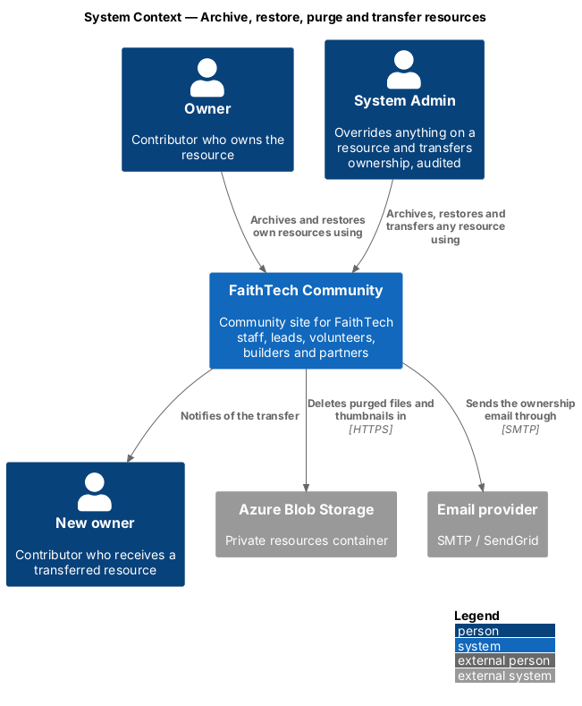
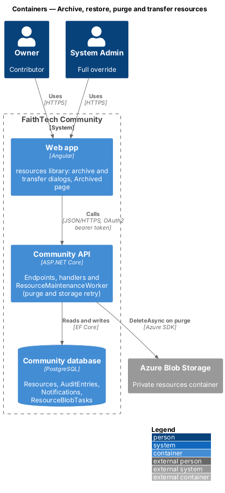
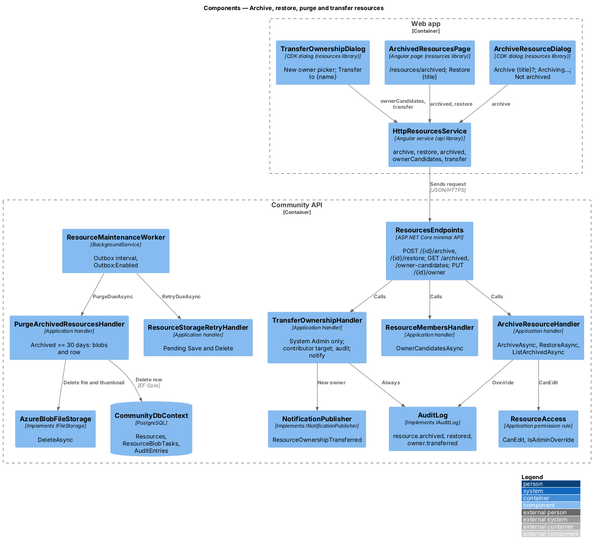
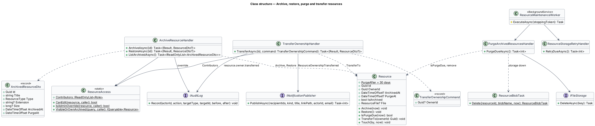
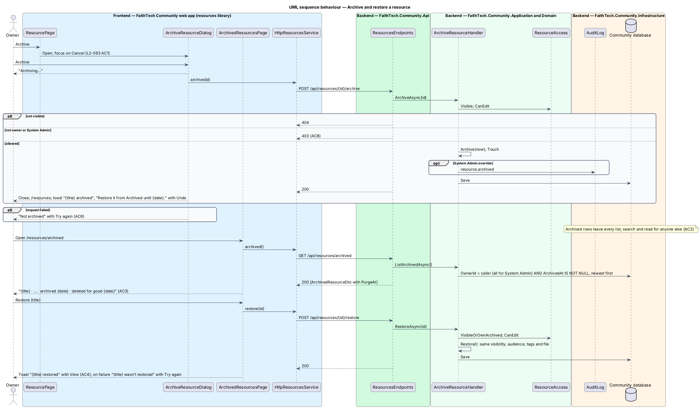
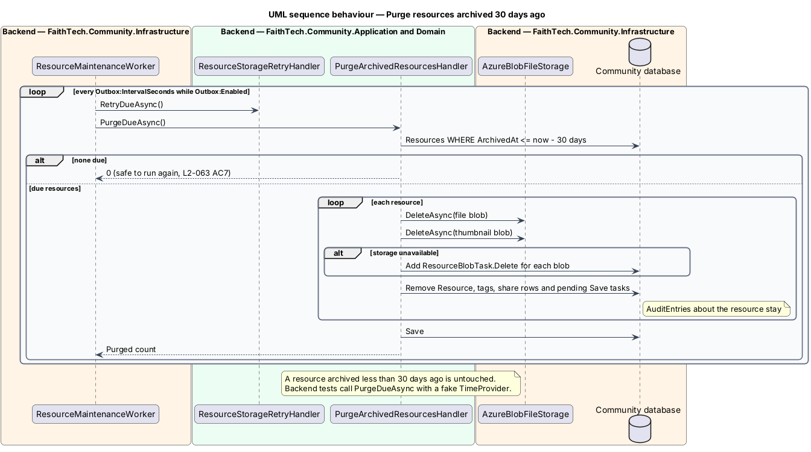
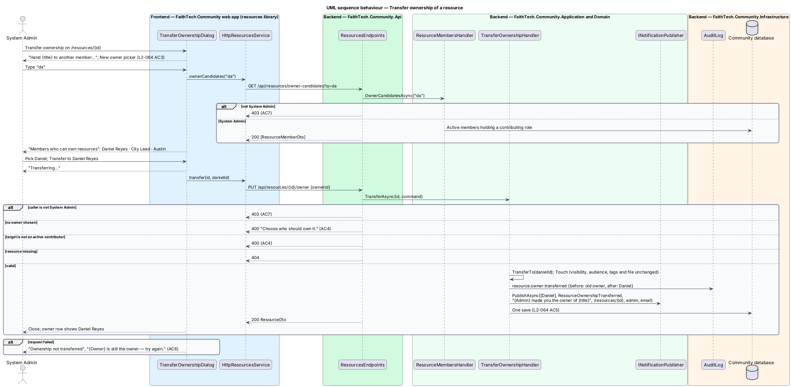

# Archive, restore, purge and transfer resources

## Overview

Deleting a resource archives it. An archived resource disappears for everyone except its owner and System Admin, waits 30 days in the owner's *Archived* list where it can be restored, and is then purged — file, thumbnail and record — by a background job. System Admin can override anything on a resource and can hand it to another contributor; every override and every transfer is written to the audit log.

Key terms:

- **archived** — `Resource.ArchivedAt` is set; the resource is excluded from every list, search and direct read except for its owner and System Admin (`L2-063` AC2)
- **purge** — permanent deletion of an archived resource's blobs and row, 30 days or more after archiving; audit entries about it are kept
- **override** — a System Admin acting on a resource they do not own; always audited (`L2-064` AC1)
- **ownership transfer** — System Admin moves a resource to another contributor; visibility, audience, tags and file are unchanged

## Description

### Web app

- **`ArchiveResourceDialog`** — CDK dialog in the `resources` library opened by *Archive* on `ResourcePage` for the owner or System Admin (mock `dialogs/archive-resource`: default, busy, failed). `ft-dialog` with the archive icon, "Archive {title}?", "It disappears for everyone who can see it today.", "You can restore it from Archived for 30 days. After {archived date + 30 days} it’s deleted for good, file and all.", *Cancel* (initial focus, `L2-044` AC6) and *Archive* (`loading` "Archiving…"). Failure: `ft-alert` danger "Not archived", "We couldn’t reach FaithTech. Nothing changed — try again." with *Try again*. On success the page returns to `/resources` and raises the info toast "{title} archived", "Restore it from Archived until {date}." with *Undo* (which restores).
- **`ArchivedResourcesPage`** — page at `/resources/archived` (mock `pages/archived-resources`: default, loading, empty, error). `ft-breadcrumb` "Resources › Archived", page header "Archived resources" with "Only you can see these. Each is deleted for good 30 days after you archive it.", and an `ft-list` in a flush card: type icon tile, title, "{Type} · {EXT} · {size} · archived {date} · deleted for good {date}" (", in {N} days" within the last week) and *Restore {title}* (`ButtonComponent` with the title as its visually hidden object). Empty "Nothing archived" with *Back to Resources*; loading `ft-list-skeleton` "Loading archived resources"; error "We couldn’t load your archived resources", "Nothing has been deleted. Check your connection and try again." with *Try again*. Restoring shows the success toast "{title} restored", "It’s back in Resources, with the same visibility as before." with *View*, or the danger toast "{title} wasn’t restored", "We couldn’t reach FaithTech. It’s still archived." with *Try again*. A System Admin sees every archived resource here.
- **`ResourcePage` (archived)** — for the owner or System Admin, an archived resource shows the breadcrumb "Resources › Archived › {title}", the warning banner "Archived {date}", "Only you can see it. It will be deleted for good on {date} unless you restore it." with *Restore*, and no *Edit* or *Archive* (mock `pages/resource/archived`).
- **`ResourcePage` (System Admin)** — on a resource they do not own: the info banner "You’re viewing this as System Admin", the owner's situation when they no longer hold a contributing role ("{Owner} no longer has the {role} role. Her resources stay as they are; you can edit, archive or hand this one to someone else. Every change is written to the audit log.") and *Edit*, *Archive* and *Transfer ownership* (mock `pages/resource/admin`).
- **`TransferOwnershipDialog`** — CDK dialog opened by *Transfer ownership* (mock `dialogs/transfer-resource-owner`: default, invalid, busy, failed). "Transfer ownership", "Hand {title} to another member. They become its owner and can edit, share or archive it.", the "New owner" `ft-person-picker` in single mode (hint "Only members who can add resources are listed: leads, Staff and System Admin.", suggestions labelled "Members who can own resources" with name, role and city, from `ownerCandidates(q)`), and the footer "Written to the audit log with your name. The new owner gets a notification." The confirm reads *Transfer to {name}* ("Transferring…" while busy); with nobody chosen it shows "Choose who should own it."; failure "Ownership not transferred", "We couldn’t reach FaithTech. {Owner} is still the owner — try again." with *Try again*.
- **`HttpResourcesService`** — `archive(id)`, `restore(id)`, `archived()`, `ownerCandidates(q)` and `transfer(id, newOwnerId)`.
- **Components** — existing: dialog, alert, button, person picker (`resources/share`), list, icon tile, empty state, skeleton, breadcrumb, toast.

### Community API

- **`ResourcesEndpoints`** — `POST /api/resources/{id}/archive` (`200`, `403` for a non-owner, `404` when not visible), `POST /api/resources/{id}/restore` (`200`, `403`, `404`), `GET /api/resources/archived` (the caller's archived resources, every one for System Admin), `GET /api/resources/owner-candidates?q=` (System Admin, `403` otherwise) and `PUT /api/resources/{id}/owner` (JSON `{ ownerId }`; `200`, `400`, `403`, `404`).
- **`ArchiveResourceHandler`** — `ArchiveAsync(id)`: loads through `ResourceAccess.Visible`, requires `CanEdit` (owner or System Admin; Staff only for their own, `L2-066` AC2), calls `Resource.Archive(now)` and `Touch`; override audited as `resource.archived`. `RestoreAsync(id)`: loads the archived resource through `VisibleOrOwnArchived`, requires `CanEdit`, calls `Restore()`; visibility, audience, tags and file are unchanged and nobody is notified again; override audited as `resource.restored`. `ListArchivedAsync()`: the caller's archived resources newest first (all for System Admin), each with `PurgeAt = ArchivedAt + 30 days` (`L2-063` AC8).
- **`TransferOwnershipHandler`** — `TransferAsync(id, newOwnerId)`: System Admin only (`403`); the resource must exist, archived or not (`404`); no owner chosen answers `400` "Choose who should own it."; the new owner must be an active member who currently holds a contributing role (`ResourceAccess.Contributors`), otherwise `400`. It calls `Resource.TransferTo(newOwnerId)` and `Touch`, records `resource.owner.transferred` with the old and new owner, and publishes `NotificationKind.ResourceOwnershipTransferred` to the new owner ("{Admin} made you the owner of {title}", linking to `/resources/{id}`, with an email) in the same save (`L2-064` AC5).
- **`PurgeArchivedResourcesHandler`** — `PurgeDueAsync()`: selects resources where `IsPurgeDue(now)` (archived 30 or more days ago), and for each deletes the file and thumbnail blobs through `IFileStorage.DeleteAsync` (queueing a `ResourceBlobTask.Delete` if storage fails), deletes the row with its tags and audience (pending `Save` tasks for it are dropped), and saves. Audit entries are separate rows and stay (`L2-063` AC7). Running it again finds nothing to do; a resource archived less than 30 days ago is untouched. Purges by the system are not audited as admin actions.
- **`Resource`** — `Archive(now)`, `Restore()`, `PurgeAt`, `IsPurgeDue(now)` and `TransferTo(ownerId)`; `Resource.PurgeAfter` is 30 days.
- **Override auditing** — every handler that changes a resource asks `ResourceAccess.IsAdminOverride(resource, caller)` and, when true, records through `IAuditLog` with target type `Resource`, the actor, the action and before and after values (`L2-041`).

### Infrastructure

- **`ResourceMaintenanceWorker`** — `BackgroundService` in `Infrastructure/Storage/` that, on the outbox interval (`Outbox:IntervalSeconds`) and only when `Outbox:Enabled` is true, creates a scope and runs `ResourceStorageRetryHandler.RetryDueAsync()` and then `PurgeArchivedResourcesHandler.PurgeDueAsync()`, logging and swallowing failures so one bad run does not stop the next. Backend tests do not run the worker; they call the handlers directly with a fake clock and fake file storage.
- **`CommunitySeeder`** — seeds a few Global link resources (for example "Hackathon judging rubric" on docs.google.com and "Event poster template" on canva.com) owned by the seeded leads, by fixed ids, so re-running the seed changes nothing. No blobs are seeded.

## Requirements

The feature realizes the following level-2 (L2) requirements. Each L2 requirement refines a level-1 (L1) requirement, cited by identifier.

| L2 ID | Refines (L1) | Requirement |
|-------|--------------|-------------|
| `L2-063` | `L1-020` | Archive, restore and purge |
| `L2-064` | `L1-020` | System Admin override and ownership transfer |

### Acceptance criteria

**`L2-063` — Archive, restore and purge**

1. Given the owner or a System Admin, when they choose "Archive", then the dialog "Archive {title}?" opens with "It disappears for everyone who can see it today.", "You can restore it from Archived for 30 days. After {archived date + 30 days} it’s deleted for good, file and all.", Cancel and "Archive", with focus starting on Cancel (`L2-044` AC6); confirming archives the resource and shows the info toast "{title} archived", "Restore it from Archived until {date}." with "Undo".
2. Given an archived resource, when anyone other than its owner or a System Admin requests it by page, API, download, list or search, then it is not returned (404 for a direct request, `L2-056` AC8); the Resources page count excludes it.
3. Given the owner, when they open "Archived" (`/resources/archived`), then the page "Archived resources" reads "Only you can see these. Each is deleted for good 30 days after you archive it." and lists their archived resources newest first as "{title} · {Type} · {EXT} · {size} · archived {date} · deleted for good {date}" (adding ", in {N} days" within the last week), each with "Restore {title}"; with none it shows "Nothing archived", "When you archive a resource it waits here for 30 days, so you can change your mind." and "Back to Resources"; while loading, a region named "Loading archived resources"; on failure, "We couldn’t load your archived resources", "Nothing has been deleted. Check your connection and try again." and "Try again".
4. Given an archived resource, when its owner (or a System Admin) restores it, then it returns to Resources with the same visibility, audience, tags and file, and the success toast "{title} restored", "It’s back in Resources, with the same visibility as before." offers "View"; when the restore fails, then the danger toast "{title} wasn’t restored", "We couldn’t reach FaithTech. It’s still archived." offers "Try again".
5. Given the owner opens an archived resource's page, when it renders, then the breadcrumb is "Resources › Archived › {title}", a banner reads "Archived {date}", "Only you can see it. It will be deleted for good on {date} unless you restore it." with "Restore", and no "Edit" or "Archive" is shown.
6. Given the archive request fails, when the dialog settles, then it shows "Not archived", "We couldn’t reach FaithTech. Nothing changed — try again." with "Try again", and the resource is unchanged; while in flight the button reads "Archiving…".
7. Given a resource archived 30 days ago or more, when the purge job runs, then its blob, thumbnail and record are deleted permanently, the job is safe to run again, and the audit entries about the resource remain; a resource archived less than 30 days ago is untouched.
8. Given any member who is not the owner or a System Admin, when they call the archive, restore or archived-list endpoints for a resource, then the response is 403 (archive, restore) or lists only the caller's own archived resources.

**`L2-064` — System Admin override and ownership transfer**

1. Given a System Admin, when they open, edit, replace the file of, share, archive or restore any resource, then the action succeeds and an audit entry is written with the actor, action, target and before and after values (`L2-041`).
2. Given a System Admin viewing a resource they do not own, when the page renders, then it shows "You’re viewing this as System Admin", a line explaining the owner's situation when they no longer hold a contributing role ("{Owner} no longer has the {role} role. Her resources stay as they are; you can edit, archive or hand this one to someone else. Every change is written to the audit log."), and the buttons "Edit", "Archive" and "Transfer ownership".
3. Given a System Admin chooses "Transfer ownership", when the dialog opens, then it reads "Transfer ownership", "Hand {title} to another member. They become its owner and can edit, share or archive it.", a "New owner" picker with the hint "Only members who can add resources are listed: leads, Staff and System Admin." whose suggestions ("Members who can own resources") show name, role and city, and the footer "Written to the audit log with your name. The new owner gets a notification."
4. Given no new owner is chosen, when the admin submits, then the field shows "Choose who should own it." and the API answers 400; given a member who may not add resources, then the API answers 400.
5. Given a new owner is chosen, when the admin confirms "Transfer to {name}", then the resource's owner changes, its visibility, audience, tags and file are unchanged, an audit entry records the old and new owner, and the new owner gets the in-app notification "{Admin} made you the owner of {title}" linking to the resource, and an email (`L2-028`).
6. Given the transfer fails, when the dialog settles, then it shows "Ownership not transferred", "We couldn’t reach FaithTech. {Owner} is still the owner — try again." with "Try again"; while in flight the button reads "Transferring…".
7. Given any member who is not a System Admin, when they call the transfer endpoint, then the response is 403 and no "Transfer ownership" control is rendered.

## Diagrams

### System context

Owners archive and restore their resources; System Admin overrides and transfers ownership, both recorded in the audit log. The purge removes files from Azure Blob storage.

### Containers

The web app calls the archive, restore and transfer endpoints. Inside the API, `ResourceMaintenanceWorker` runs the purge and the storage retry on the outbox interval.

### Components

`ArchiveResourceHandler` and `TransferOwnershipHandler` check `ResourceAccess` and audit overrides; `PurgeArchivedResourcesHandler` deletes blobs through `IFileStorage` and rows through `CommunityDbContext`.

### Class structure

`Resource` owns its archive state and purge rule; the handlers, the worker and the audit log sit around it.

### Behaviour — archive and restore

The owner archives from the resource page and restores from Archived; a non-owner gets `403`.

### Behaviour — purge after 30 days

The worker purges resources archived 30 or more days ago, file, thumbnail and row; it is safe to run again and keeps the audit entries.

### Behaviour — transfer ownership

Only System Admin may transfer, only to a contributor; the transfer is audited and the new owner notified in the same save.

## Open questions

Decisions recorded for this design ([ADR 0017](../../../adr/0017-resources-storage-access-and-lifecycle.md)):

- Resources stay with their owner when the owner is suspended or loses a contributing role; System Admin can transfer them. Nothing is archived automatically. Resolved.
- The purge runs in `ResourceMaintenanceWorker` inside the API process on the outbox interval and is switched off with `Outbox:Enabled`; there is no separate scheduler. Resolved.
- Restoring does not notify the audience again. Resolved.
- System Admin's Archived page lists every archived resource; everyone else sees only their own. Resolved.
- A transfer can target any contributor, including Staff (`L2-066` AC5) and the System Admin themself. Resolved.
