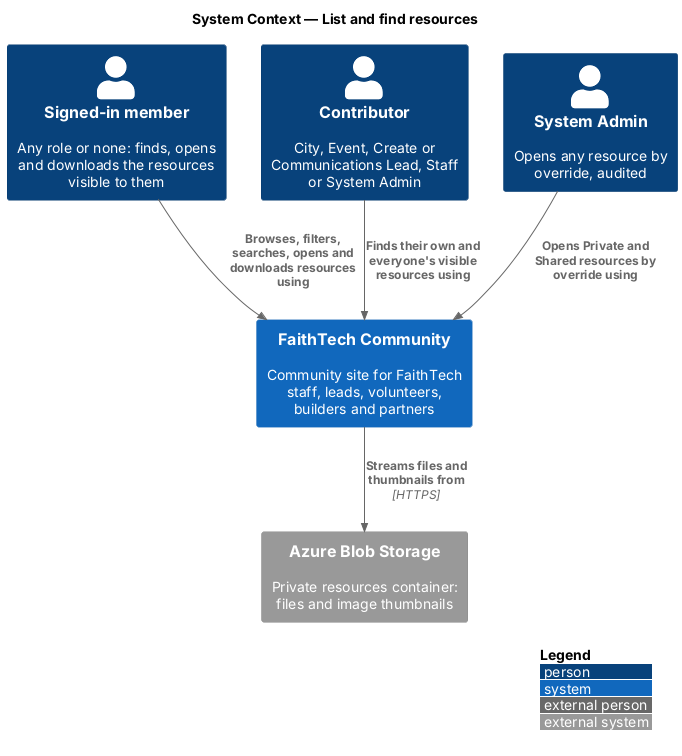
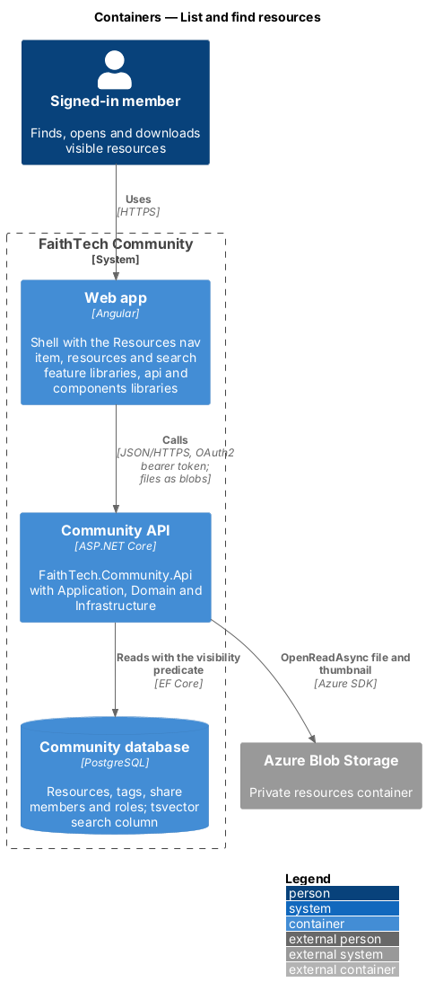
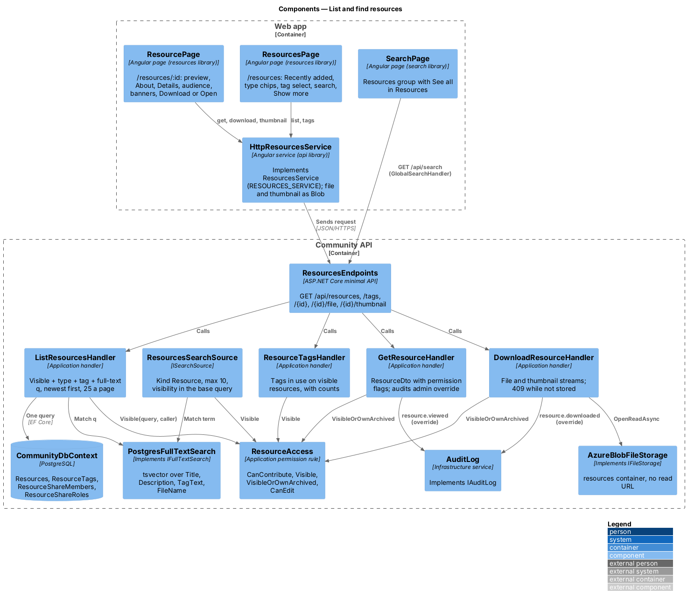
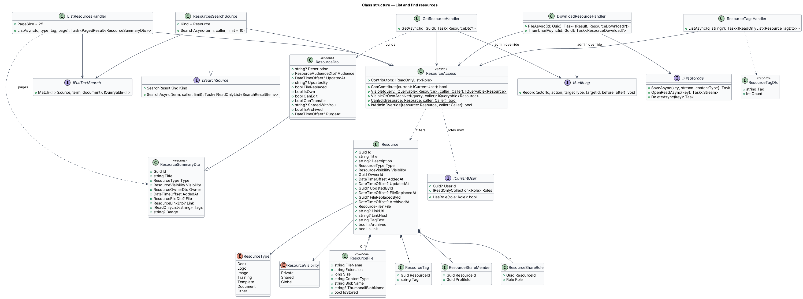
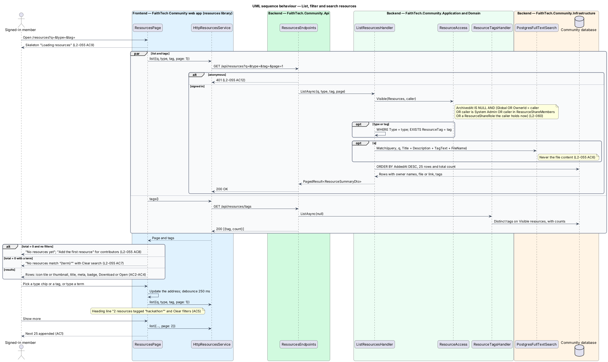
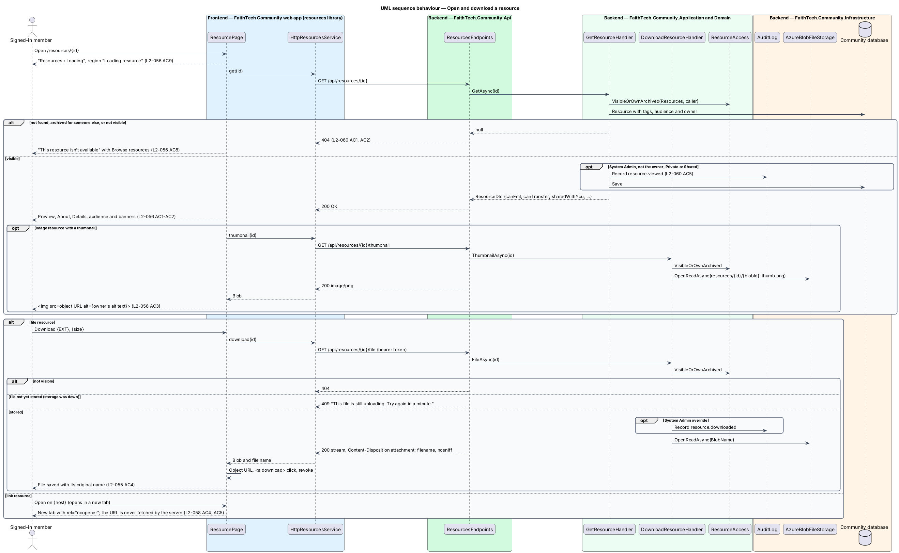
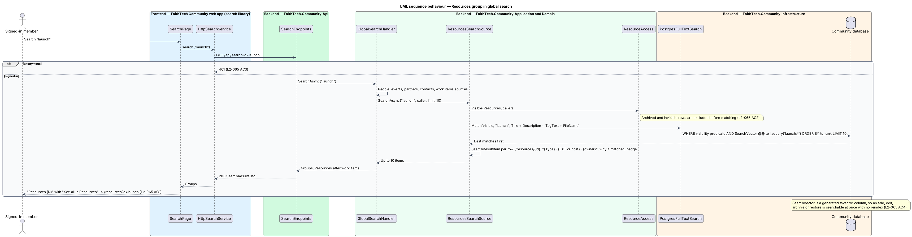

# List and find resources

## Overview

A **resource** is a deck, logo, image, training material, template or other document that a contributor adds to FaithTech Community, either as an uploaded file or as an https link to something that lives in another app. Resources replace the Drive folders, SharePoint sites, Canva links and email attachments that leads search through today.

Key terms:

- **contributor** — a member who may add resources: City Lead, Event Lead, Create Lead, Communications Lead, Staff or System Admin (`L2-057`, `L2-066`)
- **visibility** — who may open a resource: *Private* (its owner and System Admin), *Shared* (its owner, the members it names and the current holders of the roles it names) or *Global* (every signed-in member)
- **visible to the caller** — the one server-side rule, `ResourceAccess.Visible`, that every list, page, download, thumbnail and search applies inside its database query (`L2-060`)

This design covers the Resources page, the resource page, opening and downloading files and thumbnails, the visibility rule itself and the Resources group in global search. Adding and editing (`resources/add-and-edit`), sharing (`resources/share`) and archiving and ownership transfer (`resources/archive-and-transfer`) build on the same rule. Every decision on storage, downloads and live role audiences is recorded in [ADR 0017](../../../adr/0017-resources-storage-access-and-lifecycle.md).

## Description

The slice runs from the `resources` feature library in the web app to the `Resources` tables in the Community database and the private `resources` blob container.

### Web app

- **`ResourcesPage`** — page in the `resources` feature library at `/resources` (mock `pages/resources`: default, loading, empty, error, no-results, filtered, member). The page header reads "Resources" with "Decks, logos, training and templates · N resources" (or "· none yet"); contributors also get ghost *Archived* (`/resources/archived`) and primary *Add resource* (opens `AddResourceDialog`). Below it: a `<form role="search">` with the search box ("Search resources", placeholder "Search titles, descriptions, tags and file names") and the tag `ft-select` ("Any tag" plus the tags in use from `tags()`), then a labelled `ft-chip-group` "Type" of chips (All types, Deck, Logo, Image, Training, Template, Document, Other). The list "Recently added" is an `ft-list` in a flush card: each row has an `ft-icon-tile` (the resource type icon, or the image thumbnail for an Image resource), the title linking to `/resources/{id}`, the meta line "Type · EXT · size · owner · added date" (the owner reads "you"; a link shows the external icon and its host instead of the type and size), a `Private`, `Shared` or `Shared with you` badge, and a trailing ghost icon button: *Download {title}, {EXT}, {size}* for a file or *Open {title} on {host} (opens in a new tab)* for a link. *Show more* appends the next 25. The term, type and tag live in the address (`?q=&type=&tag=`), so global search's "See all in Resources" lands on the same list; typing is debounced (250 ms). States: `ft-list-skeleton` "Loading resources", the error `ft-empty-state` with *Try again*, the no-results empty state with *Clear search*, the filtered heading ("2 resources tagged “hackathon”") with *Clear filters*, and the first-run empty state with *Add the first resource* for contributors.
- **`ResourcePage`** — page at `/resources/:id` (mock `pages/resource`: default, image, link, shared, shared-with-you, private, member, admin, archived, loading, error, missing). `ft-breadcrumb` "Resources › {title}", a page header with the title and "{Type} · added {date} by {owner}", and the main action: *Download {EXT}, {size}* or *Open on {host} (opens in a new tab)* with the note "Links open in their own app…". A preview card shows the image thumbnail with the owner's alt text for an Image resource, or a large type icon tile with the file name and "{Type} · {EXT} · {size}" (or "Link to {host}"). The "About" card holds the description; the "Details" `ft-description-list` holds Type, File or Link, Visibility ("Global — every signed-in member", "Private — only you", "Shared — the people and roles below"), Tags as badges, "Updated {date} by {who} — file replaced" once replaced, and the Owner with an `ft-avatar`, followed by "Ask them if something is out of date." A Shared resource lists its audience. Banners: shared with you, private to you, and "You’re viewing this as System Admin". *Edit*, *Archive*, *Change who can see it* and *Transfer ownership* render only when `canEdit` / `canTransfer` are true; they open the dialogs of the other resources designs. A `404` shows "This resource isn’t available" with *Browse resources*, the same for missing, archived and not shared.
- **`ResourcesService`** / **`RESOURCES_SERVICE`** / **`HttpResourcesService`** — API client contract, injection token and HTTP implementation in `api/src/lib/resources`. This slice uses `list({ q, type, tag, page })`, `tags(q)`, `get(id)`, `download(id)` and `thumbnail(id)`. Downloads and thumbnails are fetched with the bearer token as a `Blob` (`responseType: 'blob'`); the page hands the browser an object URL (an `<a download="{file name}">` click for a download, an `` for a thumbnail) and revokes it afterwards, because no blob URL is public (`L2-060` AC4).
- **Components** — `IconTileComponent` gains the resource type icons (`deck`, `logo`, `image`, `training`, `template`, `document`, `other`, `link`) and an `image` variant that shows a thumbnail instead of an icon (design system `components/type-icon.html`); `IconComponent` gains the same icon names plus `external` and `download`. Everything else on these pages is an existing component.
- **Shell** — `shell/navigation.ts` adds a secondary nav item "Resources" (`/resources`, folder icon) for every signed-in member, in the top bar from 1536px, in the More drawer below that and in the phone menu drawer (mocks `README.md` note 7). The `resources` routes are lazy-loaded behind the signed-in guard.

### Community API

- **`ResourcesEndpoints`** — minimal API mapping in `Api/Endpoints/ResourcesEndpoints.cs`, a `/api/resources` group with `RequireAuthorization()` (anonymous callers get `401`, `L2-055` AC12). This slice maps `GET /api/resources?q=&type=&tag=&page=` (`PagedResult<ResourceSummaryDto>`), `GET /api/resources/tags?q=` (`ResourceTagDto[]`), `GET /api/resources/{id}` (`ResourceDto` or `404`), `GET /api/resources/{id}/file` (the bytes as `attachment` with the original file name, `X-Content-Type-Options: nosniff`, `404`, or `409` while the file is still being stored) and `GET /api/resources/{id}/thumbnail` (`image/png` or `404`). It holds no business logic.
- **`ResourceAccess`** — Application permission rule in `Resources/`. `CanContribute(current)` is true for City Lead, Event Lead, Create Lead, Communications Lead, Staff or System Admin. `Visible(query, caller)` adds one predicate to an `IQueryable<Resource>`: not archived **and** (Global **or** owned by the caller **or** the caller is System Admin **or** Shared with the caller as a named `ResourceShareMember` **or** Shared with a `ResourceShareRole` the caller holds now). The caller's roles come from `ICurrentUser`, already loaded per request, so a role change takes effect on the next request without touching any resource (`L2-060` AC8). `VisibleOrOwnArchived(query, caller)` also lets the owner and System Admin open an archived resource (`L2-063` AC5). `CanEdit(resource, caller)` is the owner or System Admin; `IsAdminOverride(resource, caller)` is a System Admin acting on a resource they do not own.
- **`ListResourcesHandler`** — `ListAsync(q, type, tag, page)`: starts from `ResourceAccess.Visible`, filters by type and by tag (a join on `ResourceTag`), matches `q` through `IFullTextSearch` over `Title + Description + TagText + FileName` (never the file content, `L2-055` AC6), orders newest first by `AddedAt`, and pages 25 at a time (at most 100, `L2-046`), returning the total for the heading.
- **`GetResourceHandler`** — `GetAsync(id)`: loads the resource through `VisibleOrOwnArchived` with its tags, audience and owner profile; answers `null` (mapped to `404`) when it is not visible. A System Admin opening a Private or Shared resource they do not own writes `resource.opened` to `IAuditLog` (`L2-060` AC5). The DTO carries `canEdit`, `canTransfer`, `isOwn`, `sharedWithYou` (how the caller is reached: by name or by which role) and the owner's current contributing role, so the page can explain an owner who has lost theirs (`L2-064` AC2).
- **`DownloadResourceHandler`** — `FileAsync(id)` and `ThumbnailAsync(id)`: the same visibility check, then `IFileStorage.OpenReadAsync(blobName)`; a file not yet stored (`ResourceFile.IsStored == false`) answers `409` "This file is still uploading. Try again in a minute." (ADR 0017). A System Admin download of a Private or Shared resource they do not own writes `resource.downloaded`.
- **`ResourceTagsHandler`** — `ListAsync(q)`: the distinct tags on resources visible to the caller, with the number of visible resources using each (`{ tag, count }`), filtered by prefix when `q` is given. It feeds the tag filter here and the tag suggestions in the add and edit dialogs.
- **`ResourcesSearchSource`** — `ISearchSource` with kind `Resource`, registered beside the other sources (ADR 0016). It starts from `ResourceAccess.Visible` (so archived and invisible resources never reach the match, `L2-065` AC2), matches the term with `IFullTextSearch` over the same document as the list, takes at most 10 best first, and builds each `SearchResultItem` with the route `/resources/{id}`, the meta "{Type} · {EXT or host} · {owner}", the reason it matched ("tagged launch", "description mentions …") and a `Shared with you` or `Private` badge. `GlobalSearchHandler` adds the "Resources" group after work items.
- **`ResourceSummaryDto`** / **`ResourceDto`** / **`ResourceTagDto`** — DTO contracts: id, title, type, visibility, owner (id, name, initials, `isYou`), added date, file (name, extension, size, `hasThumbnail`, `isStored`) or link (url, host), tags and the viewer-side badge; `ResourceDto` adds the description, the audience (members with city, roles with today's holder count), the update and file-replaced stamps and the permission flags.

### Infrastructure

- **`CommunityDbContext`** — maps `Resources` (owned `ResourceFile` columns, `LinkUrl`, `LinkHost`, `TagText`), `ResourceTags` (`ResourceId`, `Tag`, unique together, indexed on `Tag`), `ResourceShareMembers` and `ResourceShareRoles`, with indexes on `(ArchivedAt, AddedAt)`, `OwnerId` and `Visibility`.
- **`SearchVectors`** — adds a generated, GIN-indexed `SearchVector` `tsvector` on `Resources` built from `Title`, `Description`, `TagText` and the file name, used by `PostgresFullTextSearch` for both the list search and the search source. Because the column is generated, an add, edit, archive or restore is reflected immediately with no reindex (`L2-065` AC4).
- **`AzureBlobFileStorage`** — implements `IFileStorage` over the private `resources` container; `OpenReadAsync` streams the blob to the response.
- **Migration `Resources`** — creates the tables and the search vector in `Infrastructure/Persistence/Migrations/`; it is applied by the Cli (`migrate`), never by the API.

## Requirements

The feature realizes the following level-2 (L2) requirements. Each L2 requirement refines a level-1 (L1) requirement, cited by identifier.

| L2 ID | Refines (L1) | Requirement |
|-------|--------------|-------------|
| `L2-055` | `L1-020` | Resources page: list, filter and find |
| `L2-056` | `L1-020` | Resource page |
| `L2-060` | `L1-020` | Visibility and access on the server |
| `L2-065` | `L1-020` | Resources in global search |

### Acceptance criteria

**`L2-055` — Resources page: list, filter and find**

1. Given a signed-in member, when they open Resources, then the heading reads "Resources" with "Decks, logos, training and templates · N resources", and the list shows the resources visible to that member, newest first, 25 at a time with "Show more" appending the next 25 (pages hold at most 100, `L2-046`).
2. Given a list row, when it renders, then it shows a thumbnail for an Image resource and a type icon for every other type, the title, and "Type · FILE TYPE · size · owner · added date", with the owner shown as "you" for the member's own resources; a link resource shows the host in place of the file type and size (for example "Template · docs.google.com · Marcus Lee · Thu 16 Oct").
3. Given a list row, when it renders, then it carries a "Private", "Shared" or "Shared with you" badge that matches the resource's visibility from the viewer's side, and nothing for Global.
4. Given a file resource, when the member chooses its download action (accessible name "Download {title}, {EXT}, {size}"), then the file downloads with its original file name; given a link resource, when they choose "Open {title} on {host} (opens in a new tab)", then the link opens in a new tab (`L2-058`).
5. Given the type filter ("All types", Deck, Logo, Image, Training, Template, Document, Other) and the tag filter ("Any tag" plus every tag in use on a resource the member may open), when the member picks either or both, then only matching resources are listed, the heading line reads for example "2 resources tagged “hackathon”", and "Clear filters" restores the full list.
6. Given the search box ("Search resources", placeholder "Search titles, descriptions, tags and file names"), when the member types a term, then the list shows resources whose title, description, tags or file name match, within 500 ms, and never matches text inside files.
7. Given no resource matches the search, when the list updates, then it shows "No resources match “{term}”", "Nothing matches “{term}”", "Search looks at titles, descriptions, tags and file names, not the text inside files. Try another word, or ask in Announcements who has it." and "Clear search".
8. Given the member may open no resource at all, when the page loads, then the subheading ends "· none yet" and the empty state shows "No resources yet", "Add the decks, logos and training you keep sending people, so every lead can find them here." and, for a member who may add (`L2-057`), the button "Add the first resource".
9. Given the list is loading or fails to load, when the page renders, then a skeleton named "Loading resources" is shown, or "We couldn’t load resources", "Check your connection and try again. If it keeps happening, we’ve already been told about it." with "Try again", which loads the list again.
10. Given a member who may add resources, when the page renders, then it shows "Add resource" (opens the add dialog, `L2-057`) and "Archived" (opens their archived resources, `L2-063`); given any other member, then neither button is rendered.
11. Given an XS viewport, when the page renders, then the filters stack above the list and each resource is a single-column card with its badge and action, with no horizontal scroll.
12. Given an anonymous visitor, when they request the page or `GET /api/resources`, then the page redirects to sign-in and the API answers 401.

**`L2-056` — Resource page**

1. Given a resource the member may open, when they open `/resources/{id}`, then the page shows the breadcrumb "Resources › {title}", the title, "{Type} · added {date} by {owner}", an "About" section with the description, and a "Details" list with Type, File ("{file name} · {EXT} · {size}") or Link ("{host} (opens in a new tab)"), Visibility, Tags, an "Updated {date} by {who} — file replaced" row when the file has been replaced, and the Owner's avatar and name, followed by "Ask them if something is out of date."
2. Given a file resource, when the page renders, then the main button is "Download {EXT}, {size}"; given a link resource, then it is "Open on {host} (opens in a new tab)" with the note "Links open in their own app. If it asks you to sign in or the file has moved, ask {owner}."
3. Given an Image resource, when the page renders, then the preview is the image itself with the alt text the owner supplied; given any other type, then the preview is a type icon tile with the file name and "{Type} · {EXT} · {size}", or "Link to {host}" for a link.
4. Given the visibility row, when it renders, then it reads "Global — every signed-in member", "Private — only you" or "Shared — the people and roles below", and a Shared resource lists its audience ("Everyone with the {role} role · Role · N people today" and each member with "Member · {city}") with "People you share with can open and download it, but can’t share it on."
5. Given the owner or a System Admin, when they view the resource, then "Edit" (`L2-062`) and "Archive" (`L2-063`) are shown, and a Shared resource also offers "Change who can see it"; given any other member, then none of these controls is rendered.
6. Given a resource shared with the member, when they view it, then a banner reads "{Owner} shared this with {you | everyone who has the {role} role}. You can open and download it, but not share it on."
7. Given the owner viewing their Private resource, when the page renders, then a banner reads "Only you can see this. System Admin can too, and every time they open it, it’s recorded in the audit log."
8. Given a resource that does not exist, is archived and the viewer is not its owner or a System Admin, or is not visible to the viewer, when they open its page, then the API answers 404 and the same page shows "This resource isn’t available", "It may have been archived, or it hasn’t been shared with you. If someone sent you the link, ask them to share it with you." and "Browse resources", with nothing that distinguishes the three cases.
9. Given the resource is loading or fails to load, when the page renders, then the breadcrumb reads "Resources › Loading" with a region named "Loading resource", or "We couldn’t load this resource", "Check your connection and try again. If it keeps happening, we’ve already been told about it.", "Try again" and "Back to Resources".
10. Given an XS viewport, when the page renders, then the preview, the actions and the Details list stack in one column and the Download or Open button spans the width.

**`L2-060` — Visibility and access on the server**

1. Given a Private resource, when anyone other than its owner or a System Admin requests it by page, API, download, thumbnail, list or search, then it is not returned (404 for a direct request).
2. Given a Shared resource, when its owner, a member named in its audience, a member who currently holds a role named in its audience, or a System Admin requests it, then it is returned; when anyone else requests it, then it is not returned (404 for a direct request).
3. Given a Global resource, when any signed-in member requests it, then it is returned.
4. Given an anonymous visitor, when they call any Resources endpoint, including a download or thumbnail URL, then the response is 401 and no public URL for a resource blob exists.
5. Given a System Admin, when they open or download a Private resource they do not own, then it is returned and an audit entry is written (`L2-041`).
6. Given Staff, when they request resources, then they see exactly what the rules above grant them; Staff has no read-all access to Private or Shared resources.
7. Given a suspended member, when any request is made with their session, then it is refused (`L2-039`), and their resources stay visible to everyone the rules above allow.
8. Given a member's roles change, when they next list or open resources, then resources shared with a role they gained are visible and resources shared only with a role they lost are not, without any resource being changed.

**`L2-065` — Resources in global search**

1. Given a signed-in member, when they search, then a "Resources ({N})" group lists at most 10 resources, best match first, whose title, description, tags or file name match the term, each as "{title} · {Type} · {EXT or host} · {owner} · {why it matched}" (for example "tagged launch" or "description mentions the launch sponsors") with a "Shared with you" or "Private" badge where it applies, and "See all in Resources" opens the Resources page with the same term.
2. Given any user, when resource results are built, then they include only resources that user may open under `L2-060` and never archived ones, applied inside the search query rather than after it.
3. Given an anonymous visitor, when they call the search API, then the response is 401 (`L2-026`).
4. Given a resource is added, edited, archived or restored, when the member searches afterwards, then the results reflect the change without any manual reindex.

## Diagrams

### System context

Every signed-in member finds, opens and downloads the resources visible to them; contributors also add them. Files live in Azure Blob storage and are only ever read through the Community API.

### Containers

The `resources` feature library calls the Community API through the `api` library with an OAuth2 bearer token. The API reads the Community database and streams files and thumbnails from the private `resources` blob container.

### Components

`ResourcesEndpoints` dispatches to the list, get, download and tags handlers; every handler, and `ResourcesSearchSource` inside global search, starts from `ResourceAccess.Visible`. Text matching goes through `IFullTextSearch` and file reads through `IFileStorage`.

### Class structure

`Resource` composes its file or link, tags and share rows. `ResourceAccess` turns the caller's id and current roles into one query predicate used by every reader.

### Behaviour — list, filter and search

The page keeps the term and filters in the address and asks the API for one page. The handler applies visibility, the type and tag filters and the full-text match in one query, newest first.

### Behaviour — open and download

The resource page loads the resource and, for an image, its thumbnail. A download is fetched as a blob through the API and saved with its original name; anything not visible answers `404`, and a System Admin override is audited.

### Behaviour — Resources group in global search

`ResourcesSearchSource` filters by visibility before the text match, so a resource the caller may not open is never ranked, counted or returned.

## Open questions

Decisions recorded for this design ([ADR 0017](../../../adr/0017-resources-storage-access-and-lifecycle.md)):

- Downloads and thumbnails stream through the API with the same visibility rule as every other read; there is no SAS or public blob URL, unlike profile photos (ADR 0002). The web app fetches them with its token and hands the browser an object URL. Resolved.
- A role named in a Shared audience is evaluated at request time against the caller's current roles (live), not snapshotted at share time. Resolved.
- A resource that is missing, archived (for anyone but its owner and System Admin) or not visible answers the same `404`, so its existence is never revealed. Resolved.
- The only sort is "Recently added"; usage counts, version history and searching inside files are out of scope. Resolved.
- The tag filter lists only tags in use on resources the caller may open, so a tag never leaks the existence of a private resource. Resolved.
