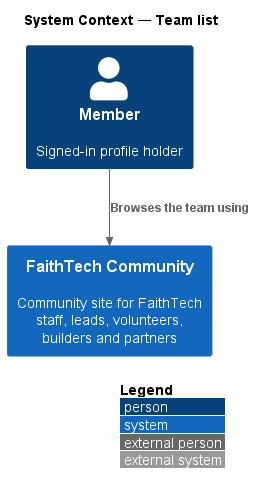
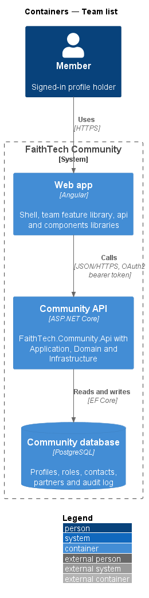
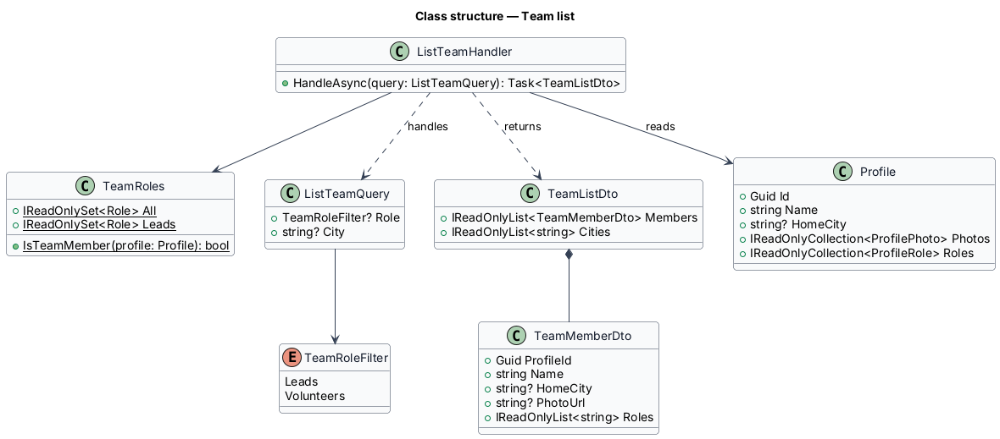
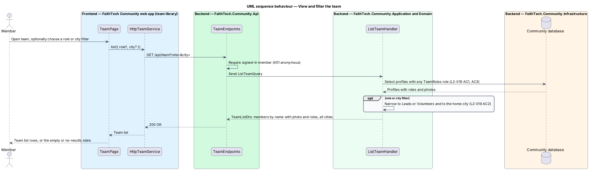

# Team list

## Overview

The **team** — everyone in FaithTech Community who holds a lead role (City Lead, Event Lead, Create Lead or Communications Lead) or the Volunteer role. Team membership is derived from roles, not stored separately: a profile joins the team when it gains one of those roles and leaves when it loses the last one.

The team page lets any signed-in member see who the team is, with name, photo and roles, and filter by role. The `team-board` mock is a separate Agile workspace screen and is outside this slice.

## Description

- **`TeamPage`** — page at `/team` in the `team` feature library. It lists team members in a list card with avatar (featured photo, initials without one), name linking to the profile and role badges, and offers role chips (All, Leads, Volunteers) and a city select. Leads and System Admins see **Invite someone**, a link to `/invites`.
- **`TeamService`** / **`TEAM_SERVICE`** / **`HttpTeamService`** — API client calling `GET /api/team?role=&city=`.
- **`TeamEndpoints`** — minimal API mapping requiring an authenticated caller (`401` anonymous).
- **`ListTeamQuery`** (`TeamRoleFilter?` Leads or Volunteers, `City?`) and **`ListTeamHandler`** in Application `Team/`. The handler selects profiles whose roles intersect `TeamRoles`, narrowed to `TeamRoles.Leads` or Volunteer and to a home city (case-insensitive), sorted by name.
- **`TeamRoles`** — Domain constant sets: `All` (City Lead, Event Lead, Create Lead, Communications Lead, Volunteer) and `Leads` (the four lead roles). `TeamRoles.IsTeamMember(profile)` is true while the profile holds one of them; the Agile workspace membership rule reuses it.
- **`TeamListDto`** — `Members` (`TeamMemberDto`) and `Cities`, every team member's distinct home city whatever the filters.
- **`TeamMemberDto`** — `ProfileId`, `Name`, `HomeCity`, `PhotoUrl` (featured photo or `null`), `Roles` (every role held).

Sorted by name, opening on All and All cities ([ADR 0007](../../../adr/0007-team-list-filters-and-photos.md)). Paged by [ADR 0015](../../../adr/0015-team-list-paging.md): `GET /api/team?role=&city=&after=&pageSize=` returns `{ members, cities, next, totalCount }`, 50 by default and at most 100. Filters and the order by lower-cased name, then id, run in the database before paging, and `next` is a keyset continuation. `cities` stays global. `TeamPage` shows "Showing N of M members" (`role="status"`) and *Show more members*. A failed continuation keeps the list, shows a danger `ft-alert`, "We couldn’t load more members. Try again.", and the button tries again (mock states `more` and `more-error`).

## Requirements

The feature realizes the following level-2 (L2) requirements. Each L2 requirement refines a level-1 (L1) requirement, cited by identifier.

| L2 ID | Refines (L1) | Requirement |
|-------|--------------|-------------|
| `L2-019` | `L1-007` | Team list |

### Acceptance criteria

**`L2-019` — Team list**

1. Given any signed-in member, when they open the team page, then it lists every profile holding a lead or volunteer role, with name, photo and roles.
2. Given a role filter (Leads or Volunteers) or a city filter, when it is applied, then only matching team members are listed.
3. Given a profile that loses its last lead or volunteer role, when the team page is viewed, then that profile no longer appears.
4. Given more than 50 matching team members, when the team page opens, then it shows the first 50 by name with "Showing 50 of N members", and "Show more members" loads the next 50 (at most 100 a page, `L2-046`) with the filters applied before paging, never repeating or skipping a member; the city filter still lists every team member's city; when loading more fails, the members already shown stay and "We couldn’t load more members. Try again." is shown.

## Diagrams

### System context

Any signed-in member views the team. No external system takes part; anonymous visitors cannot see profiles (`L2-005`).

### Containers

The `team` feature library in the Angular web app calls the Community API over HTTPS with an OAuth2 bearer token. The API persists state in the PostgreSQL Community database.

### Components

`ListTeamHandler` derives membership from `TeamRoles` on every request, so role changes take effect at once.

### Class structure

`ListTeamHandler` reads `Profile` roles against `TeamRoles` and returns `TeamMemberDto` items.

### Behaviour — view and filter the team

Membership is computed from current roles, so a profile that loses its last team role drops out on the next view (`L2-019` AC3).

## Open questions

Decisions recorded while building the Domain layer (`FaithTech.Community.Domain`):

- Team membership stays derived from roles through `TeamRoles.IsTeamMember`; nothing is stored. Resolved.
- Sort order, filter values, the default city and the photo avatar: resolved in [ADR 0007](../../../adr/0007-team-list-filters-and-photos.md). Paging: resolved in [ADR 0015](../../../adr/0015-team-list-paging.md).
- Hiding suspended profiles from the team: deferred to the admin subsystem.
